# 文档解析类 Agent 实验数据汇总记录

本记录保存七例五轮实验的详细方法与数据。结论与论证见[代表性评估报告](representativeness-assessment.md)。

本评估以原有 PDF 表单处理和 XLSX 工作簿增强任务为基准，引入不同领域的真实文档输入，通过 Agent 生成轨迹、容器内轨迹回放和原生热点采样，考察原有用例所体现的主要计算机制在跨领域输入下的代表性。
评估重点是主要热点脚本、库和函数是否共同出现，以及它们对应的文档处理机制是否延续。同时结合 Topdown 特征对比顶层流水线分配。

## 一、数据集选择与领域覆盖

选取数据集时同时考虑来源、领域覆盖、数据规模和任务形态。XLSX 选用百万单元格量级的真实业务工作簿，覆盖明细记录与统计发布表；PDF 选用具有原生可填写字段的公开业务表单，覆盖不同页数、字段规模和字段类型。在更换业务数据的同时，延续原有工作簿增强与批量表单处理任务。

XLSX 从原有交通出行扩展到电力能源、就业工资和产业生产率，选择具有真实指标、分类维度和既有数据表的公开工作簿，便于继续执行保留原表、新增 Summary、公式、情景和图表的任务。PDF 从雇佣申报扩展到税务预扣和企业贷款申请，保留字段映射、批量填写、渲染与验证的共同任务形态。下表左侧资料说明输入本身的特征，右侧给出本评估据此作出的选择。

| 数据集 | 发布方说明与来源 | 本评估的选择理由 |
|---|---|---|
| TLC | 官方行程数据包含上下车时间与地点、里程、分项车费和乘客数。[NYC TLC 数据说明](https://www.nyc.gov/site/tlc/about/tlc-trip-record-data.page) | 保留原交通业务基准；行程明细与已有分组汇总可以自然支撑运营指标、收入情景和图表。 |
| eGRID | EPA 数据涵盖发电量、排放、排放率、热输入与能源结构，并提供详细 XLSX。[EPA 数据介绍](https://www.epa.gov/egrid)、[详细数据下载](https://www.epa.gov/egrid/detailed-data) | 引入能源领域和多层级数据表；发电、排放等现成业务量适合新增跨表指标与能源 Summary。 |
| HR Metro | BLS 提供都会区／非都会区职业就业与工资估计及 XLSX，包括工资分位数。[BLS 地区数据说明](https://www.bls.gov/OES/current/oessrcma.htm)、[下载表目录](https://www.bls.gov/oes/tables.htm) | 引入区域×职业的劳动市场统计，覆盖分类编码、就业量、工资和抑制标记；可自然构建 Workforce Summary。 |
| Industry Productivity | BLS 发布细分行业生产率 XLSX，含就业、工时、产出、劳动补偿的水平与指数序列。[BLS 表格目录](https://www.bls.gov/productivity/tables/home.htm)、[指标说明](https://www.bls.gov/news.release/prin.nr0.htm) | 引入产业长期序列及宽表／长表两种组织形式；现成指标支持年度选择、变化率、情景和产业 Summary。 |
| OPM OF-306 | 用于联邦雇佣适任性申报，包含身份信息与背景问题。[OPM 表单说明](https://www.opm.gov/forms/pdf_fill/of0306.pdf) | 保留原 PDF 基准，覆盖身份文本、日期、选择项及背景声明的填写与验证。 |
| IRS W-4 | 用于向雇主声明联邦所得税预扣信息。[IRS 用途说明](https://www.irs.gov/forms-pubs/about-form-w-4) | 加入税务领域的身份、申报状态、金额与扣除项，继续执行逐条字段映射、填写和逐页渲染。 |
| SBA 1919 | 收集小企业 7(a) 贷款申请人、所有人、贷款需求及债务等信息。[SBA 用途说明](https://www.sba.gov/document/sba-form-1919-borrower-information-form) | 加入企业融资领域与更长的多页表单，覆盖企业／个人信息及更多选择项；使用仓库冻结的 04/2024 可填写版本。 |

XLSX 的规模同时考虑实际文档负载：本仓库四例约为 250 万至 580 万单元格，使各领域均具有百万级工作簿的读取、对象构建和保存工作量。PDF 保留 3／5／7 页及 38／48／127 个字段的结构差异，每轮统一处理十条虚构记录。以下精确规模、表单版本和字段数来自仓库冻结输入；官方链接用于支撑业务用途和数据内容。

### XLSX：四个领域的真实工作簿

| 数据集 | 领域与来源 | 输入规模 | 数据组织与任务 |
|---|---|---|---|
| TLC（原基准） | 交通出行；NYC TLC | 7 个工作表；主表 100,000 行 × 25 列，约 250 万单元格 | 真实出租车行程样本及分组汇总；新增运营 Summary、指标、情景和图表 |
| eGRID | 电力能源；美国 EPA | 11 个工作表；约 273 万非空单元格 | 机组、发电机、电厂与区域统计；新增能源业务 Summary |
| HR Metro | 就业与工资；美国 BLS OEWS | 4 个工作表；主表 150,023 条记录、32 列；约 421 万非空单元格 | 都会区／非都会区职业就业与工资统计；新增 Workforce Summary |
| Industry Productivity | 产业生产率；美国 BLS | 3 个工作表；长表约 56.7 万条记录、9 列；约 580 万非空单元格 | 年度宽表与机器可读长表，涵盖生产率、产出、工时、就业和劳动补偿；新增产业 Summary |

TLC 保留基于真实出行记录构建的原有业务工作簿；三个新增 XLSX 使用发布方原始工作簿，保留原有工作表和数据，由 Agent 新增业务 Summary、公式、情景控制和图表。各工作簿均具有百万级单元格规模，为读取、解析、对象构建、保存和重算提供实际负载。

### PDF：三类业务表单

| 数据集 | 领域与发布机构 | 固定版本 | 规模与批处理规模 |
|---|---|---|---|
| OPM OF-306（原基准） | 联邦雇佣申报；美国 OPM | 08/2023 | 3 页、38 个字段；10 条记录 |
| IRS W-4 | 员工税务预扣；美国 IRS | 2026 | 5 页、48 个字段；10 条记录 |
| SBA Form 1919 | 小企业贷款申请；美国 SBA | 04/2024 可填写版本 | 7 页、127 个字段；10 条记录 |

PDF 使用真实表单结构和十条虚构业务记录。处理任务包括字段识别、记录到字段的映射、批量填写、逐页渲染和结果验证。

## 二、Agent 执行轨迹生成

原 TLC 和 OPM 沿用原有任务及回放材料。五个新增用例通过 OpenClaw Agent 实际执行生成轨迹，每个数据集配置独立提示词，沿用原有任务的组织结构，明确输入、业务指标或字段、输出位置、交付物及验收要求。
XLSX 提示词要求保留原表，新增业务 Summary、跨表公式、情景参数、图表和格式，并使用 XLSX Skill 重算和验证。PDF 提示词要求使用 PDF Skill 完成字段检查、字段抽取、十条记录的填写与渲染，并验证填写结果。Agent 在任务执行中自行编写数据集对应的业务 helper 和批处理脚本，调用 Skill 工具，直至业务验收完成。
执行过程中保存 trajectory、tool events、生成脚本及其修订、输入与提示词哈希、运行环境和验收结果。随后选取成功轨迹，将其输入、业务脚本和工具调用与回放配置关联冻结。

| 新数据集 | 采用的成功轨迹 | Agent 生成的业务脚本 |
|---|---|---|
| eGRID | `xlsx-egrid-20261027T032347Z-225eb8e9` | `helpers/enhance_energy_report_v2.py` |
| HR Metro | `xlsx-hr_metro-20261027T042913Z-2c0c625f` | `helpers/enhance_workforce_v2.py` |
| Industry Productivity | `xlsx-industry_productivity-20261027T015504Z-769d363e` | `helpers/enhance_workbook_v1.py` |
| IRS W-4 | `pdf-irs_w4-20261027T021455Z-c206db3d` | `build_field_values.py、run_batch.py` |
| SBA 1919 | `pdf-sba1919-20261027T021613Z-ccd6fc4e` | `build_field_values.py、run_batch.py` |

## 三、基于轨迹的容器化回放

回放从冻结轨迹中载入输入、工具调用、业务 helper 和命令参数，按文档处理阶段执行。轨迹中的内联 Python 代码整理为独立脚本，便于运行、归档和热点归属；Agent 生成的业务 helper 与冻结的 Skill 工具随镜像一起安装。回放直接执行这些脚本和工具，无需再次调用模型。
一个容器镜像支持七个用例。旧 TLC/OPM 使用保留的 document-oe 入口；新增五例通过公共入口选择数据集，每个数据集拥有独立执行器、脚本、Skill、输入及验证器。每轮重建工作区，在同一软件环境中完成处理与业务验证。

| 阶段 | XLSX 回放操作 | PDF 回放操作 |
|---|---|---|
| P01：检查输入 | 运行结构与特征检查脚本，读取原始工作簿 | 检查可填写字段、提取字段结构、渲染模板 |
| P02：生成业务内容 | 执行 Agent helper，新增 Summary、公式、情景和图表并保存 | 执行 Agent helper，为十条记录生成字段值 JSON |
| P03：重算或批处理 | 调用 `recalc.py` 和 LibreOffice，检查公式/缓存并导出本轮 CSV | 执行批处理脚本，逐条调用填写工具与渲染工具 |
| P04：验证与交付 | 验证业务指标、公式缓存、CSV 和交付物，生成摘要 | 验证填写字段、保护字段、PDF/PNG 与批次摘要 |

软件环境固定为 Python 3.12.3、openpyxl 3.1.5、LibreOffice 25.8.7.3 和 Poppler 23.12.0。XLSX 主要调用 openpyxl 与 LibreOffice；PDF 主要调用 pypdf、pdf2image、Pillow 和 Poppler。
回放记录循环开始与结束的单调时钟标记。热点统计覆盖正式循环中的工作负载进程及线程，归档和循环外独立审计在统计区间之外完成。

## 四、实验环境、采集过程与验证

本评估分别测量两类证据：perf 采样回答“回放进程树主要执行哪些脚本、库和函数”；DevKit 计数回答“被测逻辑 CPU 上的流水线事件怎样分配”。二者使用同一镜像和输入任务，分别运行采集。

### 4.1 硬件、软件与容器

| 项目 | 实际配置 |
|---|---|
| 处理器平台 | HiSilicon HIP09；MIDR `0x00000000480fd020`，主板 `BC83AMDAL-7270Z`；平台依据为 MIDR、板号及既有硬件核验记录 |
| CPU 拓扑 | aarch64；2 路 × 64 个物理核，每核 2 个硬件线程，共 256 个逻辑 CPU；4 个 NUMA 节点 |
| 频率记录 | lscpu 报告上限 2.9 GHz、下限 0.4 GHz，boost disabled；不将上限写成实测固定运行频率 |
| 宿主内核 | `6.6.0-28.0.0.34.oe2403.aarch64`；容器共享宿主内核 |
| 回放镜像 | `office-trace-replay:agent-traces`；实际 ID `sha256:4baef1363ba99a994e17e93fe6a32c904cdb5cb349487adfa2fb13ba42301499`；arm64 / openEuler 回放环境 |
| Python 与库 | Python 3.12.3；openpyxl 3.1.5、pypdf 6.10.0、pdf2image 1.17.0、pillow 12.2.0 |
| 文档工具 | LibreOffice 25.8.7.3；Poppler 23.12.0 |
| 采集工具 | 容器内 `perf version 6.6.0-145.3.23.154.oe2403sp3.aarch64`；DevKit 26.0.RC1，可执行文件按 SHA256 冻结 |
| CPU 布局 | 容器可用逻辑 CPU 0–9；workload 运行在 0–7，控制程序和身份监测在 9。编号是宿主逻辑 CPU，不是八个独占物理核 |
| 容器隔离与权限 | 每次采集新建容器，`--network none --cpuset-cpus 0-9 --cap-add PERFMON --security-opt seccomp=unconfined`；perf 采集容器另有 `SYS_PTRACE` |
| 挂载与入口 | 测量代码 `/measurement`、证据 `/evidence` 只读，结果 `/results` 可写；Topdown 另只读挂载 `/devkit`。ENTRYPOINT 为固定 venv Python；未挂载覆盖镜像内 workload 源码。运行容器根文件系统可写 |
| 容器启动的测量入口 | perf：`/measurement/collect_native.py --dataset <id> --output /results`；Topdown：`/measurement/capture.py --dataset <id> --output /results`。各入口再按下面的流程启动采集工具与实际回放 |

硬件平台与工具的识别记录分别保存；本机 lscpu 未返回具体 Model name，DevKit 显示 NA/unknown，因此平台名称依据硬件交叉核验，不表述为 DevKit 已明确完成 HIP09 模型选择。

### 4.2 两路测量的范围与轮次

| 测量 | 采集对象 | PDF | XLSX | 汇总方法 |
|---|---|---|---|---|
| perf 热点 | perf 启动的回放命令及其后代进程、线程；CPU 0–7 只是运行位置限制 | 每例 5 个独立容器，各 1 轮、10 份记录 | 每例 5 个独立容器，各 1 轮 | 筛出各轮 ROI，合并原始 sample period，再计算热点占比 |
| DevKit Topdown | 宿主逻辑 CPU 0–7 上的事件；按 CPU 统计，不按 PID 或容器进程过滤 | 每例 5 个独立容器，各 1 轮、10 份记录 | 每例 5 个独立容器，各 1 轮 | 每次采用工具最终总报告，再对五次结果逐指标求均值与波动 |

两路各使用 35 次正式运行，即每路 PDF 15 次、XLSX 20 次。这里的“五次”是执行五次、分别采集五次；每次 PDF 处理十份，单个 PDF 数据集在每路测量中共处理五十份。预检和小型试点不混入正式统计。XLSX 复用已有第一轮，每路按预定顺序补齐四轮；正式结果统一按完整五轮展示。

### 4.3 perf 怎样随容器和回放运行

宿主启动器先核对镜像 ID 和冻结文件，创建容器，保存实际 `docker inspect`，然后启动容器。容器入口执行 `collect_native.py`，先做输入绑定预检，再启动身份监测，最后由 perf 启动实际回放命令。它不是在宿主对 `docker run` 客户端采样，也不是先找一个已有 Python PID 再 attach。

```bash
perf record -e cycles:u -F 49 -k mono --call-graph dwarf,16384 \
  -o /results/perf.data -- taskset -c 0-7 <回放命令>
```

`<回放命令>` 在 OPM/TLC 中为固定 Python 执行 `/measurement/legacy_capture.py --dataset <opm|tlc> --results-dir /results/runner --roi /results/legacy-roi.jsonl`；该包装载入原执行器并记录边界。在新增五例中为固定 Python 执行 `/opt/office-trace-replay/agent/replay.py --dataset <id> --loops 1 --results-dir /results/runner --container-inspect /evidence/container-inspect.before.json`。perf 默认继承事件到后代任务，覆盖 Python helper、LibreOffice、pdftoppm 等进程及其线程；控制程序、身份监测和 perf 本身不属于该目标子树。命令没有 `-a`、`-C` 或 `-p`，CPU 绑核与按核系统采集在这里是两回事。

| 参数／边界 | 含义 |
|---|---|
| `cycles:u` | 仅采样目标任务的用户态周期，不包含内核执行或阻塞等待时间 |
| `-F 49` | 目标频率 49 Hz；统计采用每个样本的实际 period，不把样本条数当周期总数 |
| `--call-graph dwarf,16384` | 记录 DWARF 用户调用栈，栈转储上限 16,384 字节 |
| `-k mono` 与 ROI | 使用 CLOCK_MONOTONIC；保留 `loop_including_reset` 开始到结束的样本，覆盖工作区 reset 和 P01–P04，包括循环内业务验证 |
| 循环外操作 | perf 文件可能记录入口的其他活动；分析时剔除 ROI 外预检、归档、独立深审及哈希工作。旧用例以内存包装记录原 run_iteration 边界，未改 workload 文件 |

执行完成后，在同一镜像的工具与运行库环境中导出物理调用链，避免跨环境解析缺少 Python、LibreOffice ELF 或符号：

```bash
perf script --no-inline --ns -F +pid -i /results/perf.data
perf script --no-inline --ns -G -F pid,tid,time,period,event -i /results/perf.data
```

第一份导出提供物理栈，第二份不展开栈，用于独立核对样本头。按 PID/TID、时间及进程身份记录关联实际脚本、DSO 和物理叶函数；身份观察的名义间隔为 10 ms，不能代替精确 exec 调度事件。物理叶函数采用独占归属，每个样本只计一次；不把调用链上每一帧重复相加。

函数占比按 `Σ(ROI 内该叶函数的 period) / Σ(ROI 内全部样本的 period)` 计算。七个数据集均先将五次的分子、分母分别相加，再计算占比，不平均五个百分比；未知项保留在分母，Top-10 匹配只使用已解析函数。

### 4.4 DevKit Topdown 怎样与循环对齐

Topdown 容器入口执行 `capture.py`。控制器及循环前检查先运行在 CPU 9，测量包装在原有循环边界通过本地 socket 请求开始和结束。原 recipe、helper、Skill、业务 verifier 和输入均不改动。

```bash
stdbuf -oL -eL /devkit/devkit tuner top-down -c 0-7 -L 0 -i 1 -l 0
```

| 顺序 | 操作与可核验记录 |
|---|---|
| 1．就绪 | 在 CPU 9 启动 DevKit；`-c 0-7` 选择被计数的逻辑 CPU，`-L 0` 请求全部层级，`-i 1` 设置 1 秒采集间隔，`-l 0` 开启 debug 日志。本次未设置固定时长，由循环结束控制停止 |
| 2．开始循环 | 等待首次完成的 PmuRead，确认 PMU 已开始读取；随后放行原执行器，将 workload 切到 CPU 0–7，后代进程继承该 affinity，记录单调时钟开始标记，执行 reset 与 P01–P04 |
| 3．结束循环 | 记录结束标记，将执行器切回 CPU 9，通知控制器发送 SIGINT；等待 DevKit 正常退出并写出最终总报告，随后才归档 |
| 4．提取结果 | 读取最后一份 `TOP-DOWN Summary Report-ALL` 和其原始事件计数，不平均过程中每秒打印的百分比 |

`-c 0-7` 是按 CPU 计数，能覆盖在这些 CPU 上运行的 Python、LibreOffice、pdftoppm，但也会计入同一 CPU 上其他宿主后台活动。容器 cpuset 和任务 affinity 约束运行位置，不构成 PMU 的 PID／cgroup 过滤，也不保证独占 CPU。DevKit 自身控制进程在 CPU 9。
选择 CPU 模式的依据是：短时预检尚未确认 DevKit 启动应用模式对子进程的完整覆盖，而独立忙进程对照已观测到按 CPU 模式能计到该进程。对应原始探针与结论保存在硬件／工具核验记录中。
`-l` 是日志等级，不是权限范围；本次未显式传 `-r`，保留工具默认范围，不能把它写成与 perf `cycles:u` 相同的用户态过滤。

PMU 从就绪阶段已开始计数，到循环后停止并退出；因此最终总报告属于“覆盖循环的采集包络”，不是严格裁剪后的循环计数。每次保存业务 ROI、启动包络上界和停止包络上界，不按墙钟比例扣减事件，也不按时间强行缩放百分比。下表给出实际记录：

| 数据集 | 次数 | 业务 ROI 秒（最小–最大） | 启动包络上界秒（最大） | 停止包络上界秒（最大） |
|---|---:|---:|---:|---:|
| opm | 5 | 10.842–10.885 | 1.115 | 0.013 |
| irs_w4 | 5 | 14.767–14.866 | 1.113 | 0.014 |
| sba1919 | 5 | 18.620–18.722 | 1.109 | 0.014 |
| tlc | 5 | 242.626–245.080 | 1.118 | 0.070 |
| hr_metro | 5 | 326.347–328.625 | 1.108 | 0.072 |
| egrid | 5 | 260.539–262.084 | 1.117 | 0.072 |
| industry_productivity | 5 | 478.118–480.503 | 1.117 | 0.119 |

idle 单独使用循环门控前后 `/proc/stat` 的 CPU 0–7 增量：`100 × Σidle / Σ(user+nice+system+idle+iowait+irq+softirq+steal)`。guest 已包含在 user/nice 中，不重复相加；iowait 留在总数中，不加入 idle 分子。idle 的门控窗口与 PMU 包络分别记录。

### 4.5 怎样确认执行和测量可信

| 核验层 | 实际检查 | 保存的证据 |
|---|---|---|
| 输入与执行上下文 | 执行前核对 dataset lock、recipe、输入、Skill 绑定；OPM/TLC 的 43 个旧 workload 文件保持字节与模式不变 | 预检日志、冻结锁、launch plan、runner context |
| 实际容器 | 比较 tag 对应镜像与固定 ID；启动前后 inspect 检查实际 Image、CPU/network、权限、挂载和退出状态 | `container-inspect.before.json`、`container-inspect.after.json`、launch.json |
| 本轮业务正确性 | 每次必须请求／完成／成功／失败 = 1／1／1／0，且本轮 business_verification 为 success、failures 为空 | runner summary、iteration、业务验证 JSON；本次采集未重复循环外深审，已有独立验收见镜像资格记录 |
| perf 导出完整性 | 栈导出与无栈导出按 PID/TID/纳秒时间/period/event 多重集合逐样本核对；与 perf 报告样本数对照；ROI 内＋外的样本数和 period 守恒 | `samples.txt`、`counter-samples.txt`、perf-report、sample_crosscheck |
| 符号和损失质量 | 记录空栈、未知 DSO、未知符号、未归属脚本及 perf LOST／LOST_SAMPLES／lost chunks；未知项不删除，损失未知 ROI 归属，不换算为 cycles | 各 profile 的 quality、capture_quality 和原始 stderr |
| Topdown 控制与数值 | 检查开始／结束顺序、affinity、DevKit 退出和最终报告；核对四顶层合计 100%、Core＋Memory≈Backend、Latency＋Bandwidth≈Frontend；独立保存原始计数与经验复算差异 | affinity-events、profiler-record、collection、summary、verification |
| 离线分析与归档 | 每轮保存文件大小与 SHA256，统计从逐轮结果重新生成；源代码、配置、结果与报告 hash 关联；用已知公式和反例测试核验相似度实现 | SHA256 索引、comparison-inputs、comparison.json、build.json、分析测试 |

本报告使用的热点与 Topdown 各 35 次运行均通过对应的执行和采集检查。热点采集归档逐项核验 3,420 个文件，Topdown 采集归档核验 2,680 个文件；离线重算通过，并核对 21 项镜像运行绑定和 43 个旧 workload 文件不变。
另核对 1 项仅调整证据输出路径的宿主构建脚本；原镜像资格 JSON 保持字节不变，当前 checkout 的完整源文件绑定见 docs/evidence/source-lock.json。
Topdown 分区校验允许 0.03 个百分点的打印舍入偏差。指标表采用固定版本 DevKit 的直接输出；原始计数按经验公式复算有 3 处超过 0.005 个百分点的打印容差，最大约 0.00510 pp，原值与差异都保留，没有改写工具数值。经验复算不能替代完整的官方 HIP09 事件语义验证；未计数事件也不因最终显示 0 而视作真实为零。当前比较按记录的包络和工具口径作描述性解释。

实现入口分别为 `analysis/hotspots/collect_native.py`、`analysis/topdown/capture.py` 和 `analysis/topdown/workload_entry.py`；离线相似度由 `analysis/topdown/compare_similarity.py` 计算。本节的原始 collection/inspect 文件与 SHA256 列在 [机器结果](../analysis/hotspots/reports/pdf-xlsx-common-hotspots-20261027/comparison.json) 的 `measurement_methodology.evidence` 中（完整代表性报告位于 `joint_comparison` 下），可逐次查到实际命令、容器身份和统计窗口。


## 五、完整热点对比记录

七个正式用例均在五个独立容器中分别执行一轮；PDF 每轮处理十条记录。perf 热点和 DevKit Topdown 分别采集，每路各 35 次成功运行。XLSX 保留已有第一轮并按预定计划各补四轮；主表仅使用完整五轮结果，以五轮合并 OPM 和 TLC 为基准。七例使用同一回放镜像，workload 绑定逻辑 CPU 0–7，监测和控制程序绑定 CPU 9。
采用 perf 的 `cycles:u` 事件采集原生调用栈，按物理叶函数统计热点，并关联脚本、进程和动态库。表中比例为正式循环内已观测用户态样本的 period 占比；Top-10/Top-20 用于查看主要函数的共同出现情况，权重用于描述各自分布。

| 配置 | ROI 样本数 | 采样配置 |
|---|---:|---|
| opm-n10 | 2,736 | 5 次独立重复，每次 1 轮、10 份，49 Hz；全部执行与业务验证成功 |
| irs_w4 | 3,443 | 5 次独立重复，每次 1 轮、10 份，49 Hz；全部执行与业务验证成功 |
| sba1919 | 4,275 | 5 次独立重复，每次 1 轮、10 份，49 Hz；全部执行与业务验证成功 |
| tlc | 184,974 | 5 次独立重复，每次 1 轮，49 Hz；全部执行与业务验证成功 |
| hr_metro | 201,185 | 5 次独立重复，每次 1 轮，49 Hz；全部执行与业务验证成功 |
| egrid | 240,148 | 5 次独立重复，每次 1 轮，49 Hz；全部执行与业务验证成功 |
| industry_productivity | 268,834 | 5 次独立重复，每次 1 轮，49 Hz；全部执行与业务验证成功 |

### PDF（每例五轮合并，每轮 N=10）

#### 主要脚本／进程

| 实际脚本／程序（历史仅有角色时注明） | opm-n10 | irs_w4 | sba1919 |
|---|---:|---:|---:|
| `convert_pdf_to_images.py` | 38.85% | 44.17% | 44.92% |
| `fill_fillable_fields.py` | 38.44% | 36.41% | 29.00% |
| `pdftoppm` | 8.03% | 6.89% | 14.57% |
| `verify_pdf_batch.py` | 12.26% | 12.40% | 10.64% |
| `check_fillable_fields.py` | 2.16% | 0.00% | 0.61% |

“—”表示该采样结果中没有对应标签。

#### 主要库

| 库 | opm-n10 | irs_w4 | sba1919 |
|---|---:|---:|---:|
| libpython | 50.41% | 45.21% | 37.28% |
| zlib | 25.18% | 23.75% | 23.89% |
| Pillow | 14.61% | 21.71% | 21.22% |
| Poppler | 6.23% | 3.47% | 6.93% |
| FreeType | 1.02% | 2.25% | 6.27% |
| libc | 1.86% | 2.55% | 3.74% |
| ld | 0.18% | 0.73% | 0.35% |

#### 主要热点函数（各配置 Top-10 的并集）

★ 标记原用例 `opm-n10` 的 Top-10，优先按其排名排列；粗体突出这些函数在各列的占比。✓ 表示进入本列数据集的 Top-10；# 为该列函数排名。其余行补充新数据集的 Top-10 函数。

| 库／物理叶函数 | opm-n10 | irs_w4 | sba1919 |
|---|---:|---:|---:|
| ★ #1 · `libpython / _PyEval_EvalFrameDefault` | **16.52% · #1 ✓** | **18.57% · #1 ✓** | **15.02% · #1 ✓** |
| ★ #2 · `zlib / longest_match` | **10.07% · #2 ✓** | **11.14% · #2 ✓** | **12.96% · #2 ✓** |
| ★ #3 · `zlib / deflate_slow` | **7.04% · #3 ✓** | **6.22% · #5 ✓** | **6.12% · #4 ✓** |
| ★ #4 · `Pillow / ImagingResampleHorizontal_8bpc` | **5.41% · #4 ✓** | **8.18% · #3 ✓** | **8.51% · #3 ✓** |
| ★ #5 · `Pillow / ImagingZipEncode` | **4.70% · #5 ✓** | **7.54% · #4 ✓** | **5.78% · #5 ✓** |
| ★ #6 · `libpython / deduce_unreachable` | **3.42% · #6 ✓** | **1.56% · #10 ✓** | **1.47% · #12** |
| ★ #7 · `libpython / gc_collect_main` | **2.92% · #7 ✓** | **1.81% · #9 ✓** | **1.52% · #11** |
| ★ #8 · `zlib / slide_hash` | **2.74% · #8 ✓** | **3.07% · #7 ✓** | **2.82% · #7 ✓** |
| ★ #9 · `Pillow / ImagingResampleVertical_8bpc` | **2.52% · #9 ✓** | **3.26% · #6 ✓** | **4.88% · #6 ✓** |
| ★ #10 · `zlib / inflate_fast` | **2.47% · #10 ✓** | **1.06% · #14** | **0.46% · #33** |
| `Poppler / Splash::pipeRunAARGB8(SplashPipe*)` | 1.08% · #17 | 0.95% · #16 | 2.55% · #8 ✓ |
| `Poppler / Splash::compositeBackground(unsigned char const*)` | 2.44% · #11 | 0.79% · #19 | 1.96% · #9 ✓ |
| `libpython / _Py_dict_lookup` | 0.47% · #31 | 2.44% · #8 ✓ | 1.30% · #13 |
| `FreeType / gray_render_line` | 0.11% · #95 | 0.36% · #42 | 1.93% · #10 ✓ |

#### 共同热点

| 对照 | Top-10 共同函数数 | 旧 Top-10 在新 Top-20 中出现 |
|---|---:|---:|
| opm-n10 → irs_w4 | 9 / 10 | 10 / 10 |
| opm-n10 → sba1919 | 7 / 10 | 9 / 10 |

#### 五轮合并 Top-5

各数据集五轮合并后的 Top-5 有 5 个共同函数；下表为各自 Top-5 的累计占比。

| 数据集 | Top-5 累计 ROI 占比 |
|---|---:|
| opm-n10 | 43.74% |
| irs_w4 | 51.65% |
| sba1919 | 48.40% |

### XLSX（四个领域，每例五轮合并）

#### 主要脚本／进程

按职责合并不同名称的脚本，占比为对应采样 period 之和；实际脚本保持独立。未归属线程单列。

| 职责 | 对应脚本／程序 | tlc | hr_metro | egrid | industry_productivity |
|---|---|---:|---:|---:|---:|
| 结构检查 | `inspect_xlsx_structure.py` | 12.69% | 10.58% | 0.31% | 8.45% |
| 特征检查 | `inspect_xlsx_features.py` | 10.57% | 10.32% | 10.78% | 8.37% |
| 业务增强 | `enhance_workbook.py`、`enhance_workforce_v2.py`、`enhance_energy_report_v2.py`、`enhance_workbook_v1.py` | 22.01% | 25.30% | 25.59% | 20.52% |
| 重算与缓存扫描 | `recalc.py` | 11.60% | 24.18% | 23.63% | 22.71% |
| 公式检查 | `inspect_xlsx_formulas.py` | 8.14% | 10.90% | 11.31% | 10.02% |
| 缓存值检查 | `inspect_xlsx_cached_values.py` | 8.09% | — | 10.91% | 10.11% |
| 循环内业务验证 | `verify_xlsx_enhanced.py` | 10.25% | 11.19% | 11.50% | 10.25% |
| 摘要生成 | `write_xlsx_summary.py` | 8.33% | 0.00% | 0.00% | 0.00% |
| CSV 导出 | `export_xlsx_csv.py` | 0.72% | 0.01% | 0.18% | 0.00% |
| LibreOffice 主进程 | `soffice.bin` | 4.66% | 3.44% | 3.13% | 4.51% |
| 其他已识别脚本／程序 | 其余已识别程序 | 0.00% | 0.00% | 0.00% | 0.00% |
| 未归属线程／进程 | `unknown:*`（保留未归属状态） | 2.93% | 4.07% | 2.66% | 5.07% |

“—”表示该采样结果中没有对应标签。

#### 主要库

| 库 | tlc | hr_metro | egrid | industry_productivity |
|---|---:|---:|---:|---:|
| libpython | 79.26% | 79.54% | 81.70% | 78.55% |
| LibreOffice | 6.43% | 6.44% | 4.91% | 8.41% |
| expat | 5.65% | 5.15% | 4.97% | 5.28% |
| ElementTree | 3.68% | 3.64% | 3.40% | 3.11% |
| libc | 2.50% | 2.17% | 2.07% | 2.39% |
| zlib | 1.56% | 2.09% | 1.89% | 1.37% |
| other | 0.42% | 0.50% | 0.56% | 0.42% |

#### 主要热点函数（各配置 Top-10 的并集）

★ 标记原用例 `tlc` 的 Top-10，优先按其排名排列；粗体突出这些函数在各列的占比。✓ 表示进入本列数据集的 Top-10；# 为该列函数排名。其余行补充新数据集的 Top-10 函数。

| 库／物理叶函数 | tlc | hr_metro | egrid | industry_productivity |
|---|---:|---:|---:|---:|
| ★ #1 · `libpython / _PyEval_EvalFrameDefault` | **23.65% · #1 ✓** | **21.97% · #1 ✓** | **22.80% · #1 ✓** | **21.57% · #1 ✓** |
| ★ #2 · `libpython / gc_collect_main` | **5.13% · #2 ✓** | **7.31% · #2 ✓** | **7.24% · #2 ✓** | **7.04% · #2 ✓** |
| ★ #3 · `libpython / subtype_traverse` | **3.90% · #3 ✓** | **4.84% · #3 ✓** | **5.09% · #3 ✓** | **4.27% · #4 ✓** |
| ★ #4 · `libpython / _Py_dict_lookup` | **3.57% · #4 ✓** | **4.77% · #4 ✓** | **4.97% · #4 ✓** | **4.80% · #3 ✓** |
| ★ #5 · `libpython / deduce_unreachable` | **3.23% · #5 ✓** | **4.30% · #5 ✓** | **4.43% · #5 ✓** | **4.10% · #5 ✓** |
| ★ #6 · `libpython / visit_reachable` | **2.97% · #6 ✓** | **3.33% · #6 ✓** | **3.38% · #6 ✓** | **3.16% · #6 ✓** |
| ★ #7 · `libpython / _PyObject_GenericGetAttrWithDict` | **2.04% · #7 ✓** | **1.27% · #8 ✓** | **1.35% · #8 ✓** | **1.50% · #8 ✓** |
| ★ #8 · `libpython / dictiter_iternextkey` | **1.92% · #8 ✓** | **0.78% · #21** | **0.81% · #20** | **0.74% · #23** |
| ★ #9 · `libpython / tupledealloc` | **1.61% · #9 ✓** | **1.81% · #7 ✓** | **1.76% · #7 ✓** | **1.69% · #7 ✓** |
| ★ #10 · `libpython / PyObject_GC_Del` | **1.49% · #10 ✓** | **1.07% · #11** | **1.15% · #10 ✓** | **1.02% · #12** |
| `expat / storeAtts` | 1.32% · #11 | 1.22% · #9 ✓ | 1.22% · #9 ✓ | 1.18% · #9 ✓ |
| `expat / PyExpat_XML_Parse` | 1.22% · #12 | 1.03% · #12 | 1.04% · #12 | 1.12% · #10 ✓ |
| `ElementTree / checkpath` | 1.11% · #13 | 1.19% · #10 ✓ | 1.15% · #11 | 0.96% · #14 |

#### 共同热点

| 对照 | Top-10 共同函数数 | 旧 Top-10 在新 Top-20 中出现 |
|---|---:|---:|
| tlc → hr_metro | 8 / 10 | 9 / 10 |
| tlc → egrid | 9 / 10 | 10 / 10 |
| tlc → industry_productivity | 8 / 10 | 9 / 10 |

#### 五轮合并 Top-5

各数据集五轮合并后的 Top-5 有 5 个共同函数；下表为各自 Top-5 的累计占比。

| 数据集 | Top-5 累计 ROI 占比 |
|---|---:|
| tlc | 39.46% |
| hr_metro | 43.20% |
| egrid | 44.53% |
| industry_productivity | 41.78% |

### 热点函数与执行脚本的对应关系

#### opm-n10

| 实际脚本／程序 | 库 | 物理叶函数 | ROI 占比 |
|---|---|---|---:|
| `fill_fillable_fields.py` | libpython | `_PyEval_EvalFrameDefault` | 10.27% |
| `convert_pdf_to_images.py` | zlib | `longest_match` | 10.07% |
| `convert_pdf_to_images.py` | zlib | `deflate_slow` | 7.04% |
| `verify_pdf_batch.py` | libpython | `_PyEval_EvalFrameDefault` | 5.97% |
| `convert_pdf_to_images.py` | Pillow | `ImagingResampleHorizontal_8bpc` | 5.41% |
| `convert_pdf_to_images.py` | Pillow | `ImagingZipEncode` | 4.70% |
| `convert_pdf_to_images.py` | zlib | `slide_hash` | 2.74% |
| `fill_fillable_fields.py` | libpython | `gc_collect_main` | 2.66% |
| `convert_pdf_to_images.py` | Pillow | `ImagingResampleVertical_8bpc` | 2.52% |
| `pdftoppm` | Poppler | `Splash::compositeBackground(unsigned char const*)` | 2.44% |

#### irs_w4

| 实际脚本／程序 | 库 | 物理叶函数 | ROI 占比 |
|---|---|---|---:|
| `fill_fillable_fields.py` | libpython | `_PyEval_EvalFrameDefault` | 12.79% |
| `convert_pdf_to_images.py` | zlib | `longest_match` | 11.14% |
| `convert_pdf_to_images.py` | Pillow | `ImagingResampleHorizontal_8bpc` | 8.18% |
| `convert_pdf_to_images.py` | Pillow | `ImagingZipEncode` | 7.54% |
| `convert_pdf_to_images.py` | zlib | `deflate_slow` | 6.22% |
| `verify_pdf_batch.py` | libpython | `_PyEval_EvalFrameDefault` | 5.79% |
| `convert_pdf_to_images.py` | Pillow | `ImagingResampleVertical_8bpc` | 3.26% |
| `convert_pdf_to_images.py` | zlib | `slide_hash` | 3.07% |
| `fill_fillable_fields.py` | libpython | `gc_collect_main` | 1.57% |
| `fill_fillable_fields.py` | libpython | `_Py_dict_lookup` | 1.33% |

#### sba1919

| 实际脚本／程序 | 库 | 物理叶函数 | ROI 占比 |
|---|---|---|---:|
| `convert_pdf_to_images.py` | zlib | `longest_match` | 12.96% |
| `fill_fillable_fields.py` | libpython | `_PyEval_EvalFrameDefault` | 9.14% |
| `convert_pdf_to_images.py` | Pillow | `ImagingResampleHorizontal_8bpc` | 8.51% |
| `convert_pdf_to_images.py` | zlib | `deflate_slow` | 6.12% |
| `convert_pdf_to_images.py` | Pillow | `ImagingZipEncode` | 5.78% |
| `verify_pdf_batch.py` | libpython | `_PyEval_EvalFrameDefault` | 5.66% |
| `convert_pdf_to_images.py` | Pillow | `ImagingResampleVertical_8bpc` | 4.88% |
| `convert_pdf_to_images.py` | zlib | `slide_hash` | 2.82% |
| `pdftoppm` | Poppler | `Splash::pipeRunAARGB8(SplashPipe*)` | 2.55% |
| `pdftoppm` | Poppler | `Splash::compositeBackground(unsigned char const*)` | 1.96% |

#### tlc

| 实际脚本／程序 | 库 | 物理叶函数 | ROI 占比 |
|---|---|---|---:|
| `enhance_workbook.py` | libpython | `_PyEval_EvalFrameDefault` | 6.77% |
| `inspect_xlsx_structure.py` | libpython | `_PyEval_EvalFrameDefault` | 3.33% |
| `recalc.py` | libpython | `_PyEval_EvalFrameDefault` | 3.19% |
| `inspect_xlsx_features.py` | libpython | `_PyEval_EvalFrameDefault` | 2.55% |
| `verify_xlsx_enhanced.py` | libpython | `_PyEval_EvalFrameDefault` | 2.30% |
| `inspect_xlsx_formulas.py` | libpython | `_PyEval_EvalFrameDefault` | 1.79% |
| `write_xlsx_summary.py` | libpython | `_PyEval_EvalFrameDefault` | 1.76% |
| `inspect_xlsx_cached_values.py` | libpython | `_PyEval_EvalFrameDefault` | 1.72% |
| `inspect_xlsx_structure.py` | libpython | `dictiter_iternextkey` | 1.37% |
| `enhance_workbook.py` | libpython | `gc_collect_main` | 0.90% |

#### hr_metro

| 实际脚本／程序 | 库 | 物理叶函数 | ROI 占比 |
|---|---|---|---:|
| `enhance_workforce_v2.py` | libpython | `_PyEval_EvalFrameDefault` | 7.60% |
| `recalc.py` | libpython | `_PyEval_EvalFrameDefault` | 6.04% |
| `verify_xlsx_enhanced.py` | libpython | `_PyEval_EvalFrameDefault` | 2.19% |
| `inspect_xlsx_formulas.py` | libpython | `_PyEval_EvalFrameDefault` | 2.12% |
| `inspect_xlsx_structure.py` | libpython | `_PyEval_EvalFrameDefault` | 2.08% |
| `inspect_xlsx_features.py` | libpython | `_PyEval_EvalFrameDefault` | 1.95% |
| `recalc.py` | libpython | `gc_collect_main` | 1.87% |
| `recalc.py` | libpython | `_Py_dict_lookup` | 1.84% |
| `recalc.py` | libpython | `subtype_traverse` | 1.28% |
| `enhance_workforce_v2.py` | libpython | `gc_collect_main` | 1.16% |

#### egrid

| 实际脚本／程序 | 库 | 物理叶函数 | ROI 占比 |
|---|---|---|---:|
| `enhance_energy_report_v2.py` | libpython | `_PyEval_EvalFrameDefault` | 7.93% |
| `recalc.py` | libpython | `_PyEval_EvalFrameDefault` | 6.09% |
| `inspect_xlsx_formulas.py` | libpython | `_PyEval_EvalFrameDefault` | 2.25% |
| `verify_xlsx_enhanced.py` | libpython | `_PyEval_EvalFrameDefault` | 2.24% |
| `inspect_xlsx_cached_values.py` | libpython | `_PyEval_EvalFrameDefault` | 2.15% |
| `inspect_xlsx_features.py` | libpython | `_PyEval_EvalFrameDefault` | 2.02% |
| `recalc.py` | libpython | `_Py_dict_lookup` | 1.82% |
| `recalc.py` | libpython | `gc_collect_main` | 1.76% |
| `recalc.py` | libpython | `subtype_traverse` | 1.21% |
| `enhance_energy_report_v2.py` | libpython | `gc_collect_main` | 1.17% |

#### industry_productivity

| 实际脚本／程序 | 库 | 物理叶函数 | ROI 占比 |
|---|---|---|---:|
| `enhance_workbook_v1.py` | libpython | `_PyEval_EvalFrameDefault` | 6.21% |
| `recalc.py` | libpython | `_PyEval_EvalFrameDefault` | 5.94% |
| `verify_xlsx_enhanced.py` | libpython | `_PyEval_EvalFrameDefault` | 2.10% |
| `inspect_xlsx_formulas.py` | libpython | `_PyEval_EvalFrameDefault` | 2.08% |
| `inspect_xlsx_cached_values.py` | libpython | `_PyEval_EvalFrameDefault` | 2.06% |
| `recalc.py` | libpython | `_Py_dict_lookup` | 1.67% |
| `recalc.py` | libpython | `gc_collect_main` | 1.65% |
| `inspect_xlsx_structure.py` | libpython | `_PyEval_EvalFrameDefault` | 1.61% |
| `inspect_xlsx_features.py` | libpython | `_PyEval_EvalFrameDefault` | 1.58% |
| `recalc.py` | libpython | `subtype_traverse` | 1.03% |


### 评估结论

PDF 三例的主要热点脚本共同集中在 convert_pdf_to_images.py、fill_fillable_fields.py、verify_pdf_batch.py 和 pdftoppm。五轮合并后，三例的 Top-5 函数集合完全相同：_PyEval_EvalFrameDefault、longest_match、deflate_slow、ImagingResampleHorizontal_8bpc 和 ImagingZipEncode，累计占比分别为 OPM 43.74%、W-4 51.65%、SBA 48.40%。W-4、SBA 与 OPM 的 Top-10 分别有 9、7 个共同函数；OPM 的 Top-10 在两者 Top-20 中分别出现 10、9 个。共同热点对应 Python 解释执行、zlib 压缩编码和 Pillow 图像处理；Poppler 渲染路径亦在三例中持续出现。
XLSX 四例共同以 libpython 为主要原生库，并集中出现 Expat、ElementTree、zlib 和 LibreOffice 路径。共同热点包括解释器执行、字典查找、对象遍历、垃圾回收、对象释放与 XML 解析。五轮合并后，HR Metro：Top-10 共同函数 8 个，TLC Top-10 在其 Top-20 中出现 9 个；eGRID：Top-10 共同函数 9 个，TLC Top-10 在其 Top-20 中出现 10 个；Industry Productivity：Top-10 共同函数 8 个，TLC Top-10 在其 Top-20 中出现 9 个。
四个 XLSX 的 libpython 周期占比分别为 TLC 79.26%、HR Metro 79.54%、eGRID 81.70%、Industry Productivity 78.55%。不同领域输入下，工作簿检查、增强、重算和验证仍呈现共同的主要原生计算机制。
**完整七例对比支持原 PDF/XLSX 用例在主要热点类型和底层文档处理机制层面的跨领域代表性。领域变化带来具体函数排名和权重的变化，而解释器、对象管理、XML 解析、压缩编码及文档渲染等主要路径持续出现。**

### 采样与证据说明

七例均固定五次独立重复。热点汇总五次正式 ROI 的原始 sample period 后计算占比，不平均各轮百分比；Topdown 使用每次最终总报告，再计算五次均值、样本标准差和 CV。正式表格不再采用单轮汇总结果；逐轮值保留用于验证重复波动。原始丢样、未知项、ROI、容器身份及哈希均保留，未知项不从分母删除。
当前回放镜像：`sha256:4baef1363ba99a994e17e93fe6a32c904cdb5cb349487adfa2fb13ba42301499`。

数据与追溯：[机器可读对比结果](../analysis/hotspots/reports/pdf-xlsx-common-hotspots-20261027/comparison.json)、[分析构建记录](../analysis/hotspots/reports/pdf-xlsx-common-hotspots-20261027/build.json)、[轨迹来源与回放说明](../agent/README.md)。

## 六、Topdown 特征与热点集合相似度

在已有原生热点证据基础上，对七例另行采集 DevKit Topdown 指标。PDF 每例独立采集五次，每次执行一轮、处理十份；XLSX 每例也独立采集五次。Topdown 特征取五次逐指标算术均值；热点函数采用五次原始 sample period 合并的结果。两路数据来自同一回放镜像，分别测量。

### 计算口径

| 度量 | 输入与计算 | 用途 |
|---|---|---|
| 顶层 Bound 余弦 | `[Bad Speculation, Frontend Bound, Backend Bound, Retiring]`；`(a·b)/(‖a‖‖b‖)` | 对比顶层分配形状，接近 1 表示方向接近 |
| 热点 Jaccard | 各自 Top-10 已解析物理叶函数，以「库类别＋函数名」为键；`交集数/并集数` | 对比主要函数集合，不要求权重相等 |
| 原始欧氏距离 | 固定十维：IPC、四个顶层 Bound、Core、Memory、Fetch Latency、Fetch Bandwidth、idle；`√Σ(aᵢ−bᵢ)²` | 混合单位且含层级指标，仅列作辅助，不作判定 |

### 从逐轮结果构造向量与集合

对每个数据集，按以下固定顺序构造十维向量；IPC 无量纲，其余维度使用 0–100 的百分数数值，例如 58.84% 写成 58.84，不写成 0.5884。十维不做标准化。

```text
v = [IPC, Bad Speculation, Frontend Bound, Backend Bound, Retiring,
     Core Bound, Memory Bound, Fetch Latency Bound, Fetch Bandwidth Bound, idle_pct]
```

七例对每个维度使用五次独立采集结果的算术均值：`μ=Σxᵣ/5`；样本标准差 `s=√[Σ(xᵣ−μ)²/4]`，`CV=100×s/|μ|`。顶层 Bound 是四个父项；Backend 的 Core/Memory、Frontend 的 Latency/Bandwidth 是子项，因此余弦只抽取四个顶层维度，避免重复计入父子层级。

以下是本次 TLC 与 HR Metro 的实际构造，idle 展示到六位小数；计算使用 JSON 中保存的原值：

```text
TLC 十维       = [1.234, 2.478, 18.1, 58.846, 20.572, 44.734, 14.116, 15.64, 2.462, 86.560609]
HR Metro 十维  = [1.222, 2.332, 16.31, 61.01, 20.346, 44.904, 16.108, 13.954, 2.354, 86.406387]
TLC Bound      = [2.478, 18.1, 58.846, 20.572]
HR Metro Bound = [2.332, 16.31, 61.01, 20.346]
```

由这两个四维 Bound 向量计算的余弦为 **0.999314**；十维原始欧氏距离为 **3.852**。余弦不加入 IPC、子项或 idle；欧氏距离含混合单位及父子重复，只保留作辅助，三个量不加权拼成总分。
热点集合按“库类别＋物理叶函数名”取各自合并结果的前十个已解析函数。例如 OPM 与 W-4 共有 9 个，交集为 9、并集为 11，故 Jaccard=`9/11`=**0.8182**。函数的原始 period 先用于排序；选出的集合只比较成员，权重不进入 Jaccard。


### 五组新旧对照

| 基准 → 新输入 | Bound 余弦 | Top-10 共同数 | 热点 Jaccard | 原始欧氏距离（辅助） | Frontend 变化（pp） | Backend 变化（pp） |
|---|---:|---:|---:|---:|---:|---:|
| opm → irs_w4 | 0.999897 | 9/10 | 0.8182 | 1.457 | -0.50 | -0.22 |
| opm → sba1919 | 0.998987 | 7/10 | 0.5385 | 4.040 | -2.41 | +0.74 |
| tlc → hr_metro | 0.999314 | 8/10 | 0.6667 | 3.852 | -1.79 | +2.16 |
| tlc → egrid | 0.998858 | 9/10 | 0.8182 | 4.755 | -2.49 | +2.61 |
| tlc → industry_productivity | 0.999634 | 8/10 | 0.6667 | 2.929 | -1.30 | +1.61 |

### 七例 Topdown 特征

除 IPC 外，表中值为百分比；七例均为五次独立采集的均值。

| 数据集 | 次数 | IPC | Bad Spec. | Frontend | Backend | Retiring | Core | Memory | Fetch latency | Fetch bandwidth | idle |
|---|---:|---:|---:|---:|---:|---:|---:|---:|---:|---:|---:|
| opm | 5 | 1.23 | 4.68 | 18.12 | 56.76 | 20.44 | 46.41 | 10.35 | 15.87 | 2.24 | 86.29 |
| irs_w4 | 5 | 1.27 | 4.67 | 17.62 | 56.54 | 21.17 | 46.81 | 9.73 | 15.08 | 2.53 | 86.48 |
| sba1919 | 5 | 1.31 | 4.95 | 15.71 | 57.50 | 21.84 | 47.45 | 10.05 | 13.29 | 2.42 | 86.48 |
| tlc | 5 | 1.23 | 2.48 | 18.10 | 58.85 | 20.57 | 44.73 | 14.12 | 15.64 | 2.46 | 86.56 |
| hr_metro | 5 | 1.22 | 2.33 | 16.31 | 61.01 | 20.35 | 44.90 | 16.11 | 13.95 | 2.35 | 86.41 |
| egrid | 5 | 1.25 | 2.15 | 15.61 | 61.45 | 20.78 | 45.56 | 15.90 | 13.30 | 2.31 | 86.22 |
| industry_productivity | 5 | 1.23 | 2.18 | 16.80 | 60.46 | 20.55 | 44.80 | 15.66 | 14.33 | 2.48 | 86.22 |

### PDF 五次重复的波动

| 指标 CV | OPM | IRS W-4 | SBA 1919 |
|---|---:|---:|---:|
| IPC | 1.69% | 1.29% | 1.32% |
| Bad Speculation | 6.04% | 3.42% | 1.64% |
| Frontend Bound | 3.99% | 1.27% | 1.23% |
| Backend Bound | 1.30% | 0.88% | 0.63% |
| Retiring | 1.69% | 1.27% | 1.17% |
| Memory Bound | 9.10% | 2.48% | 3.59% |
| Fetch Bandwidth Bound | 12.36% | 6.93% | 3.40% |

### XLSX 五次重复的波动

| 指标 CV | TLC | HR Metro | eGRID | Industry Productivity |
|---|---:|---:|---:|---:|
| IPC | 0.44% | 0.68% | 0.72% | 0.68% |
| Bad Speculation | 2.05% | 1.59% | 3.50% | 1.98% |
| Frontend Bound | 0.79% | 0.72% | 2.06% | 0.72% |
| Backend Bound | 0.23% | 0.29% | 0.54% | 0.39% |
| Retiring | 0.45% | 0.53% | 0.71% | 0.69% |
| Core Bound | 0.45% | 0.46% | 0.72% | 0.38% |
| Memory Bound | 2.05% | 1.05% | 2.69% | 1.23% |
| Fetch Latency Bound | 0.57% | 0.69% | 2.26% | 0.75% |
| Fetch Bandwidth Bound | 2.46% | 1.77% | 2.15% | 1.70% |

### 固定环境下的重复运行稳定性

七例在同一镜像、输入和采集参数下均有五次独立成功运行。PDF 复用既有五次，XLSX 保留原第一轮并按预定计划补四轮；没有按结果挑选轮次。报告将业务执行成功、Topdown 波动和热点排名波动分开检查。
七例 IPC 与四个顶层 Bound 共 35 个指标 CV 范围为 **0.23%–6.04%**。具体数值用于判断本环境的重复稳定性，不预设所有子层指标都低波动。
其中四个 XLSX 的 IPC CV 为 **0.44%–0.72%**，Backend Bound CV 为 **0.23%–0.54%**，说明同一固定环境下，主要流水线分配在重复执行间保持接近；热点集合的重复性另见下表。

| 数据集 | 热点重复数 | 同数据集五次两两 Top-10 共同函数数范围 |
|---|---:|---:|
| opm | 5 | 5–7/10 |
| irs_w4 | 5 | 5–8/10 |
| sba1919 | 5 | 6–8/10 |
| tlc | 5 | 10–10/10 |
| hr_metro | 5 | 10–10/10 |
| egrid | 5 | 8–9/10 |
| industry_productivity | 5 | 9–10/10 |

过程曲线展示各轮 DevKit 编号报告的逐采样点指标；五次均值、标准差和 CV 仍由各轮 ALL 最终汇总计算。过程曲线不改变相似度或重复统计的口径。


五组顶层 Bound 余弦为 0.998858–0.999897，均呈后端受限为主的分配；W-4、SBA 与 OPM 的 Top-10 分别共有 9、7 个函数，HR Metro、eGRID、Industry Productivity 与 TLC 分别共有 8、9、8 个。这两类证据共同支持主要执行机制的延续，同时保留表单渲染、工作簿组织与重算带来的权重变化。
PDF 的 Backend Bound CV 为 0.63%–1.30%；OPM 的 Fetch Bandwidth CV 为 12.36%，因此逐指标保留波动，不按统一阈值把所有特征判为稳定。XLSX 的重复波动见对应表。

### 统计边界与追溯

DevKit 按 CPU 0–7 计数，使用默认权限范围；PMU 窗口包含已记录的就绪和停止包络，idle 为另一个门控窗口。热点来自独立 `cycles:u` ROI 采样，不与 PMU 百分比相乘或换算。未解析热点不参与 Top-10 匹配，但其权重保留在原 ROI 分母；事件未计数、SMT 和复用语义的待核验项仍保留。本节给出描述性相似度，不套用未经校准的高／中／低阈值。
逐轮原始事件、公式复算差异、来源及哈希随输入清单保存；本次不重跑工作负载、不重新采集。


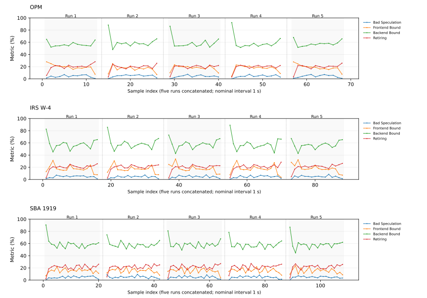

每个点为原始 DevKit 编号报告，每条线为一个指标；横轴为五轮串联的采样点序号，轮间留空且不连线。名义间隔 1 秒，保留启动和停止包络，不平滑、不插值。

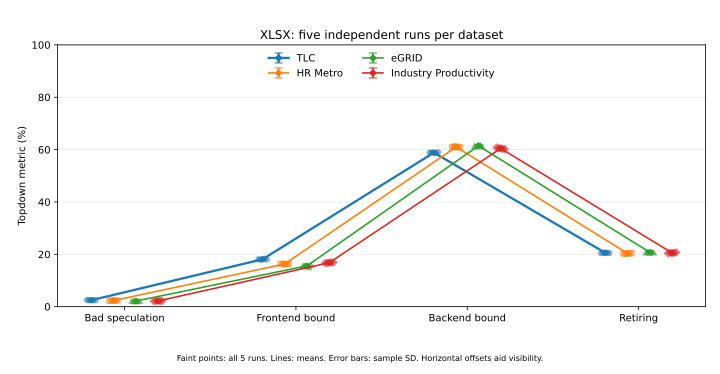

每个点为原始 DevKit 编号报告，每条线为一个指标；横轴为五轮串联的采样点序号，轮间留空且不连线。名义间隔 1 秒，保留启动和停止包络，不平滑、不插值。

## 七、逐轮指标、完整排名与采样点

以下数值直接取自合格的逐轮结果；过程曲线保留全部九个 PMU 指标，idle 只有整轮门控值，不重建逐秒 idle。

### OPM：五轮最终值

| 指标 | R1 | R2 | R3 | R4 | R5 | 均值 | 样本标准差 | CV% |
|---|---|---|---|---|---|---|---|---|
| IPC | 1.260000 | 1.210000 | 1.210000 | 1.220000 | 1.230000 | 1.226000 | 0.020736 | 1.691390 |
| Bad Speculation | 4.460000 | 5.140000 | 4.460000 | 4.730000 | 4.590000 | 4.676000 | 0.282365 | 6.038602 |
| Frontend Bound | 18.770000 | 16.930000 | 18.400000 | 18.510000 | 17.990000 | 18.120000 | 0.722150 | 3.985373 |
| Backend Bound | 55.800000 | 57.780000 | 57.000000 | 56.370000 | 56.860000 | 56.762000 | 0.738526 | 1.301092 |
| Retiring | 20.970000 | 20.140000 | 20.140000 | 20.390000 | 20.560000 | 20.440000 | 0.345615 | 1.690878 |
| Core Bound | 45.780000 | 45.940000 | 47.750000 | 46.120000 | 46.470000 | 46.412000 | 0.790740 | 1.703741 |
| Memory Bound | 10.020000 | 11.840000 | 9.250000 | 10.250000 | 10.390000 | 10.350000 | 0.942152 | 9.102916 |
| Fetch Latency Bound | 16.130000 | 15.040000 | 16.140000 | 16.350000 | 15.710000 | 15.874000 | 0.520893 | 3.281425 |
| Fetch Bandwidth Bound | 2.650000 | 1.880000 | 2.260000 | 2.150000 | 2.280000 | 2.244000 | 0.277363 | 12.360186 |
| idle_pct | 86.254019 | 86.277439 | 86.323801 | 86.334257 | 86.240221 | 86.285947 | 0.041681 | 0.048306 |

### IRS W-4：五轮最终值

| 指标 | R1 | R2 | R3 | R4 | R5 | 均值 | 样本标准差 | CV% |
|---|---|---|---|---|---|---|---|---|
| IPC | 1.260000 | 1.270000 | 1.260000 | 1.270000 | 1.300000 | 1.272000 | 0.016432 | 1.291798 |
| Bad Speculation | 4.830000 | 4.410000 | 4.660000 | 4.720000 | 4.750000 | 4.674000 | 0.159781 | 3.418509 |
| Frontend Bound | 17.720000 | 17.360000 | 17.430000 | 17.910000 | 17.660000 | 17.616000 | 0.223226 | 1.267180 |
| Backend Bound | 56.500000 | 57.120000 | 56.970000 | 56.150000 | 55.980000 | 56.544000 | 0.497122 | 0.879177 |
| Retiring | 20.960000 | 21.110000 | 20.940000 | 21.220000 | 21.600000 | 21.166000 | 0.268291 | 1.267556 |
| Core Bound | 47.130000 | 47.090000 | 47.240000 | 46.310000 | 46.300000 | 46.814000 | 0.467900 | 0.999486 |
| Memory Bound | 9.370000 | 10.030000 | 9.730000 | 9.840000 | 9.690000 | 9.732000 | 0.241495 | 2.481456 |
| Fetch Latency Bound | 14.950000 | 15.060000 | 14.940000 | 15.440000 | 15.020000 | 15.082000 | 0.206204 | 1.367218 |
| Fetch Bandwidth Bound | 2.760000 | 2.300000 | 2.490000 | 2.470000 | 2.640000 | 2.532000 | 0.175414 | 6.927875 |
| idle_pct | 86.516380 | 86.507937 | 86.433094 | 86.458333 | 86.509005 | 86.484950 | 0.037055 | 0.042846 |

### SBA 1919：五轮最终值

| 指标 | R1 | R2 | R3 | R4 | R5 | 均值 | 样本标准差 | CV% |
|---|---|---|---|---|---|---|---|---|
| IPC | 1.280000 | 1.320000 | 1.310000 | 1.320000 | 1.320000 | 1.310000 | 0.017321 | 1.322176 |
| Bad Speculation | 4.850000 | 4.910000 | 4.950000 | 4.970000 | 5.070000 | 4.950000 | 0.081240 | 1.641220 |
| Frontend Bound | 15.710000 | 15.670000 | 15.650000 | 16.020000 | 15.490000 | 15.708000 | 0.193442 | 1.231490 |
| Backend Bound | 58.040000 | 57.440000 | 57.560000 | 57.020000 | 57.450000 | 57.502000 | 0.364582 | 0.634034 |
| Retiring | 21.400000 | 21.980000 | 21.850000 | 21.990000 | 22.000000 | 21.844000 | 0.255597 | 1.170103 |
| Core Bound | 47.420000 | 47.380000 | 47.920000 | 47.090000 | 47.440000 | 47.450000 | 0.298496 | 0.629075 |
| Memory Bound | 10.620000 | 10.050000 | 9.630000 | 9.920000 | 10.010000 | 10.046000 | 0.360458 | 3.588075 |
| Fetch Latency Bound | 13.300000 | 13.370000 | 13.190000 | 13.640000 | 12.960000 | 13.292000 | 0.248938 | 1.872839 |
| Fetch Bandwidth Bound | 2.410000 | 2.300000 | 2.460000 | 2.390000 | 2.520000 | 2.416000 | 0.082037 | 3.395554 |
| idle_pct | 86.548767 | 86.465662 | 86.407310 | 86.464403 | 86.513400 | 86.479908 | 0.053798 | 0.062209 |

### TLC：五轮最终值

| 指标 | R1 | R2 | R3 | R4 | R5 | 均值 | 样本标准差 | CV% |
|---|---|---|---|---|---|---|---|---|
| IPC | 1.230000 | 1.240000 | 1.240000 | 1.230000 | 1.230000 | 1.234000 | 0.005477 | 0.443859 |
| Bad Speculation | 2.550000 | 2.490000 | 2.410000 | 2.480000 | 2.460000 | 2.478000 | 0.050695 | 2.045810 |
| Frontend Bound | 18.130000 | 17.950000 | 18.060000 | 18.330000 | 18.030000 | 18.100000 | 0.143875 | 0.794889 |
| Backend Bound | 58.840000 | 58.920000 | 58.840000 | 58.630000 | 59.000000 | 58.846000 | 0.137768 | 0.234116 |
| Retiring | 20.470000 | 20.640000 | 20.690000 | 20.560000 | 20.500000 | 20.572000 | 0.092574 | 0.450001 |
| Core Bound | 44.710000 | 44.830000 | 44.430000 | 44.980000 | 44.720000 | 44.734000 | 0.201817 | 0.451148 |
| Memory Bound | 14.140000 | 14.090000 | 14.410000 | 13.650000 | 14.290000 | 14.116000 | 0.289448 | 2.050494 |
| Fetch Latency Bound | 15.650000 | 15.540000 | 15.590000 | 15.780000 | 15.640000 | 15.640000 | 0.089722 | 0.573669 |
| Fetch Bandwidth Bound | 2.480000 | 2.410000 | 2.470000 | 2.550000 | 2.400000 | 2.462000 | 0.060581 | 2.460622 |
| idle_pct | 86.561876 | 86.556589 | 86.583607 | 86.576572 | 86.524399 | 86.560609 | 0.022982 | 0.026550 |

### HR Metro：五轮最终值

| 指标 | R1 | R2 | R3 | R4 | R5 | 均值 | 样本标准差 | CV% |
|---|---|---|---|---|---|---|---|---|
| IPC | 1.220000 | 1.210000 | 1.220000 | 1.230000 | 1.230000 | 1.222000 | 0.008367 | 0.684665 |
| Bad Speculation | 2.310000 | 2.280000 | 2.360000 | 2.370000 | 2.340000 | 2.332000 | 0.037014 | 1.587200 |
| Frontend Bound | 16.440000 | 16.320000 | 16.150000 | 16.400000 | 16.240000 | 16.310000 | 0.117898 | 0.722859 |
| Backend Bound | 60.910000 | 61.200000 | 61.180000 | 60.800000 | 60.960000 | 61.010000 | 0.174356 | 0.285783 |
| Retiring | 20.340000 | 20.190000 | 20.310000 | 20.420000 | 20.470000 | 20.346000 | 0.107842 | 0.530043 |
| Core Bound | 44.620000 | 45.090000 | 44.950000 | 44.770000 | 45.090000 | 44.904000 | 0.206107 | 0.458994 |
| Memory Bound | 16.300000 | 16.110000 | 16.230000 | 16.030000 | 15.870000 | 16.108000 | 0.169174 | 1.050251 |
| Fetch Latency Bound | 14.080000 | 13.930000 | 13.820000 | 14.000000 | 13.940000 | 13.954000 | 0.095812 | 0.686630 |
| Fetch Bandwidth Bound | 2.350000 | 2.390000 | 2.330000 | 2.400000 | 2.300000 | 2.354000 | 0.041593 | 1.766919 |
| idle_pct | 86.401500 | 86.383560 | 86.424262 | 86.404865 | 86.417746 | 86.406387 | 0.015778 | 0.018260 |

### eGRID：五轮最终值

| 指标 | R1 | R2 | R3 | R4 | R5 | 均值 | 样本标准差 | CV% |
|---|---|---|---|---|---|---|---|---|
| IPC | 1.240000 | 1.250000 | 1.240000 | 1.260000 | 1.240000 | 1.246000 | 0.008944 | 0.717839 |
| Bad Speculation | 2.230000 | 2.150000 | 2.030000 | 2.170000 | 2.190000 | 2.154000 | 0.075366 | 3.498875 |
| Frontend Bound | 15.620000 | 15.840000 | 15.530000 | 15.120000 | 15.950000 | 15.612000 | 0.322134 | 2.063371 |
| Backend Bound | 61.420000 | 61.130000 | 61.840000 | 61.740000 | 61.140000 | 61.454000 | 0.329970 | 0.536938 |
| Retiring | 20.720000 | 20.890000 | 20.600000 | 20.970000 | 20.720000 | 20.780000 | 0.148155 | 0.712971 |
| Core Bound | 45.220000 | 45.230000 | 45.680000 | 45.690000 | 45.980000 | 45.560000 | 0.328710 | 0.721487 |
| Memory Bound | 16.210000 | 15.900000 | 16.160000 | 16.050000 | 15.160000 | 15.896000 | 0.428287 | 2.694309 |
| Fetch Latency Bound | 13.310000 | 13.450000 | 13.210000 | 12.860000 | 13.670000 | 13.300000 | 0.300500 | 2.259395 |
| Fetch Bandwidth Bound | 2.320000 | 2.390000 | 2.320000 | 2.260000 | 2.280000 | 2.314000 | 0.049800 | 2.152100 |
| idle_pct | 86.120910 | 86.274331 | 86.228549 | 86.167906 | 86.286663 | 86.215672 | 0.070548 | 0.081827 |

### Industry Productivity：五轮最终值

| 指标 | R1 | R2 | R3 | R4 | R5 | 均值 | 样本标准差 | CV% |
|---|---|---|---|---|---|---|---|---|
| IPC | 1.220000 | 1.240000 | 1.230000 | 1.230000 | 1.240000 | 1.232000 | 0.008367 | 0.679107 |
| Bad Speculation | 2.130000 | 2.170000 | 2.250000 | 2.180000 | 2.180000 | 2.182000 | 0.043243 | 1.981828 |
| Frontend Bound | 16.660000 | 16.700000 | 16.830000 | 16.950000 | 16.880000 | 16.804000 | 0.121778 | 0.724699 |
| Backend Bound | 60.820000 | 60.510000 | 60.460000 | 60.280000 | 60.210000 | 60.456000 | 0.238181 | 0.393973 |
| Retiring | 20.380000 | 20.620000 | 20.450000 | 20.580000 | 20.740000 | 20.554000 | 0.142056 | 0.691137 |
| Core Bound | 44.860000 | 45.070000 | 44.750000 | 44.670000 | 44.650000 | 44.800000 | 0.172047 | 0.384032 |
| Memory Bound | 15.960000 | 15.450000 | 15.710000 | 15.610000 | 15.560000 | 15.658000 | 0.193054 | 1.232944 |
| Fetch Latency Bound | 14.210000 | 14.270000 | 14.290000 | 14.480000 | 14.390000 | 14.328000 | 0.106864 | 0.745843 |
| Fetch Bandwidth Bound | 2.450000 | 2.430000 | 2.540000 | 2.470000 | 2.490000 | 2.476000 | 0.042190 | 1.703960 |
| idle_pct | 86.041263 | 86.244976 | 86.198713 | 86.312735 | 86.311950 | 86.221927 | 0.111870 | 0.129747 |

### OPM：合并物理函数 Top-20

| 排名 | 库 | 物理叶函数 | 完整 ROI 用户态 period 占比 |
|---|---|---|---|
| 1 | libpython | `_PyEval_EvalFrameDefault` | 16.52% |
| 2 | zlib | `longest_match` | 10.07% |
| 3 | zlib | `deflate_slow` | 7.04% |
| 4 | Pillow | `ImagingResampleHorizontal_8bpc` | 5.41% |
| 5 | Pillow | `ImagingZipEncode` | 4.70% |
| 6 | libpython | `deduce_unreachable` | 3.42% |
| 7 | libpython | `gc_collect_main` | 2.92% |
| 8 | zlib | `slide_hash` | 2.74% |
| 9 | Pillow | `ImagingResampleVertical_8bpc` | 2.52% |
| 10 | zlib | `inflate_fast` | 2.47% |
| 11 | Poppler | `Splash::compositeBackground(unsigned char const*)` | 2.44% |
| 12 | zlib | `compress_block` | 2.19% |
| 13 | libpython | `_PyObject_MakeTpCall` | 1.53% |
| 14 | libpython | `visit_reachable` | 1.42% |
| 15 | libpython | `dict_traverse` | 1.23% |
| 16 | libpython | `do_super_lookup` | 1.18% |
| 17 | Poppler | `Splash::pipeRunAARGB8(SplashPipe*)` | 1.08% |
| 18 | libpython | `_PyObject_GetMethod` | 0.99% |
| 19 | libpython | `PyErr_GivenExceptionMatches` | 0.99% |
| 20 | libpython | `tupledealloc` | 0.96% |

### IRS W-4：合并物理函数 Top-20

| 排名 | 库 | 物理叶函数 | 完整 ROI 用户态 period 占比 |
|---|---|---|---|
| 1 | libpython | `_PyEval_EvalFrameDefault` | 18.57% |
| 2 | zlib | `longest_match` | 11.14% |
| 3 | Pillow | `ImagingResampleHorizontal_8bpc` | 8.18% |
| 4 | Pillow | `ImagingZipEncode` | 7.54% |
| 5 | zlib | `deflate_slow` | 6.22% |
| 6 | Pillow | `ImagingResampleVertical_8bpc` | 3.26% |
| 7 | zlib | `slide_hash` | 3.07% |
| 8 | libpython | `_Py_dict_lookup` | 2.44% |
| 9 | libpython | `gc_collect_main` | 1.81% |
| 10 | libpython | `deduce_unreachable` | 1.56% |
| 11 | libpython | `insertdict` | 1.19% |
| 12 | libpython | `unicode_dealloc` | 1.19% |
| 13 | libpython | `PyObject_GC_Del` | 1.11% |
| 14 | zlib | `inflate_fast` | 1.06% |
| 15 | zlib | `compress_block` | 1.04% |
| 16 | Poppler | `Splash::pipeRunAARGB8(SplashPipe*)` | 0.95% |
| 17 | libpython | `visit_reachable` | 0.87% |
| 18 | libc | `__memcpy_generic` | 0.82% |
| 19 | Poppler | `Splash::compositeBackground(unsigned char const*)` | 0.79% |
| 20 | Pillow | `ImagingUnpackRGB` | 0.78% |

### SBA 1919：合并物理函数 Top-20

| 排名 | 库 | 物理叶函数 | 完整 ROI 用户态 period 占比 |
|---|---|---|---|
| 1 | libpython | `_PyEval_EvalFrameDefault` | 15.02% |
| 2 | zlib | `longest_match` | 12.96% |
| 3 | Pillow | `ImagingResampleHorizontal_8bpc` | 8.51% |
| 4 | zlib | `deflate_slow` | 6.12% |
| 5 | Pillow | `ImagingZipEncode` | 5.78% |
| 6 | Pillow | `ImagingResampleVertical_8bpc` | 4.88% |
| 7 | zlib | `slide_hash` | 2.82% |
| 8 | Poppler | `Splash::pipeRunAARGB8(SplashPipe*)` | 2.55% |
| 9 | Poppler | `Splash::compositeBackground(unsigned char const*)` | 1.96% |
| 10 | FreeType | `gray_render_line` | 1.93% |
| 11 | libpython | `gc_collect_main` | 1.52% |
| 12 | libpython | `deduce_unreachable` | 1.47% |
| 13 | libpython | `_Py_dict_lookup` | 1.30% |
| 14 | Pillow | `ImagingUnpackRGB` | 1.04% |
| 15 | libc | `__memcpy_generic` | 0.88% |
| 16 | libpython | `subtype_traverse` | 0.82% |
| 17 | FreeType | `gray_set_cell` | 0.81% |
| 18 | zlib | `compress_block` | 0.76% |
| 19 | libc | `sem_trywait@@GLIBC_2.34` | 0.66% |
| 20 | libc | `strchr` | 0.65% |

### TLC：合并物理函数 Top-20

| 排名 | 库 | 物理叶函数 | 完整 ROI 用户态 period 占比 |
|---|---|---|---|
| 1 | libpython | `_PyEval_EvalFrameDefault` | 23.65% |
| 2 | libpython | `gc_collect_main` | 5.13% |
| 3 | libpython | `subtype_traverse` | 3.90% |
| 4 | libpython | `_Py_dict_lookup` | 3.57% |
| 5 | libpython | `deduce_unreachable` | 3.23% |
| 6 | libpython | `visit_reachable` | 2.97% |
| 7 | libpython | `_PyObject_GenericGetAttrWithDict` | 2.04% |
| 8 | libpython | `dictiter_iternextkey` | 1.92% |
| 9 | libpython | `tupledealloc` | 1.61% |
| 10 | libpython | `PyObject_GC_Del` | 1.49% |
| 11 | expat | `storeAtts` | 1.32% |
| 12 | expat | `PyExpat_XML_Parse` | 1.22% |
| 13 | ElementTree | `checkpath` | 1.11% |
| 14 | expat | `doContent` | 1.00% |
| 15 | libpython | `dict_dealloc` | 0.97% |
| 16 | libpython | `_PyObject_GC_New` | 0.96% |
| 17 | libpython | `PyType_GenericAlloc` | 0.89% |
| 18 | expat | `getAttributeId` | 0.88% |
| 19 | libpython | `PyLong_FromString` | 0.81% |
| 20 | libpython | `_PyEvalFrameClearAndPop` | 0.70% |

### HR Metro：合并物理函数 Top-20

| 排名 | 库 | 物理叶函数 | 完整 ROI 用户态 period 占比 |
|---|---|---|---|
| 1 | libpython | `_PyEval_EvalFrameDefault` | 21.97% |
| 2 | libpython | `gc_collect_main` | 7.31% |
| 3 | libpython | `subtype_traverse` | 4.84% |
| 4 | libpython | `_Py_dict_lookup` | 4.77% |
| 5 | libpython | `deduce_unreachable` | 4.30% |
| 6 | libpython | `visit_reachable` | 3.33% |
| 7 | libpython | `tupledealloc` | 1.81% |
| 8 | libpython | `_PyObject_GenericGetAttrWithDict` | 1.27% |
| 9 | expat | `storeAtts` | 1.22% |
| 10 | ElementTree | `checkpath` | 1.19% |
| 11 | libpython | `PyObject_GC_Del` | 1.07% |
| 12 | expat | `PyExpat_XML_Parse` | 1.03% |
| 13 | libpython | `dict_dealloc` | 0.99% |
| 14 | libpython | `_PyObject_GC_New` | 0.94% |
| 15 | libpython | `dict_traverse` | 0.89% |
| 16 | libpython | `PyLong_FromString` | 0.88% |
| 17 | libpython | `PyType_GenericAlloc` | 0.87% |
| 18 | expat | `doContent` | 0.87% |
| 19 | expat | `getAttributeId` | 0.86% |
| 20 | zlib | `longest_match` | 0.82% |

### eGRID：合并物理函数 Top-20

| 排名 | 库 | 物理叶函数 | 完整 ROI 用户态 period 占比 |
|---|---|---|---|
| 1 | libpython | `_PyEval_EvalFrameDefault` | 22.80% |
| 2 | libpython | `gc_collect_main` | 7.24% |
| 3 | libpython | `subtype_traverse` | 5.09% |
| 4 | libpython | `_Py_dict_lookup` | 4.97% |
| 5 | libpython | `deduce_unreachable` | 4.43% |
| 6 | libpython | `visit_reachable` | 3.38% |
| 7 | libpython | `tupledealloc` | 1.76% |
| 8 | libpython | `_PyObject_GenericGetAttrWithDict` | 1.35% |
| 9 | expat | `storeAtts` | 1.22% |
| 10 | libpython | `PyObject_GC_Del` | 1.15% |
| 11 | ElementTree | `checkpath` | 1.15% |
| 12 | expat | `PyExpat_XML_Parse` | 1.04% |
| 13 | libpython | `dict_traverse` | 1.04% |
| 14 | libpython | `_PyObject_GC_New` | 1.04% |
| 15 | libpython | `dict_dealloc` | 0.97% |
| 16 | libpython | `PyType_GenericAlloc` | 0.94% |
| 17 | libpython | `PyLong_FromString` | 0.87% |
| 18 | expat | `getAttributeId` | 0.83% |
| 19 | libpython | `_PyObject_MakeTpCall` | 0.82% |
| 20 | libpython | `dictiter_iternextkey` | 0.81% |

### Industry Productivity：合并物理函数 Top-20

| 排名 | 库 | 物理叶函数 | 完整 ROI 用户态 period 占比 |
|---|---|---|---|
| 1 | libpython | `_PyEval_EvalFrameDefault` | 21.57% |
| 2 | libpython | `gc_collect_main` | 7.04% |
| 3 | libpython | `_Py_dict_lookup` | 4.80% |
| 4 | libpython | `subtype_traverse` | 4.27% |
| 5 | libpython | `deduce_unreachable` | 4.10% |
| 6 | libpython | `visit_reachable` | 3.16% |
| 7 | libpython | `tupledealloc` | 1.69% |
| 8 | libpython | `_PyObject_GenericGetAttrWithDict` | 1.50% |
| 9 | expat | `storeAtts` | 1.18% |
| 10 | expat | `PyExpat_XML_Parse` | 1.12% |
| 11 | libpython | `dict_dealloc` | 1.06% |
| 12 | libpython | `PyObject_GC_Del` | 1.02% |
| 13 | LibreOffice | `XclExpMultiCellBase::GetXFIndexes(std::vector<unsigned short, std::allocator<unsigned short> >&) const` | 1.00% |
| 14 | ElementTree | `checkpath` | 0.96% |
| 15 | libpython | `dict_traverse` | 0.94% |
| 16 | libpython | `_PyObject_GC_New` | 0.92% |
| 17 | expat | `getAttributeId` | 0.90% |
| 18 | expat | `doContent` | 0.88% |
| 19 | libpython | `PyType_GenericAlloc` | 0.84% |
| 20 | libpython | `PyLong_FromString` | 0.84% |

### 各轮逐采样点数据

原始点、时间戳、Cycles／Instructions 和 ALL 汇总见[time-series.json](../analysis/topdown/reports/seven-dataset-five-repeats-20261028T020708Z-58392cf7/similarity/time-series.json)。共 35 轮、6,829 个编号报告；原始日志 SHA256 逐轮绑定。序号连续性、最终汇总一致性与指标分区已校验。整数计数相加与 ALL 最多容许 1 个打印计数单位偏差，实际差值保存在 JSON，不修正数值。

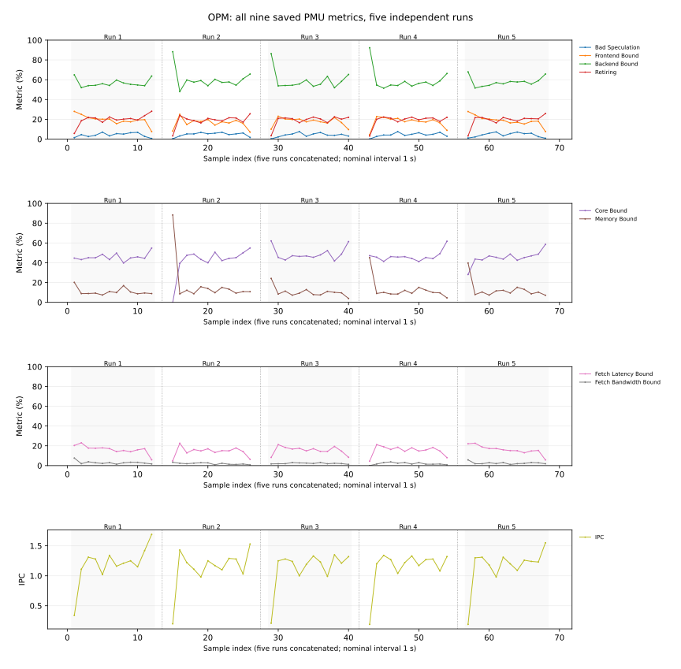

每个点为原始 DevKit 编号报告，每条线为一个指标；横轴为五轮串联的采样点序号，轮间留空且不连线。名义间隔 1 秒，保留启动和停止包络，不平滑、不插值。

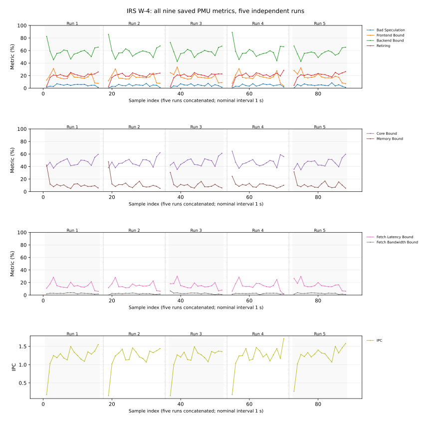

每个点为原始 DevKit 编号报告，每条线为一个指标；横轴为五轮串联的采样点序号，轮间留空且不连线。名义间隔 1 秒，保留启动和停止包络，不平滑、不插值。

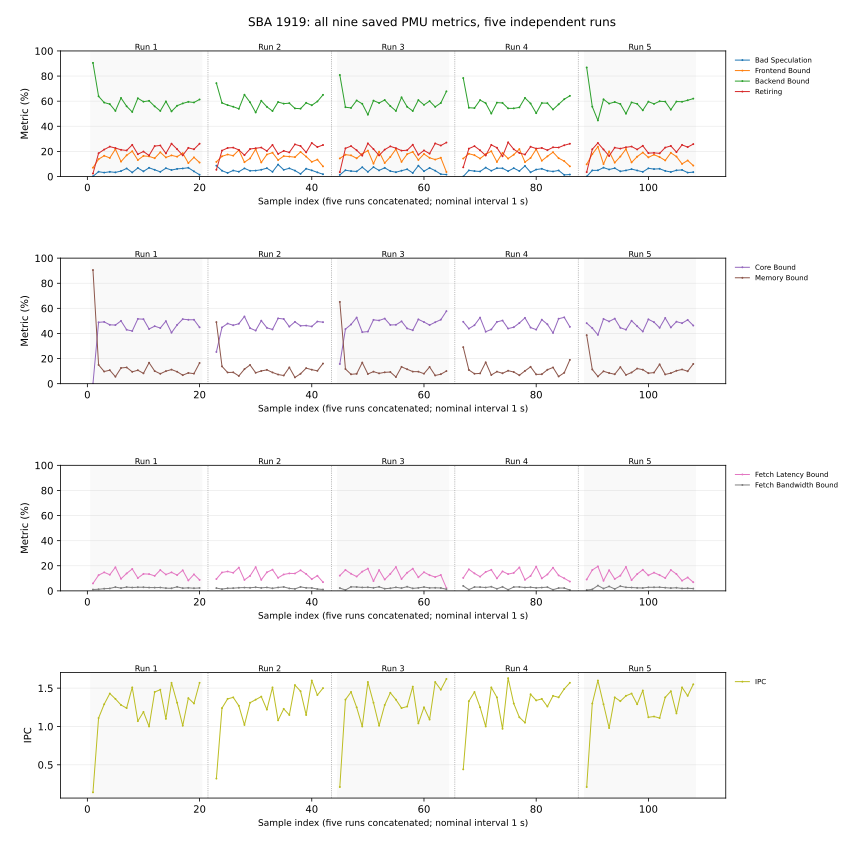

每个点为原始 DevKit 编号报告，每条线为一个指标；横轴为五轮串联的采样点序号，轮间留空且不连线。名义间隔 1 秒，保留启动和停止包络，不平滑、不插值。

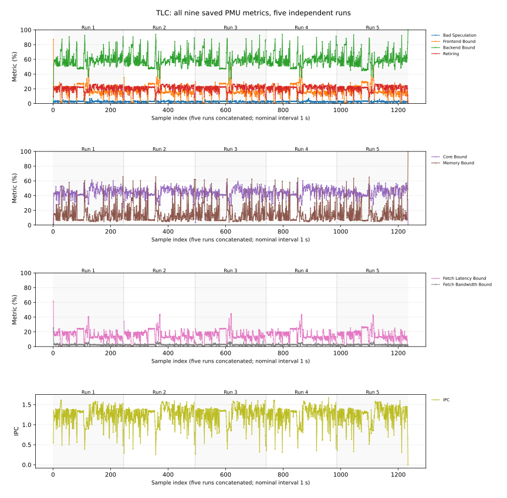

每个点为原始 DevKit 编号报告，每条线为一个指标；横轴为五轮串联的采样点序号，轮间留空且不连线。名义间隔 1 秒，保留启动和停止包络，不平滑、不插值。


每个点为原始 DevKit 编号报告，每条线为一个指标；横轴为五轮串联的采样点序号，轮间留空且不连线。名义间隔 1 秒，保留启动和停止包络，不平滑、不插值。

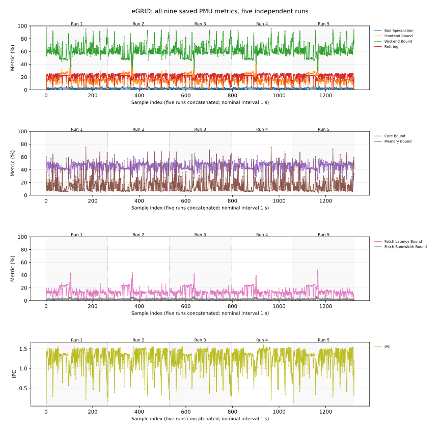

每个点为原始 DevKit 编号报告，每条线为一个指标；横轴为五轮串联的采样点序号，轮间留空且不连线。名义间隔 1 秒，保留启动和停止包络，不平滑、不插值。


每个点为原始 DevKit 编号报告，每条线为一个指标；横轴为五轮串联的采样点序号，轮间留空且不连线。名义间隔 1 秒，保留启动和停止包络，不平滑、不插值。

## 八、70 次采集与完整来源索引

每一条 collection 保存实际采集 argv、工作负载结果、ROI／包络、采集质量；对应 raw 目录下还保存 Docker inspect、原始 stdout、stderr、解析结果和 SHA256 索引。这里列出逐次来源，完整参数不靠示例命令推断。

### perf：35 次独立采集

| 数据集 | 重复 | ROI 样本数 | ROI period | collection（实际命令与质量） |
|---|---|---|---|---|
| OPM | 1 | 544 | 18375366414 | [collection](../analysis/hotspots/raw/opm-native-pilot-20261027T122345Z-2de08010/out/collection.json) |
| OPM | 2 | 563 | 18887909306 | [collection](../analysis/hotspots/raw/opm-native-pilot-20261027T122437Z-8e39f359/out/collection.json) |
| OPM | 3 | 566 | 21185490122 | [collection](../analysis/hotspots/raw/opm-native-pilot-20261027T122529Z-a8c73779/out/collection.json) |
| OPM | 4 | 525 | 17577097213 | [collection](../analysis/hotspots/raw/opm-native-pilot-20261027T122621Z-9ac767af/out/collection.json) |
| OPM | 5 | 538 | 21645992001 | [collection](../analysis/hotspots/raw/opm-native-pilot-20261027T122712Z-b4308bb3/out/collection.json) |
| IRS W-4 | 1 | 687 | 29384587935 | [collection](../analysis/hotspots/raw/irs-w4-native-pilot-20261027T122358Z-d4922d9f/out/collection.json) |
| IRS W-4 | 2 | 667 | 26042896677 | [collection](../analysis/hotspots/raw/irs-w4-native-pilot-20261027T122450Z-62d6abb9/out/collection.json) |
| IRS W-4 | 3 | 664 | 31998053594 | [collection](../analysis/hotspots/raw/irs-w4-native-pilot-20261027T122541Z-70ea9e63/out/collection.json) |
| IRS W-4 | 4 | 720 | 28398771732 | [collection](../analysis/hotspots/raw/irs-w4-native-pilot-20261027T122633Z-90dce9fc/out/collection.json) |
| IRS W-4 | 5 | 705 | 29149175824 | [collection](../analysis/hotspots/raw/irs-w4-native-pilot-20261027T122725Z-5e819403/out/collection.json) |
| SBA 1919 | 1 | 868 | 40738129426 | [collection](../analysis/hotspots/raw/sba1919-native-pilot-20261027T122415Z-071f6a58/out/collection.json) |
| SBA 1919 | 2 | 878 | 40206043103 | [collection](../analysis/hotspots/raw/sba1919-native-pilot-20261027T122507Z-e53ec7ea/out/collection.json) |
| SBA 1919 | 3 | 814 | 39787529638 | [collection](../analysis/hotspots/raw/sba1919-native-pilot-20261027T122559Z-aa7dbcee/out/collection.json) |
| SBA 1919 | 4 | 839 | 40184954447 | [collection](../analysis/hotspots/raw/sba1919-native-pilot-20261027T122651Z-9c112a75/out/collection.json) |
| SBA 1919 | 5 | 876 | 38947219018 | [collection](../analysis/hotspots/raw/sba1919-native-pilot-20261027T122743Z-c3840356/out/collection.json) |
| TLC | 1 | 33584 | 708858318062 | [collection](../analysis/hotspots/raw/tlc-native-pilot-20261027T114320Z-ab113278/out/collection.json) |
| TLC | 2 | 35691 | 714766669108 | [collection](../analysis/hotspots/raw/tlc-native-pilot-20261028T020708Z-46da5c35/out/collection.json) |
| TLC | 3 | 38373 | 694665606338 | [collection](../analysis/hotspots/raw/tlc-native-pilot-20261028T025224Z-a5155ce7/out/collection.json) |
| TLC | 4 | 38931 | 697561477624 | [collection](../analysis/hotspots/raw/tlc-native-pilot-20261028T033742Z-ad932a06/out/collection.json) |
| TLC | 5 | 38395 | 692166888496 | [collection](../analysis/hotspots/raw/tlc-native-pilot-20261028T042248Z-556a263c/out/collection.json) |
| HR Metro | 1 | 40840 | 950787992772 | [collection](../analysis/hotspots/raw/hr-metro-native-pilot-20261027T105835Z-6067e923/out/collection.json) |
| HR Metro | 2 | 41341 | 931799344438 | [collection](../analysis/hotspots/raw/hr-metro-native-pilot-20261028T021541Z-2f71832c/out/collection.json) |
| HR Metro | 3 | 41405 | 944704330018 | [collection](../analysis/hotspots/raw/hr-metro-native-pilot-20261028T030051Z-0093075f/out/collection.json) |
| HR Metro | 4 | 36941 | 940486237482 | [collection](../analysis/hotspots/raw/hr-metro-native-pilot-20261028T034607Z-aeeaddf2/out/collection.json) |
| HR Metro | 5 | 40658 | 937656980107 | [collection](../analysis/hotspots/raw/hr-metro-native-pilot-20261028T043114Z-2bdb1b8f/out/collection.json) |
| eGRID | 1 | 50874 | 751779447322 | [collection](../analysis/hotspots/raw/egrid-native-pilot-20261027T114921Z-89f0166e/out/collection.json) |
| eGRID | 2 | 42988 | 746469182525 | [collection](../analysis/hotspots/raw/egrid-native-pilot-20261028T022654Z-c2c7f214/out/collection.json) |
| eGRID | 3 | 45579 | 746986797837 | [collection](../analysis/hotspots/raw/egrid-native-pilot-20261028T031210Z-1ab9e902/out/collection.json) |
| eGRID | 4 | 50198 | 740143306909 | [collection](../analysis/hotspots/raw/egrid-native-pilot-20261028T035723Z-bcdd2cb8/out/collection.json) |
| eGRID | 5 | 50509 | 748137986895 | [collection](../analysis/hotspots/raw/egrid-native-pilot-20261028T044229Z-079234b5/out/collection.json) |
| Industry Productivity | 1 | 54048 | 1385617785328 | [collection](../analysis/hotspots/raw/industry-productivity-native-pilot-20261027T115406Z-d1215698/out/collection.json) |
| Industry Productivity | 2 | 53146 | 1401686895608 | [collection](../analysis/hotspots/raw/industry-productivity-native-pilot-20261028T023557Z-f4d5e449/out/collection.json) |
| Industry Productivity | 3 | 53587 | 1392045662613 | [collection](../analysis/hotspots/raw/industry-productivity-native-pilot-20261028T032117Z-fd625dc5/out/collection.json) |
| Industry Productivity | 4 | 53552 | 1381212712699 | [collection](../analysis/hotspots/raw/industry-productivity-native-pilot-20261028T040628Z-544e452c/out/collection.json) |
| Industry Productivity | 5 | 54501 | 1390250230053 | [collection](../analysis/hotspots/raw/industry-productivity-native-pilot-20261028T045137Z-b6c2ced6/out/collection.json) |

### DevKit：35 次独立采集

| 数据集 | 重复 | ROI 秒 | 启动包络上界秒 | 停止包络上界秒 | 实际命令／状态 |
|---|---|---|---|---|---|
| OPM | 1 | 10.885469 | 1.108269 | 0.009536 | [profiler](../analysis/topdown/raw/opm-cpu-pilot-20261027T152830Z-ffe55771/out/profiler-record.json) / [collection](../analysis/topdown/raw/opm-cpu-pilot-20261027T152830Z-ffe55771/out/collection.json) |
| OPM | 2 | 10.883807 | 1.114731 | 0.011459 | [profiler](../analysis/topdown/raw/opm-cpu-pilot-20261027T152843Z-2df2d531/out/profiler-record.json) / [collection](../analysis/topdown/raw/opm-cpu-pilot-20261027T152843Z-2df2d531/out/collection.json) |
| OPM | 3 | 10.847219 | 1.109363 | 0.009690 | [profiler](../analysis/topdown/raw/opm-cpu-pilot-20261027T153544Z-aadde888/out/profiler-record.json) / [collection](../analysis/topdown/raw/opm-cpu-pilot-20261027T153544Z-aadde888/out/collection.json) |
| OPM | 4 | 10.842380 | 1.110359 | 0.009768 | [profiler](../analysis/topdown/raw/opm-cpu-pilot-20261027T153557Z-ec6a9d70/out/profiler-record.json) / [collection](../analysis/topdown/raw/opm-cpu-pilot-20261027T153557Z-ec6a9d70/out/collection.json) |
| OPM | 5 | 10.869509 | 1.110008 | 0.012702 | [profiler](../analysis/topdown/raw/opm-cpu-pilot-20261027T153610Z-c84ae2f4/out/profiler-record.json) / [collection](../analysis/topdown/raw/opm-cpu-pilot-20261027T153610Z-c84ae2f4/out/collection.json) |
| IRS W-4 | 1 | 14.818035 | 1.111542 | 0.010677 | [profiler](../analysis/topdown/raw/irs_w4-cpu-pilot-20261027T153623Z-6cd53309/out/profiler-record.json) / [collection](../analysis/topdown/raw/irs_w4-cpu-pilot-20261027T153623Z-6cd53309/out/collection.json) |
| IRS W-4 | 2 | 14.817378 | 1.112931 | 0.009472 | [profiler](../analysis/topdown/raw/irs_w4-cpu-pilot-20261027T153640Z-8e90df1f/out/profiler-record.json) / [collection](../analysis/topdown/raw/irs_w4-cpu-pilot-20261027T153640Z-8e90df1f/out/collection.json) |
| IRS W-4 | 3 | 14.818790 | 1.106689 | 0.013433 | [profiler](../analysis/topdown/raw/irs_w4-cpu-pilot-20261027T153657Z-ea9bb945/out/profiler-record.json) / [collection](../analysis/topdown/raw/irs_w4-cpu-pilot-20261027T153657Z-ea9bb945/out/collection.json) |
| IRS W-4 | 4 | 14.766719 | 1.110964 | 0.013909 | [profiler](../analysis/topdown/raw/irs_w4-cpu-pilot-20261027T153714Z-1d1cbfea/out/profiler-record.json) / [collection](../analysis/topdown/raw/irs_w4-cpu-pilot-20261027T153714Z-1d1cbfea/out/collection.json) |
| IRS W-4 | 5 | 14.866052 | 1.091334 | 0.009512 | [profiler](../analysis/topdown/raw/irs_w4-cpu-pilot-20261027T153732Z-c9154dae/out/profiler-record.json) / [collection](../analysis/topdown/raw/irs_w4-cpu-pilot-20261027T153732Z-c9154dae/out/collection.json) |
| SBA 1919 | 1 | 18.675788 | 1.109124 | 0.013894 | [profiler](../analysis/topdown/raw/sba1919-cpu-pilot-20261027T153749Z-ca1b915b/out/profiler-record.json) / [collection](../analysis/topdown/raw/sba1919-cpu-pilot-20261027T153749Z-ca1b915b/out/collection.json) |
| SBA 1919 | 2 | 18.676393 | 1.107659 | 0.014071 | [profiler](../analysis/topdown/raw/sba1919-cpu-pilot-20261027T153810Z-392466df/out/profiler-record.json) / [collection](../analysis/topdown/raw/sba1919-cpu-pilot-20261027T153810Z-392466df/out/collection.json) |
| SBA 1919 | 3 | 18.620406 | 1.096380 | 0.013766 | [profiler](../analysis/topdown/raw/sba1919-cpu-pilot-20261027T153831Z-116d6f09/out/profiler-record.json) / [collection](../analysis/topdown/raw/sba1919-cpu-pilot-20261027T153831Z-116d6f09/out/collection.json) |
| SBA 1919 | 4 | 18.674582 | 1.093740 | 0.010591 | [profiler](../analysis/topdown/raw/sba1919-cpu-pilot-20261027T153852Z-556d6852/out/profiler-record.json) / [collection](../analysis/topdown/raw/sba1919-cpu-pilot-20261027T153852Z-556d6852/out/collection.json) |
| SBA 1919 | 5 | 18.722356 | 1.108157 | 0.012236 | [profiler](../analysis/topdown/raw/sba1919-cpu-pilot-20261027T153914Z-96df8049/out/profiler-record.json) / [collection](../analysis/topdown/raw/sba1919-cpu-pilot-20261027T153914Z-96df8049/out/collection.json) |
| TLC | 1 | 242.634500 | 1.092943 | 0.070356 | [profiler](../analysis/topdown/raw/tlc-cpu-pilot-20261027T153935Z-0b2e95f5/out/profiler-record.json) / [collection](../analysis/topdown/raw/tlc-cpu-pilot-20261027T153935Z-0b2e95f5/out/collection.json) |
| TLC | 2 | 244.779620 | 1.092484 | 0.070099 | [profiler](../analysis/topdown/raw/tlc-cpu-pilot-20261028T021134Z-669e1476/out/profiler-record.json) / [collection](../analysis/topdown/raw/tlc-cpu-pilot-20261028T021134Z-669e1476/out/collection.json) |
| TLC | 3 | 243.968270 | 1.092824 | 0.040483 | [profiler](../analysis/topdown/raw/tlc-cpu-pilot-20261028T025645Z-d527d773/out/profiler-record.json) / [collection](../analysis/topdown/raw/tlc-cpu-pilot-20261028T025645Z-d527d773/out/collection.json) |
| TLC | 4 | 242.626383 | 1.117606 | 0.040293 | [profiler](../analysis/topdown/raw/tlc-cpu-pilot-20261028T034202Z-56e8b28d/out/profiler-record.json) / [collection](../analysis/topdown/raw/tlc-cpu-pilot-20261028T034202Z-56e8b28d/out/collection.json) |
| TLC | 5 | 245.079816 | 1.091615 | 0.070352 | [profiler](../analysis/topdown/raw/tlc-cpu-pilot-20261028T042707Z-a6992634/out/profiler-record.json) / [collection](../analysis/topdown/raw/tlc-cpu-pilot-20261028T042707Z-a6992634/out/collection.json) |
| HR Metro | 1 | 327.658499 | 1.107927 | 0.071096 | [profiler](../analysis/topdown/raw/hr_metro-cpu-pilot-20261027T154340Z-06a0cdcd/out/profiler-record.json) / [collection](../analysis/topdown/raw/hr_metro-cpu-pilot-20261027T154340Z-06a0cdcd/out/collection.json) |
| HR Metro | 2 | 326.901815 | 1.094890 | 0.069217 | [profiler](../analysis/topdown/raw/hr_metro-cpu-pilot-20261028T022125Z-2ae9d2a1/out/profiler-record.json) / [collection](../analysis/topdown/raw/hr_metro-cpu-pilot-20261028T022125Z-2ae9d2a1/out/collection.json) |
| HR Metro | 3 | 328.624848 | 1.091985 | 0.071221 | [profiler](../analysis/topdown/raw/hr_metro-cpu-pilot-20261028T030639Z-378631b3/out/profiler-record.json) / [collection](../analysis/topdown/raw/hr_metro-cpu-pilot-20261028T030639Z-378631b3/out/collection.json) |
| HR Metro | 4 | 327.860675 | 1.091757 | 0.071039 | [profiler](../analysis/topdown/raw/hr_metro-cpu-pilot-20261028T035153Z-888424f0/out/profiler-record.json) / [collection](../analysis/topdown/raw/hr_metro-cpu-pilot-20261028T035153Z-888424f0/out/collection.json) |
| HR Metro | 5 | 326.346777 | 1.092922 | 0.071943 | [profiler](../analysis/topdown/raw/hr_metro-cpu-pilot-20261028T043700Z-bd6ebda4/out/profiler-record.json) / [collection](../analysis/topdown/raw/hr_metro-cpu-pilot-20261028T043700Z-bd6ebda4/out/collection.json) |
| eGRID | 1 | 261.841981 | 1.116544 | 0.071693 | [profiler](../analysis/topdown/raw/egrid-cpu-pilot-20261027T154910Z-b5134a8e/out/profiler-record.json) / [collection](../analysis/topdown/raw/egrid-cpu-pilot-20261027T154910Z-b5134a8e/out/collection.json) |
| eGRID | 2 | 260.539008 | 1.115438 | 0.071481 | [profiler](../analysis/topdown/raw/egrid-cpu-pilot-20261028T023134Z-eb1c9571/out/profiler-record.json) / [collection](../analysis/topdown/raw/egrid-cpu-pilot-20261028T023134Z-eb1c9571/out/collection.json) |
| eGRID | 3 | 262.084169 | 1.113654 | 0.070097 | [profiler](../analysis/topdown/raw/egrid-cpu-pilot-20261028T031652Z-b11b2078/out/profiler-record.json) / [collection](../analysis/topdown/raw/egrid-cpu-pilot-20261028T031652Z-b11b2078/out/collection.json) |
| eGRID | 4 | 261.472137 | 1.094508 | 0.070869 | [profiler](../analysis/topdown/raw/egrid-cpu-pilot-20261028T040204Z-d1aceb61/out/profiler-record.json) / [collection](../analysis/topdown/raw/egrid-cpu-pilot-20261028T040204Z-d1aceb61/out/collection.json) |
| eGRID | 5 | 260.878497 | 1.116948 | 0.066320 | [profiler](../analysis/topdown/raw/egrid-cpu-pilot-20261028T044713Z-a6a35efe/out/profiler-record.json) / [collection](../analysis/topdown/raw/egrid-cpu-pilot-20261028T044713Z-a6a35efe/out/collection.json) |
| Industry Productivity | 1 | 478.883034 | 1.114901 | 0.072150 | [profiler](../analysis/topdown/raw/industry_productivity-cpu-pilot-20261027T155334Z-021c3c33/out/profiler-record.json) / [collection](../analysis/topdown/raw/industry_productivity-cpu-pilot-20261027T155334Z-021c3c33/out/collection.json) |
| Industry Productivity | 2 | 478.118405 | 1.106085 | 0.072212 | [profiler](../analysis/topdown/raw/industry_productivity-cpu-pilot-20261028T024423Z-33592b46/out/profiler-record.json) / [collection](../analysis/topdown/raw/industry_productivity-cpu-pilot-20261028T024423Z-33592b46/out/collection.json) |
| Industry Productivity | 3 | 480.502769 | 1.117429 | 0.119473 | [profiler](../analysis/topdown/raw/industry_productivity-cpu-pilot-20261028T032939Z-23f19730/out/profiler-record.json) / [collection](../analysis/topdown/raw/industry_productivity-cpu-pilot-20261028T032939Z-23f19730/out/collection.json) |
| Industry Productivity | 4 | 479.537671 | 1.108658 | 0.071764 | [profiler](../analysis/topdown/raw/industry_productivity-cpu-pilot-20261028T041446Z-ef5dbe68/out/profiler-record.json) / [collection](../analysis/topdown/raw/industry_productivity-cpu-pilot-20261028T041446Z-ef5dbe68/out/collection.json) |
| Industry Productivity | 5 | 480.279536 | 1.091206 | 0.070876 | [profiler](../analysis/topdown/raw/industry_productivity-cpu-pilot-20261028T050000Z-33fd3393/out/profiler-record.json) / [collection](../analysis/topdown/raw/industry_productivity-cpu-pilot-20261028T050000Z-33fd3393/out/collection.json) |

### 机器数据与核验入口

- [相似度完整数据](../analysis/topdown/reports/seven-dataset-five-repeats-20261028T020708Z-58392cf7/similarity/comparison.json)：十维向量、配对、排除项和来源。
- [perf 完整函数与脚本数据](../analysis/hotspots/reports/pdf-xlsx-common-hotspots-20261027/comparison.json)：包含未展示的小项与未知项。
- [Topdown 原始统计](../analysis/topdown/reports/seven-dataset-five-repeats-20261028T020708Z-58392cf7/statistics.json)、[35 次核验](../analysis/topdown/reports/seven-dataset-five-repeats-20261028T020708Z-58392cf7/verification.json)。
- [测量来源哈希清单](evidence/report-split.json)：本次离线拆分、逐采样点导出与测量结果不变检查。

原始 perf／DevKit 大文件保存在本地 analysis raw 目录，Git 不上传大文件；清单和派生统计保持可追溯。PMU 公式经验复算、SMT／事件复用和包络边界说明见第四、六节及上述机器记录。
<!-- BEGIN DOCOPS TASK OPERATION EXTENSION -->

## 九、扩展任务操作：十二项 DocOps 完整记录

本节为后续扩展实验，原有七例五次数据与前八节保持不变。本节以原始 OPM、TLC 为对照，采用统一 openEuler 环境下的新十二项 perf 与 DevKit；旧 Debian 首批仅作历史记录，不进入本节数值。

### 9.1 样本与冻结执行链

| 任务 | 格式／业务 | 采用的来源 run | 最终有效链 | 历史内容 reward |
|---|---|---|---|---|
| 031 | PDF／听证材料包扁平化发布 | 09-pdf-031-20261103T105309Z | build_public_packet.py；PDF 渲染；validate_public_packet.py | 0 |
| 037 | PDF／公交绕行材料修复 | 10-pdf-037-20261103T105547Z | build_bus_detour_packet.py；PDF 渲染；validate_bus_detour_packet.py | 0 |
| pdfwf005 | PDF／结算材料包重建 | 11-pdf-pdfwf005-20261103T105800Z | rebuild_closeout_binder.py；PDF 检查；图片／拼图／诊断 | 1 |
| 013 | Excel／采购投标评审发布 | xlsx013-rerun-20261103T112157Z | build_public_bid_workbook.py；recalc.py；verify_public_bid_workbook.py；PDF／拼图 | 0 |
| 014 | Excel／灾害补助公开发布 | 04-xlsx-014-20261103T103608Z | build_disaster_release_v1.py；recalc.py；finalize_disaster_release_ooxml_v3.py；validate_disaster_release_v1.py／渲染 | 1 |
| 016 | Excel／预测模型情景级联 | 05-xlsx-016-20261103T103856Z | build_forecast_dashboard_v1.py；recalc.py；测试副本切换情景并重算 | 0 |
| 001 | Word／受控文档发布修复 | word001-full-20261103T084219Z | create_packet.py；render_docx.py；结构与渲染检查 | 1 |
| 003 | Word／公开记录元数据清理 | 01-docx-003-20261103T091000Z | build_public_packet.py；audit_public_packet.py；render_docx.py | 0 |
| 009 | Word／事件手册发布 | 02-docx-009-20261103T092824Z | build_incident_manual_publication.py；render_docx.py；validate_incident_manual_publication.py | 1 |
| 021 | PPT／庇护所无障碍整改 | 06-pptx-021-20261103T104204Z | build_public_shelter_briefing.py；validate_public_shelter_briefing.py；soffice.py／图片／拼图 | 0 |
| 026 | PPT／气候披露图表重建 | 07-pptx-026-20261103T104652Z | build_climate_disclosure.py；转 PDF／图片；qa_climate_disclosure.py | 0 |
| 029 | PPT／季度业务回顾发布 | 08-pptx-029-20261103T104925Z | build_release_deck.py；validate_release_deck.py；转 PDF／图片 | 0 |

来源判定保持原样，缺失 CTRF、summary-only 及脚本关联推断等来源边界保留在 recipe／机器结果中；回放或采集成功不升级历史内容判定。各任务采用独立冻结脚本；相同脚本名不表示共享同一个业务实现。

### 9.2 环境、窗口和采集方法

原 OPM／TLC 的五次结果绑定镜像 `sha256:4baef1363ba99a994e17e93fe6a32c904cdb5cb349487adfa2fb13ba42301499`；十二项 DocOps 绑定其派生镜像 `sha256:57483856a27942ffd4aef853950ca66b00c12b0787aae6c1dac74371d03e6164`。Python 3.12.3、openpyxl 3.1.5、LibreOffice 25.8.7.3、Poppler 23.12.0、perf 6.6.0-145.3.23.154 与 DevKit 26.0.RC1。DocOps 增加 python-docx 1.2.0、python-pptx 1.0.2、lxml 6.1.2、fontTools 4.68.0、ReportLab 5.0.1、ImageMagick 7.1.2.9 等所需依赖。

perf 按回放入口及其后代采样，`cycles:u`、49 Hz、DWARF 16384、CLOCK_MONOTONIC；同镜像导出物理栈并加载精确 build-id 调试文件。每项原有一次采集、十轮回放；补符号只离线重解析，样本键、叶地址、DSO、进程权重、ROI 分母及原文件哈希已核对不变。
DocOps perf 仅筛选 workflow 步骤区间并集，排除 dispatcher；原七例的循环 ROI 包含 reset。两者都包含各自任务的原有检查，但检查内容和输入规模不相同。未知项始终保留完整周期分母。
DevKit 单独运行，按宿主 CPU 0–7 计数，业务绑 0–7，控制／监测／准备／归档绑 CPU 9。当前 CLI 最小 interval 为 1 秒，采集整份十轮批次，记录实际编号报告和 ALL。完整包络保留就绪、间隙与停止边界，可能包含对应 CPU 上其他宿主活动；不当作精确进程过滤。
硬件沿用 MIDR `0x00000000480fd020` 平台；DevKit 型号横幅仍显示 unknown，采用既有硬件核验与固定工具输出口径。经验公式复算、未计数事件和打印差异保留，未将其冒称完整的官方 HIP09 语义确认。

```bash
perf record -e cycles:u -F 49 -k mono --call-graph dwarf,16384 -- <测量包装入口>
perf script --no-inline --ns -F +pid -i /original/perf.data
devkit tuner top-down -c 0-7 -L 0 -i 1 -l 0
```

Topdown 四顶层总变差＝0.5 × Σ|新指标−基准指标|，指标单位为百分点；IPC 相对变化＝100 × (新 IPC／基准 IPC−1)。子层 Core／Memory、Fetch Latency／Bandwidth 分别展示，避免父子分类重复加权。余弦为辅助；本节不跨不同 idle 窗口计算混合单位十维距离。函数 Jaccard 使用 DSO 文件名＋完整叶函数名；基准清单占比在目标全部已解析函数中查找，不限目标前十。

### 9.3 最终指标、窗口与采集质量

| 配置 | IPC | Bad Speculation | Frontend Bound | Backend Bound | Retiring | Core Bound | Memory Bound | Fetch Latency Bound | Fetch Bandwidth Bound |
|---|---|---|---|---|---|---|---|---|---|
| OPM | 1.226 | 4.676 | 18.120 | 56.762 | 20.440 | 46.412 | 10.350 | 15.874 | 2.244 |
| TLC | 1.234 | 2.478 | 18.100 | 58.846 | 20.572 | 44.734 | 14.116 | 15.640 | 2.462 |
| 031 | 1.060 | 2.980 | 8.940 | 70.480 | 17.600 | 55.130 | 15.350 | 7.730 | 1.210 |
| 037 | 0.990 | 2.580 | 10.280 | 70.650 | 16.490 | 54.050 | 16.590 | 9.170 | 1.120 |
| pdfwf005 | 1.120 | 4.660 | 11.970 | 64.630 | 18.740 | 50.530 | 14.100 | 10.260 | 1.710 |
| 013 | 0.950 | 3.400 | 15.050 | 65.660 | 15.880 | 48.480 | 17.180 | 13.140 | 1.910 |
| 014 | 0.840 | 3.470 | 18.410 | 64.090 | 14.040 | 45.290 | 18.800 | 16.290 | 2.120 |
| 016 | 0.720 | 4.170 | 23.400 | 60.360 | 12.070 | 41.990 | 18.370 | 21.010 | 2.380 |
| 001 | 0.890 | 3.040 | 14.860 | 67.190 | 14.910 | 48.080 | 19.110 | 12.600 | 2.260 |
| 003 | 0.940 | 3.210 | 15.180 | 65.890 | 15.730 | 49.720 | 16.170 | 13.030 | 2.140 |
| 009 | 1.080 | 2.870 | 17.620 | 61.510 | 17.990 | 46.570 | 14.940 | 15.000 | 2.630 |
| 021 | 1.150 | 2.490 | 16.270 | 62.090 | 19.150 | 48.810 | 13.280 | 13.500 | 2.770 |
| 026 | 1.020 | 2.940 | 19.020 | 61.040 | 16.990 | 45.620 | 15.420 | 16.300 | 2.720 |
| 029 | 0.910 | 3.260 | 20.980 | 60.550 | 15.210 | 44.140 | 16.410 | 17.710 | 3.270 |

| 任务 | perf ROI 样本 | 未解析周期占比 | Topdown workflow 秒 | Topdown 包络秒 | 编号过程点 | 全包络 idle % |
|---|---|---|---|---|---|---|
| 031 | 773 | 0.0018% | 17.759 | 20.344 | 21 | 87.204 |
| 037 | 5084 | 0.0463% | 23.062 | 25.620 | 26 | 86.714 |
| pdfwf005 | 1239 | 0.1798% | 17.273 | 19.913 | 20 | 87.450 |
| 013 | 156032 | 0.5092% | 49.519 | 52.710 | 53 | 85.295 |
| 014 | 109567 | 0.6795% | 39.285 | 42.644 | 43 | 85.942 |
| 016 | 166358 | 0.4045% | 50.976 | 54.369 | 55 | 85.106 |
| 001 | 3736 | 2.4878% | 27.817 | 30.810 | 31 | 86.850 |
| 003 | 3280 | 2.8771% | 23.523 | 26.411 | 27 | 83.236 |
| 009 | 7707 | 2.5392% | 22.230 | 25.216 | 26 | 78.530 |
| 021 | 572915 | 2.0744% | 84.528 | 109.190 | 110 | 90.357 |
| 026 | 196298 | 3.0198% | 64.462 | 67.504 | 68 | 89.482 |
| 029 | 201812 | 1.6253% | 49.916 | 52.810 | 53 | 90.932 |

九项指标来自 ALL 最终累计报告，idle 来自本批 /proc/stat 包络；没有重建逐点 idle，也不把逐点百分比均值用作 ALL。每项一次独立采集，尚不计算重复均值、标准差或 CV。perf loss 按原始计数单位保存，ROI 归属未知，不换算为丢失周期。

### 9.4 与 OPM／TLC 的全部比较

| 新任务 | 基准 | 共同 Top-10 | Jaccard | 基准清单在新任务占比 | IPC Δ% | Bad Δpp | FE Δpp | BE Δpp | Retiring Δpp | Bound 总变差 pp | 余弦（辅助） |
|---|---|---|---|---|---|---|---|---|---|---|---|
| 031 | OPM | 3 | 0.1765 | 67.11% | -13.540 | -1.696 | -9.180 | +13.718 | -2.840 | 13.717 | 0.980371 |
| 031 | TLC | 0 | 0.0000 | 2.75% | -14.100 | +0.502 | -9.160 | +11.634 | -2.972 | 12.134 | 0.983233 |
| 037 | OPM | 4 | 0.2500 | 56.07% | -19.250 | -2.096 | -7.840 | +13.888 | -3.950 | 13.887 | 0.981511 |
| 037 | TLC | 1 | 0.0526 | 5.44% | -19.773 | +0.102 | -7.820 | +11.804 | -4.082 | 11.904 | 0.984538 |
| pdfwf005 | OPM | 5 | 0.3333 | 25.93% | -8.646 | -0.016 | -6.150 | +7.868 | -1.700 | 7.867 | 0.991439 |
| pdfwf005 | TLC | 2 | 0.1111 | 7.99% | -9.238 | +2.182 | -6.130 | +5.784 | -1.832 | 7.964 | 0.992521 |
| 013 | OPM | 5 | 0.3333 | 34.26% | -22.512 | -1.276 | -3.070 | +8.898 | -4.560 | 8.902 | 0.991606 |
| 013 | TLC | 1 | 0.0526 | 6.12% | -23.015 | +0.922 | -3.050 | +6.814 | -4.692 | 7.739 | 0.993354 |
| 014 | OPM | 4 | 0.2500 | 32.61% | -31.485 | -1.206 | +0.290 | +7.328 | -6.400 | 7.612 | 0.991818 |
| 014 | TLC | 2 | 0.1111 | 8.37% | -31.929 | +0.992 | +0.310 | +5.244 | -6.532 | 6.539 | 0.993171 |
| 016 | OPM | 2 | 0.1111 | 8.68% | -41.272 | -0.506 | +5.280 | +3.598 | -8.370 | 8.877 | 0.987621 |
| 016 | TLC | 2 | 0.1111 | 12.06% | -41.653 | +1.692 | +5.300 | +1.514 | -8.502 | 8.504 | 0.987813 |
| 001 | OPM | 4 | 0.2500 | 45.33% | -27.406 | -1.636 | -3.260 | +10.428 | -5.530 | 10.427 | 0.988859 |
| 001 | TLC | 2 | 0.1111 | 4.61% | -27.877 | +0.562 | -3.240 | +8.344 | -5.662 | 8.904 | 0.991037 |
| 003 | OPM | 3 | 0.1765 | 44.19% | -23.328 | -1.466 | -2.940 | +9.128 | -4.710 | 9.122 | 0.991317 |
| 003 | TLC | 0 | 0.0000 | 2.00% | -23.825 | +0.732 | -2.920 | +7.044 | -4.842 | 7.769 | 0.993183 |
| 009 | OPM | 4 | 0.2500 | 45.80% | -11.909 | -1.806 | -0.500 | +4.748 | -2.450 | 4.752 | 0.997530 |
| 009 | TLC | 1 | 0.0526 | 3.89% | -12.480 | +0.392 | -0.480 | +2.664 | -2.582 | 3.059 | 0.998647 |
| 021 | OPM | 1 | 0.0526 | 2.59% | -6.199 | -2.186 | -1.850 | +5.328 | -1.290 | 5.327 | 0.997244 |
| 021 | TLC | 1 | 0.0526 | 3.90% | -6.807 | +0.012 | -1.830 | +3.244 | -1.422 | 3.254 | 0.998666 |
| 026 | OPM | 2 | 0.1111 | 4.96% | -16.803 | -1.736 | +0.900 | +4.278 | -3.450 | 5.182 | 0.997047 |
| 026 | TLC | 2 | 0.1111 | 6.34% | -17.342 | +0.462 | +0.920 | +2.194 | -3.582 | 3.579 | 0.998010 |
| 029 | OPM | 1 | 0.0526 | 7.36% | -25.775 | -1.416 | +2.860 | +3.788 | -5.230 | 6.647 | 0.994697 |
| 029 | TLC | 2 | 0.1111 | 12.53% | -26.256 | +0.782 | +2.880 | +1.704 | -5.362 | 5.364 | 0.995378 |

| 新任务 | 基准 | Core Δpp | Memory Δpp | Fetch Latency Δpp | Fetch Bandwidth Δpp |
|---|---|---|---|---|---|
| 031 | OPM | +8.718 | +5.000 | -8.144 | -1.034 |
| 031 | TLC | +10.396 | +1.234 | -7.910 | -1.252 |
| 037 | OPM | +7.638 | +6.240 | -6.704 | -1.124 |
| 037 | TLC | +9.316 | +2.474 | -6.470 | -1.342 |
| pdfwf005 | OPM | +4.118 | +3.750 | -5.614 | -0.534 |
| pdfwf005 | TLC | +5.796 | -0.016 | -5.380 | -0.752 |
| 013 | OPM | +2.068 | +6.830 | -2.734 | -0.334 |
| 013 | TLC | +3.746 | +3.064 | -2.500 | -0.552 |
| 014 | OPM | -1.122 | +8.450 | +0.416 | -0.124 |
| 014 | TLC | +0.556 | +4.684 | +0.650 | -0.342 |
| 016 | OPM | -4.422 | +8.020 | +5.136 | +0.136 |
| 016 | TLC | -2.744 | +4.254 | +5.370 | -0.082 |
| 001 | OPM | +1.668 | +8.760 | -3.274 | +0.016 |
| 001 | TLC | +3.346 | +4.994 | -3.040 | -0.202 |
| 003 | OPM | +3.308 | +5.820 | -2.844 | -0.104 |
| 003 | TLC | +4.986 | +2.054 | -2.610 | -0.322 |
| 009 | OPM | +0.158 | +4.590 | -0.874 | +0.386 |
| 009 | TLC | +1.836 | +0.824 | -0.640 | +0.168 |
| 021 | OPM | +2.398 | +2.930 | -2.374 | +0.526 |
| 021 | TLC | +4.076 | -0.836 | -2.140 | +0.308 |
| 026 | OPM | -0.792 | +5.070 | +0.426 | +0.476 |
| 026 | TLC | +0.886 | +1.304 | +0.660 | +0.258 |
| 029 | OPM | -2.272 | +6.060 | +1.836 | +1.026 |
| 029 | TLC | -0.594 | +2.294 | +2.070 | +0.808 |

总变差、百分点差和函数集合分别描述不同层次；不将它们拼成单一高／中／低标签。

### 9.5 十二项脚本、库与逐函数结果

### 031：PDF／听证材料包扁平化发布

| 实际进程／脚本 | ROI 周期占比 |
|---|---|
| pdftoppm | 78.26% |
| validate_public_packet.py | 16.80% |
| build_public_packet.py | 4.91% |
| unknown:bash | 0.02% |
| bash | 0.01% |
| unknown:taskset | 0.00% |

| 原生组件 | ROI 周期占比 |
|---|---|
| zlib | 66.25% |
| Python | 20.08% |
| PNG | 8.68% |
| Poppler | 2.56% |
| libc | 2.12% |
| libfreetype.so.6.20.1 | 0.15% |
| loader | 0.15% |
| bash | 0.01% |

| 函数排名 | 物理叶函数 | DSO 文件名 | ROI 周期占比 | 属于 OPM Top-10 | 属于 TLC Top-10 |
|---|---|---|---|---|---|
| 1 | `longest_match` | libz.so.1.2.13 | 56.95% | ✓ |  |
| 2 | `png_write_find_filter` | libpng16.so.16.40.0 | 8.68% |  |  |
| 3 | `deflate_slow` | libz.so.1.2.13 | 6.83% | ✓ |  |
| 4 | `slide_hash` | libz.so.1.2.13 | 2.00% | ✓ |  |
| 5 | `Splash::pipeRunAARGB8(SplashPipe*)` | libpoppler.so.133.0.0 | 1.96% |  |  |
| 6 | `PyObject_Vectorcall` | libpython3.12.so.1.0 | 1.87% |  |  |
| 7 | `term_rule` | libpython3.12.so.1.0 | 1.44% |  |  |
| 8 | `shift_expr_rule` | libpython3.12.so.1.0 | 1.09% |  |  |
| 9 | `expression_rule` | libpython3.12.so.1.0 | 0.94% |  |  |
| 10 | `tok_get_normal_mode` | libpython3.12.so.1.0 | 0.89% |  |  |
| 11 | `code_hash` | libpython3.12.so.1.0 | 0.82% |  |  |
| 12 | `cfg_to_instr_sequence.isra.0` | libpython3.12.so.1.0 | 0.77% |  |  |
| 13 | `_PyEval_EvalFrameDefault` | libpython3.12.so.1.0 | 0.76% | ✓ | ✓ |
| 14 | `sum_rule` | libpython3.12.so.1.0 | 0.75% |  |  |
| 15 | `_Py_dict_lookup` | libpython3.12.so.1.0 | 0.57% |  | ✓ |
| 16 | `tupledealloc` | libpython3.12.so.1.0 | 0.56% |  | ✓ |
| 17 | `bitwise_or_rule` | libpython3.12.so.1.0 | 0.43% |  |  |
| 18 | `gc_collect_main` | libpython3.12.so.1.0 | 0.43% | ✓ | ✓ |
| 19 | `__memset_generic` | libc.so.6 | 0.42% |  |  |
| 20 | `bitwise_xor_rule` | libpython3.12.so.1.0 | 0.41% |  |  |

完整未截短函数名称、完整权重、原始采集 loss 与来源 hash 均在机器结果／原 profile 中。
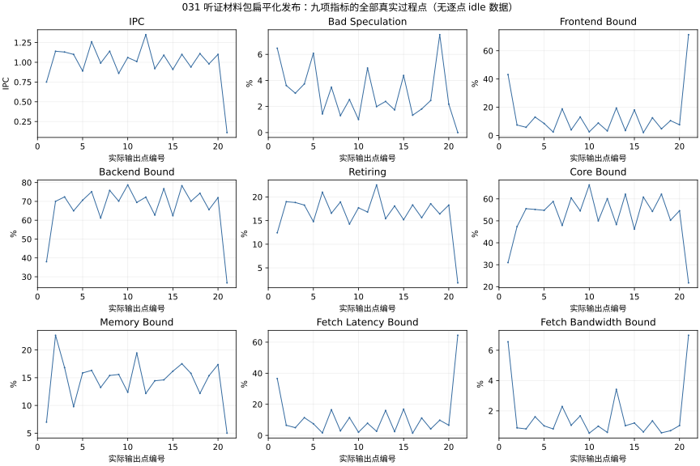

### 037：PDF／公交绕行材料修复

| 实际进程／脚本 | ROI 周期占比 |
|---|---|
| pdftoppm | 68.32% |
| build_bus_detour_packet.py | 18.97% |
| validate_bus_detour_packet.py | 12.43% |
| unknown:awk | 0.09% |
| unknown:grep | 0.04% |
| bash | 0.04% |
| unknown:grepconf.sh | 0.03% |
| unknown:bc | 0.02% |

| 原生组件 | ROI 周期占比 |
|---|---|
| zlib | 52.92% |
| Python | 29.90% |
| PNG | 10.27% |
| Poppler | 4.61% |
| libc | 1.19% |
| loader | 0.62% |
| libfreetype.so.6.20.1 | 0.42% |
| bash | 0.03% |

| 函数排名 | 物理叶函数 | DSO 文件名 | ROI 周期占比 | 属于 OPM Top-10 | 属于 TLC Top-10 |
|---|---|---|---|---|---|
| 1 | `longest_match` | libz.so.1.2.13 | 45.90% | ✓ |  |
| 2 | `png_write_find_filter` | libpng16.so.16.40.0 | 10.27% |  |  |
| 3 | `deflate_slow` | libz.so.1.2.13 | 4.64% | ✓ |  |
| 4 | `Splash::pipeRunAARGB8(SplashPipe*)` | libpoppler.so.133.0.0 | 3.04% |  |  |
| 5 | `_PyEval_EvalFrameDefault` | libpython3.12.so.1.0 | 2.96% | ✓ | ✓ |
| 6 | `_PyPegen_expect_token` | libpython3.12.so.1.0 | 1.50% |  |  |
| 7 | `star_target_rule` | libpython3.12.so.1.0 | 1.47% |  |  |
| 8 | `slide_hash` | libz.so.1.2.13 | 1.43% | ✓ |  |
| 9 | `astfold_expr` | libpython3.12.so.1.0 | 1.34% |  |  |
| 10 | `compiler_visit_expr1` | libpython3.12.so.1.0 | 1.01% |  |  |
| 11 | `tok_get_normal_mode` | libpython3.12.so.1.0 | 0.97% |  |  |
| 12 | `siphash13` | libpython3.12.so.1.0 | 0.95% |  |  |
| 13 | `_Py_dict_lookup` | libpython3.12.so.1.0 | 0.94% |  | ✓ |
| 14 | `compiler_visit_stmt` | libpython3.12.so.1.0 | 0.86% |  |  |
| 15 | `atom_rule` | libpython3.12.so.1.0 | 0.78% |  |  |
| 16 | `unicode_decode_utf8` | libpython3.12.so.1.0 | 0.76% |  |  |
| 17 | `gc_collect_main` | libpython3.12.so.1.0 | 0.75% | ✓ | ✓ |
| 18 | `unsafe_latin_compare` | libpython3.12.so.1.0 | 0.64% |  |  |
| 19 | `Splash::drawAALine(SplashPipe*, int, int, int, bool, unsigned char)` | libpoppler.so.133.0.0 | 0.63% |  |  |
| 20 | `Splash::compositeBackground(unsigned char const*)` | libpoppler.so.133.0.0 | 0.63% |  |  |

完整未截短函数名称、完整权重、原始采集 loss 与来源 hash 均在机器结果／原 profile 中。
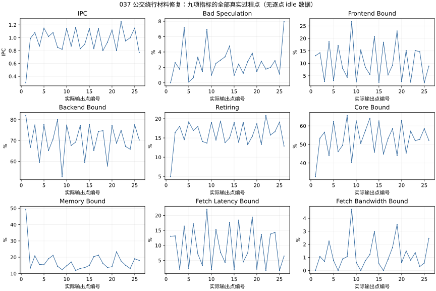

### pdfwf005：PDF／结算材料包重建

| 实际进程／脚本 | ROI 周期占比 |
|---|---|
| montage | 35.99% |
| pdftoppm | 29.50% |
| rebuild_closeout_binder.py | 18.29% |
| python-inline-or-module | 16.14% |
| bash | 0.05% |
| pdftotext | 0.02% |
| unknown:mkdir | 0.01% |
| unknown:bash | 0.01% |

| 原生组件 | ROI 周期占比 |
|---|---|
| Python | 31.74% |
| ImageMagick | 25.96% |
| zlib | 23.67% |
| PNG | 11.60% |
| libc | 4.42% |
| png.so | 1.21% |
| Poppler | 0.72% |
| [unknown] | 0.16% |

| 函数排名 | 物理叶函数 | DSO 文件名 | ROI 周期占比 | 属于 OPM Top-10 | 属于 TLC Top-10 |
|---|---|---|---|---|---|
| 1 | `HorizontalFilter._omp_fn.0` | libMagickCore-7.Q16HDRI.so.10.0.2 | 12.59% |  |  |
| 2 | `VerticalFilter._omp_fn.0` | libMagickCore-7.Q16HDRI.so.10.0.2 | 11.46% |  |  |
| 3 | `png_write_find_filter` | libpng16.so.16.40.0 | 10.57% |  |  |
| 4 | `longest_match` | libz.so.1.2.13 | 8.13% | ✓ |  |
| 5 | `deflate_slow` | libz.so.1.2.13 | 7.42% | ✓ |  |
| 6 | `inflate_fast` | libz.so.1.2.13 | 2.97% | ✓ |  |
| 7 | `_PyEval_EvalFrameDefault` | libpython3.12.so.1.0 | 2.83% | ✓ | ✓ |
| 8 | `slide_hash` | libz.so.1.2.13 | 2.71% | ✓ |  |
| 9 | `_Py_dict_lookup` | libpython3.12.so.1.0 | 2.43% |  | ✓ |
| 10 | `adler32_z` | libz.so.1.2.13 | 2.30% |  |  |
| 11 | `__memcpy_generic` | libc.so.6 | 1.99% |  |  |
| 12 | `instr_sequence_to_cfg` | libpython3.12.so.1.0 | 1.60% |  |  |
| 13 | `bitwise_xor_rule` | libpython3.12.so.1.0 | 1.26% |  |  |
| 14 | `deduce_unreachable` | libpython3.12.so.1.0 | 1.13% | ✓ | ✓ |
| 15 | `_PyCfg_OptimizeCodeUnit.isra.0` | libpython3.12.so.1.0 | 1.09% |  |  |
| 16 | `png_read_filter_row_up` | libpng16.so.16.40.0 | 1.03% |  |  |
| 17 | `_PyPegen_fill_token` | libpython3.12.so.1.0 | 1.02% |  |  |
| 18 | `shift_expr_rule` | libpython3.12.so.1.0 | 1.00% |  |  |
| 19 | `ReadOnePNGImage` | png.so | 0.94% |  |  |
| 20 | `term_raw` | libpython3.12.so.1.0 | 0.87% |  |  |

完整未截短函数名称、完整权重、原始采集 loss 与来源 hash 均在机器结果／原 profile 中。
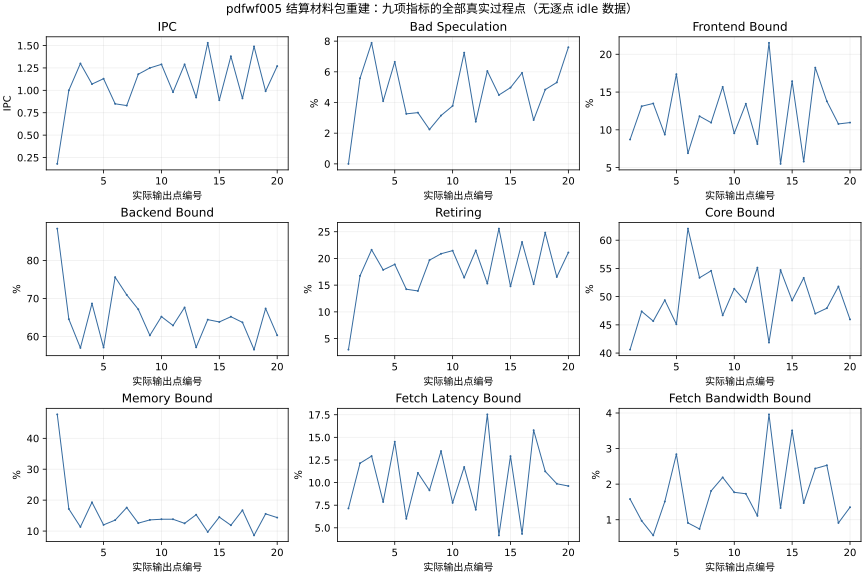

### 013：Excel／采购投标评审发布

| 实际进程／脚本 | ROI 周期占比 |
|---|---|
| pdftoppm | 31.25% |
| montage | 26.79% |
| soffice.bin | 19.23% |
| recalc.py | 7.82% |
| build_public_bid_workbook.py | 7.21% |
| verify_public_bid_workbook.py | 6.79% |
| unknown:thread-pool | 0.79% |
| sh | 0.02% |

| 原生组件 | ROI 周期占比 |
|---|---|
| zlib | 31.66% |
| Python | 19.77% |
| ImageMagick | 13.43% |
| LibreOffice | 10.20% |
| PNG | 8.85% |
| libc | 8.31% |
| pixman | 1.55% |
| loader | 1.47% |

| 函数排名 | 物理叶函数 | DSO 文件名 | ROI 周期占比 | 属于 OPM Top-10 | 属于 TLC Top-10 |
|---|---|---|---|---|---|
| 1 | `longest_match` | libz.so.1.2.13 | 21.24% | ✓ |  |
| 2 | `png_write_find_filter` | libpng16.so.16.40.0 | 8.38% |  |  |
| 3 | `HorizontalFilter._omp_fn.0` | libMagickCore-7.Q16HDRI.so.10.0.2 | 8.05% |  |  |
| 4 | `deflate_slow` | libz.so.1.2.13 | 5.65% | ✓ |  |
| 5 | `VerticalFilter._omp_fn.0` | libMagickCore-7.Q16HDRI.so.10.0.2 | 3.52% |  |  |
| 6 | `_PyEval_EvalFrameDefault` | libpython3.12.so.1.0 | 3.33% | ✓ | ✓ |
| 7 | `__memcpy_generic` | libc.so.6 | 2.73% |  |  |
| 8 | `slide_hash` | libz.so.1.2.13 | 1.92% | ✓ |  |
| 9 | `inflate_fast` | libz.so.1.2.13 | 1.47% | ✓ |  |
| 10 | `_int_free` | libc.so.6 | 1.46% |  |  |
| 11 | `malloc` | libc.so.6 | 1.32% |  |  |
| 12 | `pixman_composite_src_8888_8888_asm_neon` | libpixman-1.so.0.42.2 | 1.01% |  |  |
| 13 | `do_lookup_x` | ld-linux-aarch64.so.1 | 0.85% |  |  |
| 14 | `FcStrHashIgnoreCase` | libfontconfig.so.1.12.1 | 0.80% |  |  |
| 15 | `_Py_dict_lookup` | libpython3.12.so.1.0 | 0.77% |  | ✓ |
| 16 | `CompositeOverImage._omp_fn.0` | libMagickCore-7.Q16HDRI.so.10.0.2 | 0.77% |  |  |
| 17 | `_PyObject_GenericGetAttrWithDict` | libpython3.12.so.1.0 | 0.68% |  | ✓ |
| 18 | `_Py_type_getattro_impl` | libpython3.12.so.1.0 | 0.65% |  |  |
| 19 | `adler32_z` | libz.so.1.2.13 | 0.64% |  |  |
| 20 | `rtl::uri::detail::readUcs4(char16_t const**, char16_t const*, bool, unsigned short, rtl::uri::detail::EscapeType*)` | libuno_sal.so.3 | 0.59% |  |  |

完整未截短函数名称、完整权重、原始采集 loss 与来源 hash 均在机器结果／原 profile 中。
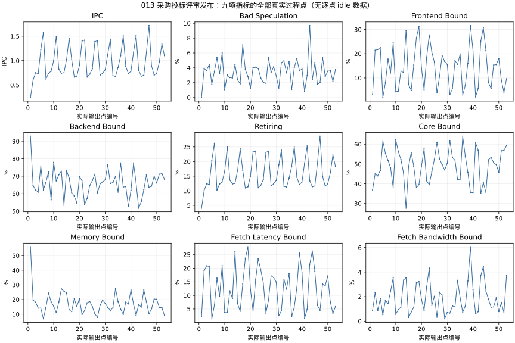

### 014：Excel／灾害补助公开发布

| 实际进程／脚本 | ROI 周期占比 |
|---|---|
| pdftoppm | 39.47% |
| soffice.bin | 30.67% |
| build_disaster_release_v1.py | 12.11% |
| validate_disaster_release_v1.py | 9.09% |
| recalc.py | 7.80% |
| unknown:thread-pool | 0.55% |
| unknown:taskset | 0.07% |
| sh | 0.03% |

| 原生组件 | ROI 周期占比 |
|---|---|
| zlib | 30.54% |
| Python | 25.49% |
| LibreOffice | 17.51% |
| PNG | 7.57% |
| libc | 6.65% |
| loader | 2.68% |
| Poppler | 2.51% |
| libfreeblpriv3.so | 1.94% |

| 函数排名 | 物理叶函数 | DSO 文件名 | ROI 周期占比 | 属于 OPM Top-10 | 属于 TLC Top-10 |
|---|---|---|---|---|---|
| 1 | `longest_match` | libz.so.1.2.13 | 22.52% | ✓ |  |
| 2 | `png_write_find_filter` | libpng16.so.16.40.0 | 7.57% |  |  |
| 3 | `deflate_slow` | libz.so.1.2.13 | 4.90% | ✓ |  |
| 4 | `_PyEval_EvalFrameDefault` | libpython3.12.so.1.0 | 3.15% | ✓ | ✓ |
| 5 | `s_mpv_mul_d_add_prop` | libfreeblpriv3.so | 1.66% |  |  |
| 6 | `do_lookup_x` | ld-linux-aarch64.so.1 | 1.54% |  |  |
| 7 | `_Py_dict_lookup` | libpython3.12.so.1.0 | 1.41% |  | ✓ |
| 8 | `_PyObject_GenericSetAttrWithDict` | libpython3.12.so.1.0 | 1.36% |  |  |
| 9 | `malloc_consolidate` | libc.so.6 | 1.22% |  |  |
| 10 | `slide_hash` | libz.so.1.2.13 | 1.21% | ✓ |  |
| 11 | `inflate_table` | libz.so.1.2.13 | 1.15% |  |  |
| 12 | `_int_free` | libc.so.6 | 1.13% |  |  |
| 13 | `void rtl::str::release<_rtl_uString>(_rtl_uString*)` | libuno_sal.so.3 | 1.11% |  |  |
| 14 | `ScColumnData::GetMostUsedPattern(int, int) const` | libsclo.so | 1.07% |  |  |
| 15 | `pixman_composite_src_8888_8888_asm_neon` | libpixman-1.so.0.42.2 | 1.06% |  |  |
| 16 | `SplashXPathScanner::renderAALine(SplashBitmap*, int*, int*, int, bool) const` | libpoppler.so.133.0.0 | 1.05% |  |  |
| 17 | `PyObject_GC_Del` | libpython3.12.so.1.0 | 1.03% |  | ✓ |
| 18 | `_PyPegen_new_identifier` | libpython3.12.so.1.0 | 0.93% |  |  |
| 19 | `malloc` | libc.so.6 | 0.87% |  |  |
| 20 | `tupledealloc` | libpython3.12.so.1.0 | 0.82% |  | ✓ |

完整未截短函数名称、完整权重、原始采集 loss 与来源 hash 均在机器结果／原 profile 中。
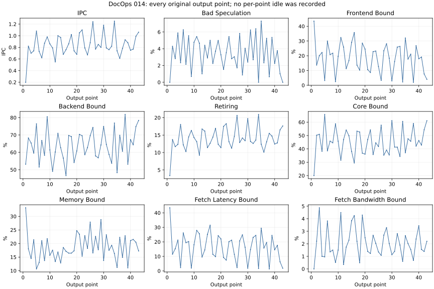

### 016：Excel／预测模型情景级联

| 实际进程／脚本 | ROI 周期占比 |
|---|---|
| soffice.bin | 43.86% |
| recalc.py | 22.25% |
| python-inline-or-module | 19.72% |
| build_forecast_dashboard_v1.py | 9.35% |
| pdftoppm | 3.61% |
| unknown:thread-pool | 0.78% |
| unknown:awk | 0.08% |
| unknown:grep | 0.04% |

| 原生组件 | ROI 周期占比 |
|---|---|
| Python | 47.65% |
| LibreOffice | 27.74% |
| libc | 8.81% |
| loader | 3.62% |
| zlib | 2.92% |
| pixman | 2.37% |
| libfreeblpriv3.so | 1.58% |
| PNG | 1.15% |

| 函数排名 | 物理叶函数 | DSO 文件名 | ROI 周期占比 | 属于 OPM Top-10 | 属于 TLC Top-10 |
|---|---|---|---|---|---|
| 1 | `_PyEval_EvalFrameDefault` | libpython3.12.so.1.0 | 4.57% | ✓ | ✓ |
| 2 | `_Py_dict_lookup` | libpython3.12.so.1.0 | 3.70% |  | ✓ |
| 3 | `std::_Rb_tree<int, int, std::_Identity<int>, std::less<int>, std::allocator<int> >::_M_get_insert_unique_pos(int const&)` | libsclo.so | 3.11% |  |  |
| 4 | `void rtl::str::release<_rtl_uString>(_rtl_uString*)` | libuno_sal.so.3 | 2.13% |  |  |
| 5 | `longest_match` | libz.so.1.2.13 | 2.12% | ✓ |  |
| 6 | `_PyPegen_fill_token` | libpython3.12.so.1.0 | 2.07% |  |  |
| 7 | `pixman_composite_src_8888_8888_asm_neon` | libpixman-1.so.0.42.2 | 1.71% |  |  |
| 8 | `_Py_hashtable_get` | libpython3.12.so.1.0 | 1.45% |  |  |
| 9 | `_int_malloc` | libc.so.6 | 1.42% |  |  |
| 10 | `_int_free` | libc.so.6 | 1.38% |  |  |
| 11 | `malloc` | libc.so.6 | 1.24% |  |  |
| 12 | `png_write_find_filter` | libpng16.so.16.40.0 | 1.15% |  |  |
| 13 | `rtl_uString_acquire` | libuno_sal.so.3 | 1.07% |  |  |
| 14 | `__mbsrtowcs_l` | libc.so.6 | 1.04% |  |  |
| 15 | `func_traverse` | libpython3.12.so.1.0 | 1.00% |  |  |
| 16 | `do_lookup_x` | ld-linux-aarch64.so.1 | 0.93% |  |  |
| 17 | `_PyObject_GenericGetAttrWithDict` | libpython3.12.so.1.0 | 0.91% |  | ✓ |
| 18 | `bitwise_xor_rule` | libpython3.12.so.1.0 | 0.87% |  |  |
| 19 | `gc_collect_main` | libpython3.12.so.1.0 | 0.86% | ✓ | ✓ |
| 20 | `_dl_map_object_from_fd` | ld-linux-aarch64.so.1 | 0.83% |  |  |

完整未截短函数名称、完整权重、原始采集 loss 与来源 hash 均在机器结果／原 profile 中。
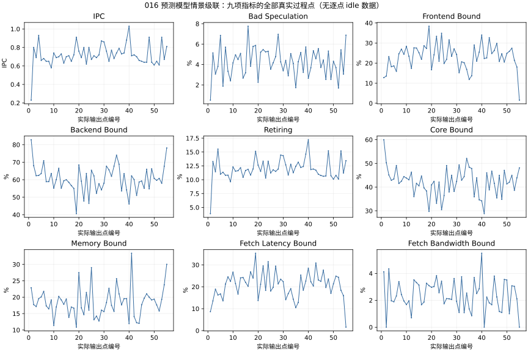

### 001：Word／受控文档发布修复

| 实际进程／脚本 | ROI 周期占比 |
|---|---|
| pdftoppm | 50.07% |
| soffice.bin | 25.96% |
| create_packet.py | 14.90% |
| python-inline-or-module | 8.92% |
| pdfinfo | 0.03% |
| bash | 0.02% |
| unknown:gpgconf | 0.01% |
| unknown:sed | 0.01% |

| 原生组件 | ROI 周期占比 |
|---|---|
| zlib | 44.27% |
| Python | 18.74% |
| LibreOffice | 11.65% |
| libc | 7.16% |
| PNG | 5.34% |
| lxml | 2.95% |
| loader | 2.86% |
| pixman | 2.09% |

| 函数排名 | 物理叶函数 | DSO 文件名 | ROI 周期占比 | 属于 OPM Top-10 | 属于 TLC Top-10 |
|---|---|---|---|---|---|
| 1 | `longest_match` | libz.so.1.2.13 | 36.05% | ✓ |  |
| 2 | `deflate_slow` | libz.so.1.2.13 | 5.87% | ✓ |  |
| 3 | `png_write_find_filter` | libpng16.so.16.40.0 | 5.34% |  |  |
| 4 | `_int_free` | libc.so.6 | 2.25% |  |  |
| 5 | `do_lookup_x` | ld-linux-aarch64.so.1 | 1.76% |  |  |
| 6 | `cppu::_copyConstructAnyFromData(_uno_Any*, void*, _typelib_TypeDescriptionReference*, _typelib_TypeDescription*, void (*)(void*), _uno_Mapping*)` | libuno_cppu.so.3 | 1.50% |  |  |
| 7 | `slide_hash` | libz.so.1.2.13 | 1.41% | ✓ |  |
| 8 | `pixman_composite_src_8888_8888_asm_neon` | libpixman-1.so.0.42.2 | 1.41% |  |  |
| 9 | `_PyEval_EvalFrameDefault` | libpython3.12.so.1.0 | 1.39% | ✓ | ✓ |
| 10 | `_Py_dict_lookup` | libpython3.12.so.1.0 | 1.28% |  | ✓ |
| 11 | `func_dealloc` | libpython3.12.so.1.0 | 1.09% |  |  |
| 12 | `malloc` | libc.so.6 | 1.04% |  |  |
| 13 | `s_mpv_mul_d_add_prop` | libfreeblpriv3.so | 0.77% |  |  |
| 14 | `code_hash` | libpython3.12.so.1.0 | 0.76% |  |  |
| 15 | `std::_Rb_tree<rtl::OUString, std::pair<rtl::OUString const, rtl::Reference<configmgr::Node> >, std::_Select1st<std::pair<rtl::OUString const, rtl::Reference<configmgr::Node> > >, …` | libconfigmgrlo.so | 0.74% |  |  |
| 16 | `malloc_consolidate` | libc.so.6 | 0.71% |  |  |
| 17 | `void rtl::str::release<_rtl_uString>(_rtl_uString*)` | libuno_sal.so.3 | 0.70% |  |  |
| 18 | `_Py_type_getattro` | libpython3.12.so.1.0 | 0.70% |  |  |
| 19 | `pixman_composite_src_n_8888_asm_neon` | libpixman-1.so.0.42.2 | 0.68% |  |  |
| 20 | `FcConfigSubstituteWithPat` | libfontconfig.so.1.12.1 | 0.57% |  |  |

完整未截短函数名称、完整权重、原始采集 loss 与来源 hash 均在机器结果／原 profile 中。
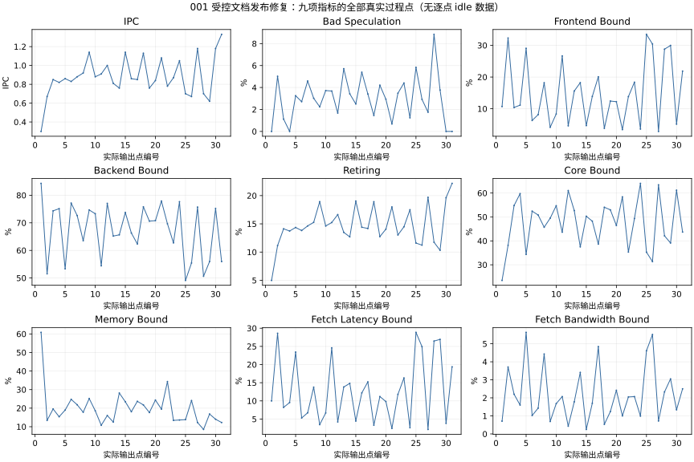

### 003：Word／公开记录元数据清理

| 实际进程／脚本 | ROI 周期占比 |
|---|---|
| pdftoppm | 51.54% |
| soffice.bin | 24.73% |
| build_public_packet.py | 13.61% |
| audit_public_packet.py | 9.96% |
| unknown:bash | 0.03% |
| sh | 0.02% |
| unknown:gpgconf | 0.02% |
| unknown:pdftoppm | 0.01% |

| 原生组件 | ROI 周期占比 |
|---|---|
| zlib | 44.62% |
| Python | 14.91% |
| LibreOffice | 14.23% |
| PNG | 9.05% |
| libc | 6.15% |
| loader | 3.54% |
| lxml | 3.14% |
| pixman | 1.43% |

| 函数排名 | 物理叶函数 | DSO 文件名 | ROI 周期占比 | 属于 OPM Top-10 | 属于 TLC Top-10 |
|---|---|---|---|---|---|
| 1 | `longest_match` | libz.so.1.2.13 | 33.55% | ✓ |  |
| 2 | `png_write_find_filter` | libpng16.so.16.40.0 | 9.05% |  |  |
| 3 | `deflate_slow` | libz.so.1.2.13 | 5.91% | ✓ |  |
| 4 | `slide_hash` | libz.so.1.2.13 | 3.21% | ✓ |  |
| 5 | `do_lookup_x` | ld-linux-aarch64.so.1 | 2.48% |  |  |
| 6 | `_PyUnicode_ToLowerFull` | libpython3.12.so.1.0 | 2.22% |  |  |
| 7 | `do_upper_or_lower` | libpython3.12.so.1.0 | 1.77% |  |  |
| 8 | `subtype_dealloc` | libpython3.12.so.1.0 | 1.74% |  |  |
| 9 | `_int_malloc` | libc.so.6 | 1.57% |  |  |
| 10 | `rtl_uString_assign` | libuno_sal.so.3 | 1.52% |  |  |
| 11 | `strchr` | libc.so.6 | 1.27% |  |  |
| 12 | `std::_Rb_tree<rtl::OUString, std::pair<rtl::OUString const, rtl::Reference<configmgr::Node> >, std::_Select1st<std::pair<rtl::OUString const, rtl::Reference<configmgr::Node> > >, …` | libconfigmgrlo.so | 1.20% |  |  |
| 13 | `make_gen` | libpython3.12.so.1.0 | 1.17% |  |  |
| 14 | `PyObject_CallOneArg` | libpython3.12.so.1.0 | 1.17% |  |  |
| 15 | `_int_free` | libc.so.6 | 1.13% |  |  |
| 16 | `_PyEval_EvalFrameDefault` | libpython3.12.so.1.0 | 1.11% | ✓ | ✓ |
| 17 | `(anonymous namespace)::InterfaceTypeDescription::~InterfaceTypeDescription()` | libuno_cppuhelpergcc3.so.3 | 0.99% |  |  |
| 18 | `adler32_z` | libz.so.1.2.13 | 0.93% |  |  |
| 19 | `s_mpv_mul_d_add_prop` | libfreeblpriv3.so | 0.92% |  |  |
| 20 | `pixman_composite_src_n_8888_asm_neon` | libpixman-1.so.0.42.2 | 0.81% |  |  |

完整未截短函数名称、完整权重、原始采集 loss 与来源 hash 均在机器结果／原 profile 中。
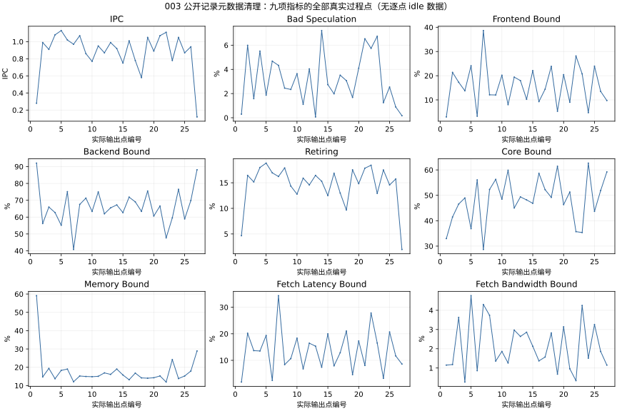

### 009：Word／事件手册发布

| 实际进程／脚本 | ROI 周期占比 |
|---|---|
| pdftoppm | 64.00% |
| soffice.bin | 22.33% |
| build_incident_manual_publication.py | 9.44% |
| validate_incident_manual_publication.py | 3.38% |
| render_docx.py | 0.52% |
| unknown:awk | 0.10% |
| unknown:grep | 0.05% |
| bash | 0.04% |

| 原生组件 | ROI 周期占比 |
|---|---|
| zlib | 44.39% |
| PNG | 19.00% |
| LibreOffice | 9.11% |
| Python | 8.86% |
| libc | 7.52% |
| lxml | 2.88% |
| loader | 2.48% |
| pixman | 2.07% |

| 函数排名 | 物理叶函数 | DSO 文件名 | ROI 周期占比 | 属于 OPM Top-10 | 属于 TLC Top-10 |
|---|---|---|---|---|---|
| 1 | `longest_match` | libz.so.1.2.13 | 27.62% | ✓ |  |
| 2 | `png_write_find_filter` | libpng16.so.16.40.0 | 19.00% |  |  |
| 3 | `deflate_slow` | libz.so.1.2.13 | 10.59% | ✓ |  |
| 4 | `slide_hash` | libz.so.1.2.13 | 4.91% | ✓ |  |
| 5 | `_PyEval_EvalFrameDefault` | libpython3.12.so.1.0 | 2.35% | ✓ | ✓ |
| 6 | `_int_free` | libc.so.6 | 1.90% |  |  |
| 7 | `pixman_composite_src_8888_8888_asm_neon` | libpixman-1.so.0.42.2 | 1.53% |  |  |
| 8 | `do_lookup_x` | ld-linux-aarch64.so.1 | 1.23% |  |  |
| 9 | `malloc` | libc.so.6 | 1.09% |  |  |
| 10 | `malloc_consolidate` | libc.so.6 | 1.06% |  |  |
| 11 | `list_dealloc` | libpython3.12.so.1.0 | 0.91% |  |  |
| 12 | `free_keys_object` | libpython3.12.so.1.0 | 0.79% |  |  |
| 13 | `Splash::compositeBackground(unsigned char const*)` | libpoppler.so.133.0.0 | 0.67% |  |  |
| 14 | `unoidl::detail::UnoidlProvider::findEntity(rtl::OUString const&) const` | libunoidllo.so | 0.62% |  |  |
| 15 | `_int_free_create_chunk` | libc.so.6 | 0.62% |  |  |
| 16 | `xmlStrEqual` | etree.cpython-312-aarch64-linux-gnu.so | 0.61% |  |  |
| 17 | `compress_block` | libz.so.1.2.13 | 0.58% |  |  |
| 18 | `s_mpv_mul_d_add_prop` | libfreeblpriv3.so | 0.53% |  |  |
| 19 | `adler32_z` | libz.so.1.2.13 | 0.52% |  |  |
| 20 | `pixman_composite_src_n_8888_asm_neon` | libpixman-1.so.0.42.2 | 0.46% |  |  |

完整未截短函数名称、完整权重、原始采集 loss 与来源 hash 均在机器结果／原 profile 中。
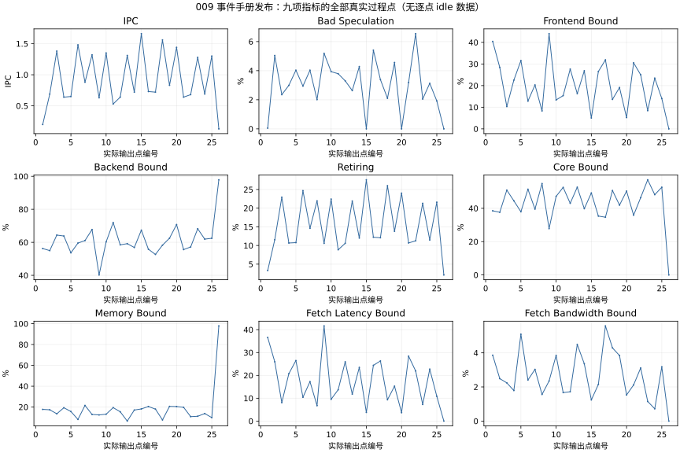

### 021：PPT／庇护所无障碍整改

| 实际进程／脚本 | ROI 周期占比 |
|---|---|
| pdftoppm | 32.54% |
| soffice.bin | 32.24% |
| montage | 14.28% |
| build_public_shelter_briefing.py | 11.61% |
| validate_public_shelter_briefing.py | 7.69% |
| unknown:thread-pool | 1.42% |
| unknown:Parser | 0.08% |
| soffice.py | 0.07% |

| 原生组件 | ROI 周期占比 |
|---|---|
| Poppler | 27.74% |
| LibreOffice | 24.32% |
| Python | 15.95% |
| ImageMagick | 10.59% |
| libc | 7.56% |
| JPEG | 4.76% |
| lxml | 2.12% |
| pixman | 1.98% |

| 函数排名 | 物理叶函数 | DSO 文件名 | ROI 周期占比 | 属于 OPM Top-10 | 属于 TLC Top-10 |
|---|---|---|---|---|---|
| 1 | `Splash::pipeRun(SplashPipe*)` | libpoppler.so.133.0.0 | 9.94% |  |  |
| 2 | `VerticalFilter._omp_fn.0` | libMagickCore-7.Q16HDRI.so.10.0.2 | 6.96% |  |  |
| 3 | `Splash::pipeRunAARGB8(SplashPipe*)` | libpoppler.so.133.0.0 | 6.12% |  |  |
| 4 | `vcl::(anonymous namespace)::ImplScaleConvolutionVer(Bitmap const&, Bitmap&, double const&, vcl::Kernel const&)` | libvcllo.so | 3.89% |  |  |
| 5 | `HorizontalFilter._omp_fn.0` | libMagickCore-7.Q16HDRI.so.10.0.2 | 2.69% |  |  |
| 6 | `__memcpy_generic` | libc.so.6 | 2.29% |  |  |
| 7 | `Splash::drawAALine(SplashPipe*, int, int, int, bool, unsigned char)` | libpoppler.so.133.0.0 | 2.01% |  |  |
| 8 | `_PyEval_EvalFrameDefault` | libpython3.12.so.1.0 | 1.80% | ✓ | ✓ |
| 9 | `BitmapReadAccess::SetPixelForN24BitTcBgr(unsigned char*, long, BitmapColor const&)` | libvcllo.so | 1.61% |  |  |
| 10 | `expandRow(unsigned char*, unsigned char*, int, int, int)` | libpoppler.so.133.0.0 | 1.52% |  |  |
| 11 | `vcl::(anonymous namespace)::ImplScaleConvolutionHor(Bitmap const&, Bitmap&, double const&, vcl::Kernel const&)` | libvcllo.so | 1.49% |  |  |
| 12 | `FlateStream::getChars(int, unsigned char*)` | libpoppler.so.133.0.0 | 1.49% |  |  |
| 13 | `pixman_composite_src_8888_8888_asm_neon` | libpixman-1.so.0.42.2 | 1.42% |  |  |
| 14 | `Splash::scaleImageYdownXdown(bool (*)(void*, unsigned char*, unsigned char*), void*, SplashColorMode, int, bool, int, int, int, int, SplashBitmap*)` | libpoppler.so.133.0.0 | 1.37% |  |  |
| 15 | `decode_mcu_AC_refine` | libjpeg.so.62.4.0 | 1.12% |  |  |
| 16 | `_int_malloc` | libc.so.6 | 1.10% |  |  |
| 17 | `malloc` | libc.so.6 | 1.04% |  |  |
| 18 | `rgb_ycc_convert` | libjpeg.so.62.4.0 | 0.97% |  |  |
| 19 | `_Py_dict_lookup` | libpython3.12.so.1.0 | 0.97% |  | ✓ |
| 20 | `Splash::scaleImageYupXupBilinear(bool (*)(void*, unsigned char*, unsigned char*), void*, SplashColorMode, int, bool, int, int, int, int, SplashBitmap*)` | libpoppler.so.133.0.0 | 0.90% |  |  |

完整未截短函数名称、完整权重、原始采集 loss 与来源 hash 均在机器结果／原 profile 中。
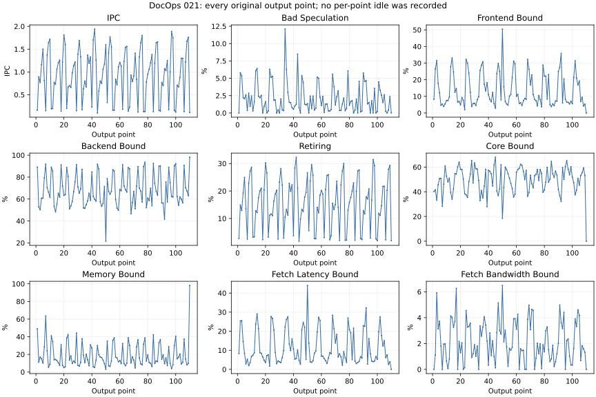

### 026：PPT／气候披露图表重建

| 实际进程／脚本 | ROI 周期占比 |
|---|---|
| pdftoppm | 40.38% |
| soffice.bin | 30.44% |
| build_climate_disclosure.py | 20.77% |
| qa_climate_disclosure.py | 6.24% |
| unknown:thread-pool | 1.63% |
| unknown:awk | 0.14% |
| bash | 0.07% |
| unknown:Parser | 0.06% |

| 原生组件 | ROI 周期占比 |
|---|---|
| Poppler | 36.90% |
| Python | 20.97% |
| LibreOffice | 19.20% |
| libc | 6.60% |
| lxml | 3.60% |
| JPEG | 2.64% |
| loader | 2.26% |
| pixman | 2.09% |

| 函数排名 | 物理叶函数 | DSO 文件名 | ROI 周期占比 | 属于 OPM Top-10 | 属于 TLC Top-10 |
|---|---|---|---|---|---|
| 1 | `Splash::pipeRunAARGB8(SplashPipe*)` | libpoppler.so.133.0.0 | 12.81% |  |  |
| 2 | `Splash::pipeRun(SplashPipe*)` | libpoppler.so.133.0.0 | 11.74% |  |  |
| 3 | `_PyEval_EvalFrameDefault` | libpython3.12.so.1.0 | 2.75% | ✓ | ✓ |
| 4 | `Splash::drawAALine(SplashPipe*, int, int, int, bool, unsigned char)` | libpoppler.so.133.0.0 | 2.52% |  |  |
| 5 | `_PyCfg_OptimizeCodeUnit.isra.0` | libpython3.12.so.1.0 | 1.84% |  |  |
| 6 | `FlateStream::getChars(int, unsigned char*)` | libpoppler.so.133.0.0 | 1.72% |  |  |
| 7 | `s_mpv_mul_d_add_prop` | libfreeblpriv3.so | 1.46% |  |  |
| 8 | `gc_collect_main` | libpython3.12.so.1.0 | 1.44% | ✓ | ✓ |
| 9 | `pixman_composite_src_8888_8888_asm_neon` | libpixman-1.so.0.42.2 | 1.34% |  |  |
| 10 | `expandRow(unsigned char*, unsigned char*, int, int, int)` | libpoppler.so.133.0.0 | 1.29% |  |  |
| 11 | `_int_free` | libc.so.6 | 1.23% |  |  |
| 12 | `_int_malloc` | libc.so.6 | 1.22% |  |  |
| 13 | `SplashClip::testClipPaths(int, int)` | libpoppler.so.133.0.0 | 1.20% |  |  |
| 14 | `Splash::scaleImageYdownXdown(bool (*)(void*, unsigned char*, unsigned char*), void*, SplashColorMode, int, bool, int, int, int, int, SplashBitmap*)` | libpoppler.so.133.0.0 | 1.01% |  |  |
| 15 | `do_lookup_x` | ld-linux-aarch64.so.1 | 0.89% |  |  |
| 16 | `_PyPegen_singleton_seq.isra.0` | libpython3.12.so.1.0 | 0.89% |  |  |
| 17 | `void (anonymous namespace)::stackBlurVertical<(anonymous namespace)::SumFunction8>((anonymous namespace)::BlurSharedData const&, int, int)` | libvcllo.so | 0.88% |  |  |
| 18 | `jsimd_huff_encode_one_block_neon` | libjpeg.so.62.4.0 | 0.79% |  |  |
| 19 | `shift_expr_rule` | libpython3.12.so.1.0 | 0.78% |  |  |
| 20 | `SplashBitmap::getPixel(int, int, unsigned char*)` | libpoppler.so.133.0.0 | 0.75% |  |  |

完整未截短函数名称、完整权重、原始采集 loss 与来源 hash 均在机器结果／原 profile 中。
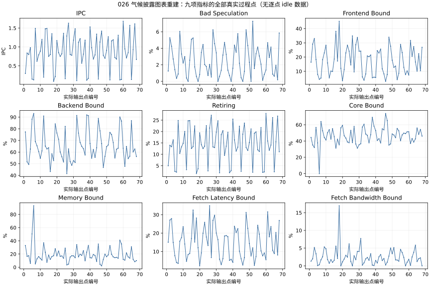

### 029：PPT／季度业务回顾发布

| 实际进程／脚本 | ROI 周期占比 |
|---|---|
| soffice.bin | 50.44% |
| build_release_deck.py | 24.05% |
| validate_release_deck.py | 17.35% |
| pdftoppm | 6.11% |
| unknown:thread-pool | 1.46% |
| soffice.py | 0.29% |
| unknown:Parser | 0.14% |
| sh | 0.03% |

| 原生组件 | ROI 周期占比 |
|---|---|
| Python | 36.96% |
| LibreOffice | 32.15% |
| libc | 7.61% |
| Poppler | 5.08% |
| loader | 3.86% |
| pixman | 2.93% |
| libstdc++.so.6.0.30 | 2.42% |
| lxml | 1.87% |

| 函数排名 | 物理叶函数 | DSO 文件名 | ROI 周期占比 | 属于 OPM Top-10 | 属于 TLC Top-10 |
|---|---|---|---|---|---|
| 1 | `_PyEval_EvalFrameDefault` | libpython3.12.so.1.0 | 5.31% | ✓ | ✓ |
| 2 | `_Py_dict_lookup` | libpython3.12.so.1.0 | 3.45% |  | ✓ |
| 3 | `oox::drawingml::table::applyTableStylePart(oox::core::XmlFilterBase const&, oox::drawingml::FillProperties&, oox::drawingml::TextCharacterProperties&, oox::drawingml::LineProperti…` | libooxlo.so | 2.00% |  |  |
| 4 | `malloc` | libc.so.6 | 1.91% |  |  |
| 5 | `oox::PropertyMap::fillSequences(com::sun::star::uno::Sequence<rtl::OUString>&, com::sun::star::uno::Sequence<com::sun::star::uno::Any>&) const` | libooxlo.so | 1.85% |  |  |
| 6 | `Splash::pipeRunAARGB8(SplashPipe*)` | libpoppler.so.133.0.0 | 1.76% |  |  |
| 7 | `_PyCfg_OptimizeCodeUnit.isra.0` | libpython3.12.so.1.0 | 1.68% |  |  |
| 8 | `pixman_composite_src_8888_8888_asm_neon` | libpixman-1.so.0.42.2 | 1.67% |  |  |
| 9 | `std::_Hashtable<unsigned short, std::pair<unsigned short const, SfxPoolItem const*>, std::allocator<std::pair<unsigned short const, SfxPoolItem const*> >, std::__detail::_Select1s…` | libsvllo.so | 1.54% |  |  |
| 10 | `std::__detail::_Prime_rehash_policy::_M_need_rehash(unsigned long, unsigned long, unsigned long) const` | libstdc++.so.6.0.30 | 1.47% |  |  |
| 11 | `void rtl::str::release<_rtl_uString>(_rtl_uString*)` | libuno_sal.so.3 | 1.34% |  |  |
| 12 | `_PyObject_FastCallDictTstate` | libpython3.12.so.1.0 | 1.31% |  |  |
| 13 | `pixman_composite_src_n_8888_asm_neon` | libpixman-1.so.0.42.2 | 1.26% |  |  |
| 14 | `s_mpv_mul_d_add_prop` | libfreeblpriv3.so | 1.15% |  |  |
| 15 | `update_one_slot` | libpython3.12.so.1.0 | 1.07% |  |  |
| 16 | `_dl_tlsdesc_return` | ld-linux-aarch64.so.1 | 1.07% |  |  |
| 17 | `_PyObject_GenericGetAttrWithDict` | libpython3.12.so.1.0 | 0.95% |  | ✓ |
| 18 | `do_lookup_x` | ld-linux-aarch64.so.1 | 0.90% |  |  |
| 19 | `_int_free` | libc.so.6 | 0.89% |  |  |
| 20 | `Splash::pipeRun(SplashPipe*)` | libpoppler.so.133.0.0 | 0.85% |  |  |

完整未截短函数名称、完整权重、原始采集 loss 与来源 hash 均在机器结果／原 profile 中。
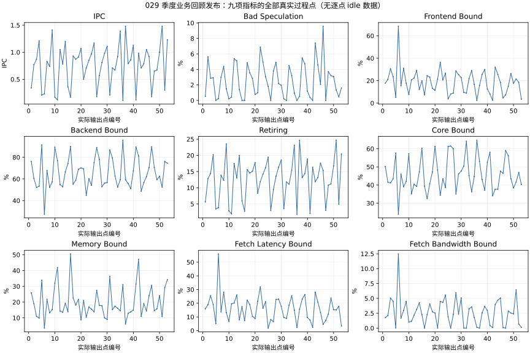

### 9.6 新任务内部同格式对照（补充）

| 任务 A | 任务 B | 共同 Top-10 | Jaccard | Bound 总变差 pp | 余弦（辅助） |
|---|---|---|---|---|---|
| 031 | 037 | 5 | 0.3333 | 1.510 | 0.999701 |
| 031 | pdfwf005 | 4 | 0.2500 | 5.850 | 0.997509 |
| 037 | pdfwf005 | 5 | 0.3333 | 6.020 | 0.997478 |
| 013 | 014 | 5 | 0.3333 | 3.420 | 0.998306 |
| 013 | 016 | 3 | 0.1765 | 9.115 | 0.988848 |
| 014 | 016 | 3 | 0.1765 | 5.695 | 0.995765 |
| 001 | 003 | 5 | 0.3333 | 1.305 | 0.999844 |
| 001 | 009 | 8 | 0.6667 | 5.845 | 0.996396 |
| 003 | 009 | 5 | 0.3333 | 4.710 | 0.997670 |
| 021 | 026 | 5 | 0.3333 | 3.205 | 0.998549 |
| 021 | 029 | 2 | 0.1111 | 5.480 | 0.995532 |
| 026 | 029 | 4 | 0.2500 | 2.275 | 0.999167 |

### 9.6A 完整函数清单的出现范围与周期分区

该补充统计以 OPM、TLC 各自完整已解析函数清单及其去重并集为参考，按库文件名＋完整物理叶函数名精确匹配。统计目标是新任务中哪些函数已由旧采样观察到；不限定旧前十，也不将旧清单未见项等同为新业务算法或新计算机制。

对每个新任务、每个参考范围：已见 period＋未见 period＋未解析 period＝新任务完整 ROI period。以下百分比的分母均为目标完整 ROI。OPM 与 TLC 出现集合有交集，不相加；OPM+TLC 使用去重并集。旧例中极低权重函数也算已见，故“路径出现过”不证明旧负载充分体现相同成本。

| 任务 | 参考清单 | 已见 period | 未见 period | 未解析 period | 已见 % | 未见 % | 未解析 % | 未见函数数 |
|---|---|---|---|---|---|---|---|---|
| 031 | OPM | 29907346184 | 9524036184 | 725948 | 75.845161 | 24.152998 | 0.001841 | 65 |
| 031 | TLC | 29697233693 | 9734148675 | 725948 | 75.312315 | 24.685844 | 0.001841 | 69 |
| 031 | OPM+TLC | 31209821314 | 8221561054 | 725948 | 79.148244 | 20.849915 | 0.001841 | 54 |
| 037 | OPM | 39988274916 | 16436518864 | 26135206 | 70.837231 | 29.116472 | 0.046297 | 138 |
| 037 | TLC | 37243110581 | 19181683199 | 26135206 | 65.974309 | 33.979393 | 0.046297 | 123 |
| 037 | OPM+TLC | 41079968555 | 15344825225 | 26135206 | 72.771112 | 27.182591 | 0.046297 | 105 |
| pdfwf005 | OPM | 17250417403 | 23199959632 | 72871142 | 42.569187 | 57.250987 | 0.179826 | 112 |
| pdfwf005 | TLC | 16302370738 | 24148006297 | 72871142 | 40.229674 | 59.590500 | 0.179826 | 103 |
| pdfwf005 | OPM+TLC | 18401972879 | 22048404156 | 72871142 | 45.410903 | 54.409272 | 0.179826 | 93 |
| 013 | OPM | 44964540185 | 43201536247 | 451232017 | 50.740133 | 48.750675 | 0.509192 | 528 |
| 013 | TLC | 50205824959 | 37960251473 | 451232017 | 56.654649 | 42.836159 | 0.509192 | 333 |
| 013 | OPM+TLC | 52424821064 | 35741255368 | 451232017 | 59.158670 | 40.332138 | 0.509192 | 315 |
| 014 | OPM | 32934592591 | 30123088683 | 431395318 | 51.874424 | 47.446097 | 0.679480 | 511 |
| 014 | TLC | 40165751851 | 22891929423 | 431395318 | 63.264035 | 36.056485 | 0.679480 | 322 |
| 014 | OPM+TLC | 42010681701 | 21046999573 | 431395318 | 66.169937 | 33.150584 | 0.679480 | 303 |
| 016 | OPM | 25824361613 | 49001827572 | 303889138 | 34.372867 | 65.222649 | 0.404484 | 678 |
| 016 | TLC | 40112955227 | 34713233958 | 303889138 | 53.391340 | 46.204176 | 0.404484 | 447 |
| 016 | OPM+TLC | 42260093003 | 32566096182 | 303889138 | 56.249233 | 43.346283 | 0.404484 | 428 |
| 001 | OPM | 35004349448 | 20359634756 | 1412488230 | 61.652914 | 35.859281 | 2.487806 | 237 |
| 001 | TLC | 39749635481 | 15614348723 | 1412488230 | 70.010752 | 27.501442 | 2.487806 | 171 |
| 001 | OPM+TLC | 40845325993 | 14518658211 | 1412488230 | 71.940584 | 25.571610 | 2.487806 | 158 |
| 003 | OPM | 30669300128 | 21052175771 | 1532136337 | 57.591023 | 39.531921 | 2.877056 | 210 |
| 003 | TLC | 35875694719 | 15845781180 | 1532136337 | 67.367627 | 29.755317 | 2.877056 | 152 |
| 003 | OPM+TLC | 36560345532 | 15161130367 | 1532136337 | 68.653269 | 28.469675 | 2.877056 | 142 |
| 009 | OPM | 39981575365 | 27846561388 | 1767157065 | 57.448677 | 40.012133 | 2.539190 | 271 |
| 009 | TLC | 43930071800 | 23898064953 | 1767157065 | 63.122187 | 34.338622 | 2.539190 | 216 |
| 009 | OPM+TLC | 45242799871 | 22585336882 | 1767157065 | 65.008419 | 32.452391 | 2.539190 | 201 |
| 021 | OPM | 42758646847 | 70614938794 | 2401668723 | 36.932458 | 60.993119 | 2.074423 | 705 |
| 021 | TLC | 27982652715 | 85390932926 | 2401668723 | 24.169805 | 73.755772 | 2.074423 | 532 |
| 021 | OPM+TLC | 53935080006 | 59438505635 | 2401668723 | 46.586017 | 51.339560 | 2.074423 | 497 |
| 026 | OPM | 34248357052 | 33840869975 | 2120158553 | 48.780312 | 48.199923 | 3.019765 | 585 |
| 026 | TLC | 18751954655 | 49337272372 | 2120158553 | 26.708615 | 70.271620 | 3.019765 | 418 |
| 026 | OPM+TLC | 41697987754 | 26391239273 | 2120158553 | 59.390903 | 37.589332 | 3.019765 | 396 |
| 029 | OPM | 14856789509 | 24026685300 | 642425826 | 37.587479 | 60.787192 | 1.625329 | 470 |
| 029 | TLC | 19169826407 | 19713648402 | 642425826 | 48.499404 | 49.875267 | 1.625329 | 320 |
| 029 | OPM+TLC | 21940646517 | 16942828292 | 642425826 | 55.509542 | 42.865129 | 1.625329 | 303 |

### 9.6B 旧两例均未见的主要具体函数

下表每项列旧 OPM／TLC 合并清单未见函数中的前十项，按目标完整 ROI period 排序；函数名称显示最多 180 字符，完整签名和 period 仍在 comparison.json 的函数列表及 function_presence 字段中。旧采样未见不证明永不执行；通用辅助路径、不同实现和具体对象操作分别解释。

**031 听证材料包扁平化发布：未见函数 54 个，合计 20.85%。**

| 函数 | 库文件名 | 目标 period | 完整 ROI 占比 |
|---|---|---|---|
| `png_write_find_filter` | libpng16.so.16.40.0 | 3421412927 | 8.68% |
| `term_rule` | libpython3.12.so.1.0 | 567246634 | 1.44% |
| `shift_expr_rule` | libpython3.12.so.1.0 | 428663053 | 1.09% |
| `expression_rule` | libpython3.12.so.1.0 | 370058830 | 0.94% |
| `tok_get_normal_mode` | libpython3.12.so.1.0 | 349607343 | 0.89% |
| `code_hash` | libpython3.12.so.1.0 | 323985885 | 0.82% |
| `cfg_to_instr_sequence.isra.0` | libpython3.12.so.1.0 | 303514806 | 0.77% |
| `sum_rule` | libpython3.12.so.1.0 | 294543029 | 0.75% |
| `bitwise_or_rule` | libpython3.12.so.1.0 | 169152987 | 0.43% |
| `bitwise_xor_rule` | libpython3.12.so.1.0 | 163140221 | 0.41% |

**037 公交绕行材料修复：未见函数 105 个，合计 27.18%。**

| 函数 | 库文件名 | 目标 period | 完整 ROI 占比 |
|---|---|---|---|
| `png_write_find_filter` | libpng16.so.16.40.0 | 5797867418 | 10.27% |
| `_PyPegen_expect_token` | libpython3.12.so.1.0 | 845923366 | 1.50% |
| `star_target_rule` | libpython3.12.so.1.0 | 832342895 | 1.47% |
| `astfold_expr` | libpython3.12.so.1.0 | 755634100 | 1.34% |
| `compiler_visit_expr1` | libpython3.12.so.1.0 | 570148750 | 1.01% |
| `tok_get_normal_mode` | libpython3.12.so.1.0 | 549244333 | 0.97% |
| `compiler_visit_stmt` | libpython3.12.so.1.0 | 486030611 | 0.86% |
| `atom_rule` | libpython3.12.so.1.0 | 438102907 | 0.78% |
| `shift_expr_rule` | libpython3.12.so.1.0 | 350756704 | 0.62% |
| `term_raw` | libpython3.12.so.1.0 | 348065234 | 0.62% |

**pdfwf005 结算材料包重建：未见函数 93 个，合计 54.41%。**

| 函数 | 库文件名 | 目标 period | 完整 ROI 占比 |
|---|---|---|---|
| `HorizontalFilter._omp_fn.0` | libMagickCore-7.Q16HDRI.so.10.0.2 | 5102262862 | 12.59% |
| `VerticalFilter._omp_fn.0` | libMagickCore-7.Q16HDRI.so.10.0.2 | 4645151623 | 11.46% |
| `png_write_find_filter` | libpng16.so.16.40.0 | 4283600071 | 10.57% |
| `instr_sequence_to_cfg` | libpython3.12.so.1.0 | 646473128 | 1.60% |
| `bitwise_xor_rule` | libpython3.12.so.1.0 | 511402065 | 1.26% |
| `png_read_filter_row_up` | libpng16.so.16.40.0 | 415887179 | 1.03% |
| `_PyPegen_fill_token` | libpython3.12.so.1.0 | 412862893 | 1.02% |
| `shift_expr_rule` | libpython3.12.so.1.0 | 406708457 | 1.00% |
| `ReadOnePNGImage` | png.so | 381398690 | 0.94% |
| `term_raw` | libpython3.12.so.1.0 | 352838622 | 0.87% |

**013 采购投标评审发布：未见函数 315 个，合计 40.33%。**

| 函数 | 库文件名 | 目标 period | 完整 ROI 占比 |
|---|---|---|---|
| `png_write_find_filter` | libpng16.so.16.40.0 | 7423314478 | 8.38% |
| `HorizontalFilter._omp_fn.0` | libMagickCore-7.Q16HDRI.so.10.0.2 | 7129663715 | 8.05% |
| `VerticalFilter._omp_fn.0` | libMagickCore-7.Q16HDRI.so.10.0.2 | 3118338666 | 3.52% |
| `pixman_composite_src_8888_8888_asm_neon` | libpixman-1.so.0.42.2 | 894731742 | 1.01% |
| `FcStrHashIgnoreCase` | libfontconfig.so.1.12.1 | 704536289 | 0.80% |
| `CompositeOverImage._omp_fn.0` | libMagickCore-7.Q16HDRI.so.10.0.2 | 684497496 | 0.77% |
| `rtl::uri::detail::readUcs4(char16_t const**, char16_t const*, bool, unsigned short, rtl::uri::detail::EscapeType*)` | libuno_sal.so.3 | 521699635 | 0.59% |
| `pixman_composite_src_n_8888_asm_neon` | libpixman-1.so.0.42.2 | 482064702 | 0.54% |
| `code_hash` | libpython3.12.so.1.0 | 472765708 | 0.53% |
| `SfxInterface::GetSlot(rtl::OUString const&) const` | libsfxlo.so | 404013552 | 0.46% |

**014 灾害补助公开发布：未见函数 303 个，合计 33.15%。**

| 函数 | 库文件名 | 目标 period | 完整 ROI 占比 |
|---|---|---|---|
| `png_write_find_filter` | libpng16.so.16.40.0 | 4808553703 | 7.57% |
| `s_mpv_mul_d_add_prop` | libfreeblpriv3.so | 1056881590 | 1.66% |
| `ScColumnData::GetMostUsedPattern(int, int) const` | libsclo.so | 679020089 | 1.07% |
| `pixman_composite_src_8888_8888_asm_neon` | libpixman-1.so.0.42.2 | 675512585 | 1.06% |
| `SplashXPathScanner::renderAALine(SplashBitmap*, int*, int*, int, bool) const` | libpoppler.so.133.0.0 | 665314676 | 1.05% |
| `_PyPegen_new_identifier` | libpython3.12.so.1.0 | 592821474 | 0.93% |
| `pixman_composite_src_n_8888_asm_neon` | libpixman-1.so.0.42.2 | 505070087 | 0.80% |
| `primary_raw` | libpython3.12.so.1.0 | 499088978 | 0.79% |
| `std::_Rb_tree<rtl::OUString, std::pair<rtl::OUString const, rtl::Reference<configmgr::Node> >, std::_Select1st<std::pair<rtl::OUString const, rtl::Reference<configmgr::Node> > >, …` | libconfigmgrlo.so | 474289921 | 0.75% |
| `std::_Hashtable<std::basic_string_view<char, std::char_traits<char> >, std::pair<std::basic_string_view<char, std::char_traits<char> > const, unsigned long>, std::allocator<std::p…` | liborcus-parser-0.20.so.0 | 397355800 | 0.63% |

**016 预测模型情景级联：未见函数 428 个，合计 43.35%。**

| 函数 | 库文件名 | 目标 period | 完整 ROI 占比 |
|---|---|---|---|
| `std::_Rb_tree<int, int, std::_Identity<int>, std::less<int>, std::allocator<int> >::_M_get_insert_unique_pos(int const&)` | libsclo.so | 2333994024 | 3.11% |
| `_PyPegen_fill_token` | libpython3.12.so.1.0 | 1553336085 | 2.07% |
| `pixman_composite_src_8888_8888_asm_neon` | libpixman-1.so.0.42.2 | 1284599382 | 1.71% |
| `png_write_find_filter` | libpng16.so.16.40.0 | 861639963 | 1.15% |
| `__mbsrtowcs_l` | libc.so.6 | 780592409 | 1.04% |
| `bitwise_xor_rule` | libpython3.12.so.1.0 | 656380887 | 0.87% |
| `shift_expr_rule` | libpython3.12.so.1.0 | 601845376 | 0.80% |
| `conjunction_rule` | libpython3.12.so.1.0 | 584054454 | 0.78% |
| `s_mpv_mul_d_add` | libfreeblpriv3.so | 565473814 | 0.75% |
| `t_primary_raw` | libpython3.12.so.1.0 | 526658889 | 0.70% |

**001 受控文档发布修复：未见函数 158 个，合计 25.57%。**

| 函数 | 库文件名 | 目标 period | 完整 ROI 占比 |
|---|---|---|---|
| `png_write_find_filter` | libpng16.so.16.40.0 | 3030752044 | 5.34% |
| `cppu::_copyConstructAnyFromData(_uno_Any*, void*, _typelib_TypeDescriptionReference*, _typelib_TypeDescription*, void (*)(void*), _uno_Mapping*)` | libuno_cppu.so.3 | 854286631 | 1.50% |
| `pixman_composite_src_8888_8888_asm_neon` | libpixman-1.so.0.42.2 | 798015082 | 1.41% |
| `s_mpv_mul_d_add_prop` | libfreeblpriv3.so | 438599142 | 0.77% |
| `code_hash` | libpython3.12.so.1.0 | 433364467 | 0.76% |
| `std::_Rb_tree<rtl::OUString, std::pair<rtl::OUString const, rtl::Reference<configmgr::Node> >, std::_Select1st<std::pair<rtl::OUString const, rtl::Reference<configmgr::Node> > >, …` | libconfigmgrlo.so | 417854267 | 0.74% |
| `pixman_composite_src_n_8888_asm_neon` | libpixman-1.so.0.42.2 | 388907942 | 0.68% |
| `FcConfigSubstituteWithPat` | libfontconfig.so.1.12.1 | 326298231 | 0.57% |
| `com::sun::star::lang::cppu_detail_getUnoType(com::sun::star::lang::XComponent const*) [clone .isra.0]` | libcomphelper.so | 286327881 | 0.50% |
| `term_raw` | libpython3.12.so.1.0 | 269746631 | 0.48% |

**003 公开记录元数据清理：未见函数 142 个，合计 28.47%。**

| 函数 | 库文件名 | 目标 period | 完整 ROI 占比 |
|---|---|---|---|
| `png_write_find_filter` | libpng16.so.16.40.0 | 4820020182 | 9.05% |
| `_PyUnicode_ToLowerFull` | libpython3.12.so.1.0 | 1181208257 | 2.22% |
| `do_upper_or_lower` | libpython3.12.so.1.0 | 940464371 | 1.77% |
| `(anonymous namespace)::InterfaceTypeDescription::~InterfaceTypeDescription()` | libuno_cppuhelpergcc3.so.3 | 525105853 | 0.99% |
| `s_mpv_mul_d_add_prop` | libfreeblpriv3.so | 490281519 | 0.92% |
| `pixman_composite_src_n_8888_asm_neon` | libpixman-1.so.0.42.2 | 429757719 | 0.81% |
| `_PyPegen_expect_token` | libpython3.12.so.1.0 | 392806016 | 0.74% |
| `bitwise_xor_rule` | libpython3.12.so.1.0 | 390545667 | 0.73% |
| `std::_Rb_tree<rtl::OUString, std::pair<rtl::OUString const, rtl::Reference<configmgr::Node> >, std::_Select1st<std::pair<rtl::OUString const, rtl::Reference<configmgr::Node> > >, …` | libconfigmgrlo.so | 362782754 | 0.68% |
| `xmlreader::XmlReader::scanName(char const**)` | libxmlreaderlo.so | 362034946 | 0.68% |

**009 事件手册发布：未见函数 201 个，合计 32.45%。**

| 函数 | 库文件名 | 目标 period | 完整 ROI 占比 |
|---|---|---|---|
| `png_write_find_filter` | libpng16.so.16.40.0 | 13221124244 | 19.00% |
| `pixman_composite_src_8888_8888_asm_neon` | libpixman-1.so.0.42.2 | 1064971704 | 1.53% |
| `unoidl::detail::UnoidlProvider::findEntity(rtl::OUString const&) const` | libunoidllo.so | 434952618 | 0.62% |
| `xmlStrEqual` | etree.cpython-312-aarch64-linux-gnu.so | 424283850 | 0.61% |
| `s_mpv_mul_d_add_prop` | libfreeblpriv3.so | 371459659 | 0.53% |
| `pixman_composite_src_n_8888_asm_neon` | libpixman-1.so.0.42.2 | 322445962 | 0.46% |
| `configmgr::ValueParser::endElement()` | libconfigmgrlo.so | 271490796 | 0.39% |
| `configmgr::GroupNode::GroupNode(configmgr::GroupNode const&, bool)` | libconfigmgrlo.so | 154408110 | 0.22% |
| `std::_Rb_tree<rtl::OUString, std::pair<rtl::OUString const, rtl::Reference<configmgr::Node> >, std::_Select1st<std::pair<rtl::OUString const, rtl::Reference<configmgr::Node> > >, …` | libconfigmgrlo.so | 149001943 | 0.21% |
| `rtl_string_assign` | libuno_sal.so.3 | 135824275 | 0.20% |

**021 庇护所无障碍整改：未见函数 497 个，合计 51.34%。**

| 函数 | 库文件名 | 目标 period | 完整 ROI 占比 |
|---|---|---|---|
| `VerticalFilter._omp_fn.0` | libMagickCore-7.Q16HDRI.so.10.0.2 | 8054283077 | 6.96% |
| `vcl::(anonymous namespace)::ImplScaleConvolutionVer(Bitmap const&, Bitmap&, double const&, vcl::Kernel const&)` | libvcllo.so | 4498309322 | 3.89% |
| `HorizontalFilter._omp_fn.0` | libMagickCore-7.Q16HDRI.so.10.0.2 | 3110449977 | 2.69% |
| `BitmapReadAccess::SetPixelForN24BitTcBgr(unsigned char*, long, BitmapColor const&)` | libvcllo.so | 1862579409 | 1.61% |
| `expandRow(unsigned char*, unsigned char*, int, int, int)` | libpoppler.so.133.0.0 | 1765066367 | 1.52% |
| `vcl::(anonymous namespace)::ImplScaleConvolutionHor(Bitmap const&, Bitmap&, double const&, vcl::Kernel const&)` | libvcllo.so | 1728129377 | 1.49% |
| `pixman_composite_src_8888_8888_asm_neon` | libpixman-1.so.0.42.2 | 1638241511 | 1.42% |
| `Splash::scaleImageYdownXdown(bool (*)(void*, unsigned char*, unsigned char*), void*, SplashColorMode, int, bool, int, int, int, int, SplashBitmap*)` | libpoppler.so.133.0.0 | 1584486401 | 1.37% |
| `decode_mcu_AC_refine` | libjpeg.so.62.4.0 | 1295515376 | 1.12% |
| `rgb_ycc_convert` | libjpeg.so.62.4.0 | 1123735968 | 0.97% |

**026 气候披露图表重建：未见函数 396 个，合计 37.59%。**

| 函数 | 库文件名 | 目标 period | 完整 ROI 占比 |
|---|---|---|---|
| `s_mpv_mul_d_add_prop` | libfreeblpriv3.so | 1026985354 | 1.46% |
| `pixman_composite_src_8888_8888_asm_neon` | libpixman-1.so.0.42.2 | 940457347 | 1.34% |
| `expandRow(unsigned char*, unsigned char*, int, int, int)` | libpoppler.so.133.0.0 | 905703410 | 1.29% |
| `SplashClip::testClipPaths(int, int)` | libpoppler.so.133.0.0 | 839534814 | 1.20% |
| `Splash::scaleImageYdownXdown(bool (*)(void*, unsigned char*, unsigned char*), void*, SplashColorMode, int, bool, int, int, int, int, SplashBitmap*)` | libpoppler.so.133.0.0 | 710605042 | 1.01% |
| `_PyPegen_singleton_seq.isra.0` | libpython3.12.so.1.0 | 623546364 | 0.89% |
| `void (anonymous namespace)::stackBlurVertical<(anonymous namespace)::SumFunction8>((anonymous namespace)::BlurSharedData const&, int, int)` | libvcllo.so | 615142019 | 0.88% |
| `jsimd_huff_encode_one_block_neon` | libjpeg.so.62.4.0 | 557913808 | 0.79% |
| `shift_expr_rule` | libpython3.12.so.1.0 | 544492462 | 0.78% |
| `SplashBitmap::getPixel(int, int, unsigned char*)` | libpoppler.so.133.0.0 | 527967918 | 0.75% |

**029 季度业务回顾发布：未见函数 303 个，合计 42.87%。**

| 函数 | 库文件名 | 目标 period | 完整 ROI 占比 |
|---|---|---|---|
| `oox::drawingml::table::applyTableStylePart(oox::core::XmlFilterBase const&, oox::drawingml::FillProperties&, oox::drawingml::TextCharacterProperties&, oox::drawingml::LineProperti…` | libooxlo.so | 788694859 | 2.00% |
| `oox::PropertyMap::fillSequences(com::sun::star::uno::Sequence<rtl::OUString>&, com::sun::star::uno::Sequence<com::sun::star::uno::Any>&) const` | libooxlo.so | 731549829 | 1.85% |
| `pixman_composite_src_8888_8888_asm_neon` | libpixman-1.so.0.42.2 | 659671424 | 1.67% |
| `std::__detail::_Prime_rehash_policy::_M_need_rehash(unsigned long, unsigned long, unsigned long) const` | libstdc++.so.6.0.30 | 579807158 | 1.47% |
| `pixman_composite_src_n_8888_asm_neon` | libpixman-1.so.0.42.2 | 499658661 | 1.26% |
| `s_mpv_mul_d_add_prop` | libfreeblpriv3.so | 456324822 | 1.15% |
| `void (anonymous namespace)::stackBlurVertical<(anonymous namespace)::SumFunction8>((anonymous namespace)::BlurSharedData const&, int, int)` | libvcllo.so | 302309086 | 0.76% |
| `bitwise_or_rule` | libpython3.12.so.1.0 | 294244957 | 0.74% |
| `std::_Rb_tree<rtl::OUString, std::pair<rtl::OUString const, rtl::Reference<configmgr::Node> >, std::_Select1st<std::pair<rtl::OUString const, rtl::Reference<configmgr::Node> > >, …` | libconfigmgrlo.so | 281849467 | 0.71% |
| `SfxItemPool::CheckItemInfoFlag(unsigned short, unsigned short) const` | libsvllo.so | 266149663 | 0.67% |

以上只新增既有数据的集合统计，没有重跑、导出或重新采样。原任务 profile、原基准函数权重、Topdown 指标及 533 个过程点保持原样。

### 9.7 来源与离线复算

- 原始基准：`analysis/hotspots/comparison-inputs-pdf5-20261027.json`。
- 原始统一环境 perf：`analysis/docops/raw/unified-symbol-check-20261103T1703Z/campaign.json`。
- 离线符号结果：`analysis/docops/raw/unified-symbol-check-20261103T1703Z/offline-symbol-enrichment-v1/enrichment.json`。
- 统一环境 DevKit：`analysis/docops/raw/unified-topdown-20261104-v1/campaign.json`。
- 本节机器结果：`analysis/docops/processed/task-operation-expansion-20261104/comparison.json`。

```bash
python3 -B analysis/docops/operation_comparison.py --update --publish
```

该命令只读取既有 JSON、日志与冻结 recipe，重建比较表、曲线及追加章节，不启动 workload、容器、perf、DevKit 或模型。

<!-- END DOCOPS TASK OPERATION EXTENSION -->
