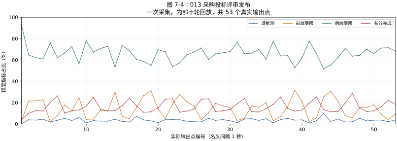
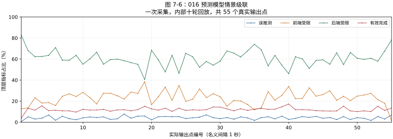
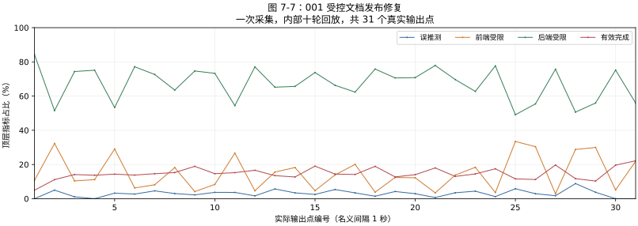

# 文档解析类 Agent 代表性评估报告

## 一、研究目标与关键发现

本评估考察：保留 PDF 批量表单处理和 XLSX 大型工作簿增强任务，更换真实业务输入后，原基准的主要 CPU 计算机制是否延续。进一步据此识别办公 Agent 尚未覆盖的操作类型，为 Word/PPT 场景选型提供依据。

| 关键发现 | 实测证据 | 含义 |
|---|---|---|
| PDF 的主要热点延续 | W-4／SBA 与 OPM 共享 9／7 个 Top-10 函数；三例合并 Top-5 共有 5 个函数 | 解释执行、压缩编码与图像处理路径共同出现 |
| XLSX 的主要热点延续 | HR Metro／eGRID／Industry 与 TLC 共享 8／9／8 个 Top-10 函数 | 对象管理、GC、XML 与工作簿处理机制延续 |
| 顶层流水线分配接近 | 五组 Bound 余弦 0.998858–0.999897 | 支持粗粒度分配形状接近，结合函数证据解释 |
| 固定环境下可重复 | 每例、每路各五次；XLSX IPC CV 0.44%–0.72%，Backend CV 0.23%–0.54% | 主要结果在同环境重复运行中保持接近 |

**主要判断：在本次任务形态和工具链下，跨业务领域输入没有明显改变主要原生热点集合。任务操作与软件执行路径，是解释 CPU 负载特征的重要线索。** 这里验证的是同类任务的跨领域代表性；整个办公 Agent 的场景覆盖还需要检验文档排版与幻灯片构建等不同操作。

本报告完整说明实验设计、测量与结论；逐轮数值、完整热点排名、采样点、命令和证据索引见[实验数据汇总记录](experimental-results.md)。

## 二、数据集选择与任务设计

选择同时考虑官方或公开可信来源、业务领域、工作簿规模和任务可执行性。XLSX 从交通扩展到电力能源、区域就业工资和产业生产率；PDF 从联邦雇佣申报扩展到税务预扣和小企业贷款申请。

| XLSX 数据集 | 领域与来源 | 冻结输入规模 | 任务 |
|---|---|---|---|
| TLC（原基准） | 交通出行；NYC TLC | 7 个工作表；主表 100,000 行 × 25 列，约 250 万单元格 | 真实出租车行程样本及分组汇总；新增运营 Summary、指标、情景和图表 |
| eGRID | 电力能源；美国 EPA | 11 个工作表；约 273 万非空单元格 | 机组、发电机、电厂与区域统计；新增能源业务 Summary |
| HR Metro | 就业与工资；美国 BLS OEWS | 4 个工作表；主表 150,023 条记录、32 列；约 421 万非空单元格 | 都会区／非都会区职业就业与工资统计；新增 Workforce Summary |
| Industry Productivity | 产业生产率；美国 BLS | 3 个工作表；长表约 56.7 万条记录、9 列；约 580 万非空单元格 | 年度宽表与机器可读长表，涵盖生产率、产出、工时、就业和劳动补偿；新增产业 Summary |

| PDF 数据集 | 领域与发布机构 | 冻结版本 | 页数／字段／批处理 |
|---|---|---|---|
| OPM OF-306（原基准） | 联邦雇佣申报；美国 OPM | 08/2023 | 3 页、38 个字段；10 条记录 |
| IRS W-4 | 员工税务预扣；美国 IRS | 2026 | 5 页、48 个字段；10 条记录 |
| SBA Form 1919 | 小企业贷款申请；美国 SBA | 04/2024 可填写版本 | 7 页、127 个字段；10 条记录 |

TLC 沿用基于真实行程记录构建的原业务工作簿；三个新增 XLSX 保留发布方原始工作簿。百万级单元格规模为解析、对象构建和保存提供实际工作量，既有业务指标用于新增 Summary、公式、情景和图表。PDF 使用公开可填写表单与十条虚构记录，覆盖不同页面和字段规模，统一执行字段映射、填写、渲染和验证。

来源依据包括 [TLC 行程数据](https://www.nyc.gov/site/tlc/about/tlc-trip-record-data.page)、[EPA eGRID](https://www.epa.gov/egrid/detailed-data)、[BLS OEWS](https://www.bls.gov/oes/tables.htm)、[BLS 生产率表](https://www.bls.gov/productivity/tables/home.htm)、[OPM OF-306](https://www.opm.gov/forms/pdf_fill/of0306.pdf)、[IRS W-4](https://www.irs.gov/forms-pubs/about-form-w-4) 和 [SBA 1919](https://www.sba.gov/document/sba-form-1919-borrower-information-form)。原始表数量、数据布局及表单页数差异保留；领域多样性用于检验任务机制的延续。

## 三、实验环境、轨迹来源与回放流程

### 3.1 硬件、软件与容器

| 项目 | 实际配置 |
|---|---|
| 处理器平台 | HiSilicon HIP09；MIDR `0x00000000480fd020`，主板 `BC83AMDAL-7270Z`；平台依据为 MIDR、板号及既有硬件核验记录 |
| CPU 拓扑 | aarch64；2 路 × 64 个物理核，每核 2 个硬件线程，共 256 个逻辑 CPU；4 个 NUMA 节点 |
| 频率记录 | lscpu 报告上限 2.9 GHz、下限 0.4 GHz，boost disabled；不将上限写成实测固定运行频率 |
| 宿主内核 | `6.6.0-28.0.0.34.oe2403.aarch64`；容器共享宿主内核 |
| 回放镜像 | `office-trace-replay:agent-traces`；实际 ID `sha256:4baef1363ba99a994e17e93fe6a32c904cdb5cb349487adfa2fb13ba42301499`；arm64 / openEuler 回放环境 |
| Python 与库 | Python 3.12.3；openpyxl 3.1.5、pypdf 6.10.0、pdf2image 1.17.0、pillow 12.2.0 |
| 文档工具 | LibreOffice 25.8.7.3；Poppler 23.12.0 |
| 采集工具 | 容器内 `perf version 6.6.0-145.3.23.154.oe2403sp3.aarch64`；DevKit 26.0.RC1，可执行文件按 SHA256 冻结 |
| CPU 布局 | 容器可用逻辑 CPU 0–9；workload 运行在 0–7，控制程序和身份监测在 9。编号是宿主逻辑 CPU，不是八个独占物理核 |
| 容器隔离与权限 | 每次采集新建容器，`--network none --cpuset-cpus 0-9 --cap-add PERFMON --security-opt seccomp=unconfined`；perf 采集容器另有 `SYS_PTRACE` |
| 挂载与入口 | 测量代码 `/measurement`、证据 `/evidence` 只读，结果 `/results` 可写；Topdown 另只读挂载 `/devkit`。ENTRYPOINT 为固定 venv Python；未挂载覆盖镜像内 workload 源码。运行容器根文件系统可写 |
| 容器启动的测量入口 | perf：`/measurement/collect_native.py --dataset <id> --output /results`；Topdown：`/measurement/capture.py --dataset <id> --output /results`。各入口再按下面的流程启动采集工具与实际回放 |

### 3.2 真实 Agent 轨迹来源

TLC／OPM 沿用原有任务与回放材料。五个新增用例由 OpenClaw Agent 实际执行；每例使用独立提示词，明确业务任务、输入、输出和验收要求。Agent 编写业务 helper 并调用 Skill，保存 trajectory、tool events、脚本修订、输入／提示词及运行环境绑定，选择成功轨迹用于回放。

| 新增用例 | 采用的成功轨迹 | Agent 业务脚本 |
|---|---|---|
| eGRID | `xlsx-egrid-20261027T032347Z-225eb8e9` | `helpers/enhance_energy_report_v2.py` |
| HR Metro | `xlsx-hr_metro-20261027T042913Z-2c0c625f` | `helpers/enhance_workforce_v2.py` |
| Industry Productivity | `xlsx-industry_productivity-20261027T015504Z-769d363e` | `helpers/enhance_workbook_v1.py` |
| IRS W-4 | `pdf-irs_w4-20261027T021455Z-c206db3d` | `build_field_values.py、run_batch.py` |
| SBA 1919 | `pdf-sba1919-20261027T021613Z-ccd6fc4e` | `build_field_values.py、run_batch.py` |

### 3.3 容器内轨迹回放

一个固定镜像支持七例：旧 OPM／TLC 使用 `document-oe/run.py`，新增五例由 `agent/replay.py` 调度私有 runner。每例独立保存输入、业务脚本、Skill、recipe 和 verifier。轨迹中的内联代码整理为独立脚本，回放执行冻结脚本与工具，不再调用模型。

| 阶段 | XLSX | PDF |
|---|---|---|
| P01 输入检查 | 结构、特征检查，读取原工作簿 | 可填写检查、字段抽取、模板渲染 |
| P02 业务内容 | 业务 helper 新增 Summary、公式、情景、图表并保存 | 业务 helper 生成十条记录的字段值 |
| P03 重算／批处理 | `recalc.py` → LibreOffice，公式／缓存检查，导出本轮 CSV | 逐记录填写、逐页渲染 |
| P04 验证与交付 | 指标、缓存、CSV 和交付物验证，生成摘要 | 填写字段、保护字段、PDF／PNG 与批次验证 |

每轮重建工作区。正式循环包含 reset、P01–P04 和循环内验证；归档、哈希及循环外独立审计位于循环外。旧 43 个 workload 文件保持冻结字节与权限。

## 四、采集方法与分析方法

### 4.1 两路独立采集

| 测量 | 实际对象 | 轮次与范围 | 汇总 |
|---|---|---|---|
| perf 热点 | 回放命令及其后代进程／线程 | 七例各五个独立容器；每次一轮，PDF 每轮 N=10；共 35 次 | 正式 ROI 原始 sample period 合并，再计算用户态周期占比 |
| DevKit Topdown | 宿主逻辑 CPU 0–7，按核计数 | 相同七例各五次，另行执行，共 35 次 | 每轮最终 ALL 报告 → 均值、样本标准差和 CV |

perf 采集命令在容器内执行，由它启动回放；没有 `-a`、`-C` 或 `-p`。CPU 0–7 是进程允许运行的位置，控制和身份监测在 CPU 9。DevKit 则明确按 CPU 0–7 统计，可能包含这些 CPU 上的其他宿主活动。

```bash
# 容器内：目标回放命令与后代任务；固定 venv Python 执行实际回放。
perf record -e cycles:u -F 49 -k mono --call-graph dwarf,16384 \
  -o /results/perf.data -- taskset -c 0-7 <回放命令>
perf script --no-inline --ns -F +pid -i /results/perf.data

# 容器内：控制器位于 CPU 9；对 CPU 0–7 计数。
stdbuf -oL -eL /devkit/devkit tuner top-down -c 0-7 -L 0 -i 1 -l 0
```

新用例的 `<回放命令>` 为固定 Python 执行 `agent/replay.py --dataset <id> --loops 1` 并传入结果目录和容器 inspect；旧用例由 `legacy_capture.py` 包装原入口记录相同循环边界。逐次实参见数据记录。

`cycles:u` 只覆盖目标任务用户态执行；以 CLOCK_MONOTONIC 的循环标记筛选 ROI，未知项保留在分母。同镜像导出物理栈，按物理叶函数独占计数并关联脚本和库。它描述采样周期分布，不直接等于总 CPU 时间。

DevKit 在首次完成 PMU 读取后放行循环，循环结束后 SIGINT 停止并取得 ALL。保留启动／停止包络，不将按核 PMU 百分比视为严格 ROI 过滤。`-i 1` 为名义一秒输出，`-l 0` 为 debug 日志；未显式指定 `-r`，采用工具默认权限范围。idle 由循环门控前后 `/proc/stat` 单独计算。

### 4.2 向量、函数集合与相似度

```text
v = [IPC, Bad Speculation, Frontend Bound, Backend Bound, Retiring,
     Core Bound, Memory Bound, Fetch Latency Bound, Fetch Bandwidth Bound, idle_pct]
```

每维取五轮最终结果的算术均值；IPC 无量纲，其余用 0–100 的百分数，不做标准化。均值 `μ=Σx/5`；样本标准差 `s=√(Σ(x−μ)²/4)`；`CV=100s/|μ|`。

| 比较量 | 输入与公式 | 解释 |
|---|---|---|
| Bound 余弦 | 只取四顶层 Bound：`(a·b)/(‖a‖‖b‖)` | 比较粗粒度分配形状，避免重复计入父子项 |
| 热点 Jaccard | 五轮 period 合并排序，取 Top-10「库类别＋物理叶函数」；`&#124;A∩B&#124;/&#124;A∪B&#124;` | 比较主要函数成员，权重不进入集合运算 |
| 原始欧氏距离 | 十维向量：`√Σ(aᵢ−bᵢ)²` | 含混合单位和父子层级，仅作辅助，不拼成总分 |

### 4.3 执行、采样与结果核验

每次要求请求／完成／成功／失败＝1／1／1／0、循环业务验证成功，并核对实际 Docker inspect、输入与 recipe 绑定。perf 栈与无栈导出逐样本交叉核验、ROI 内外 period 守恒；Topdown 校验顶层与子层分区，五轮统计从原始结果复算。丢样、未知符号和未计数事件保留记录，不补算缺失权重。43 个旧 workload、35 次各路采集、来源与报告哈希均有核验记录。SMT／事件复用语义待核验项与按核包络限制随数据记录保留。

## 五、实验结果与代表性分析

### 5.1 主要脚本、库与计算机制

下表按执行职责归并实际脚本。占比为完整 ROI 的已观测用户态 sample period；业务处理与检查／验证分列，避免把公共检查成本直接归为业务计算。

| PDF 职责／脚本 | OPM | IRS W-4 | SBA 1919 |
|---|---|---|---|
| 转换 `convert_pdf_to_images.py` | 38.85% | 44.17% | 44.92% |
| 填写 `fill_fillable_fields.py` | 38.44% | 36.41% | 29.00% |
| 渲染 `pdftoppm` | 8.03% | 6.89% | 14.57% |
| 验证 `verify_pdf_batch.py` | 12.26% | 12.40% | 10.64% |

| XLSX 职责／脚本 | TLC | HR Metro | eGRID | Industry Productivity |
|---|---|---|---|---|
| 输入检查 `inspect_xlsx_structure.py / inspect_xlsx_features.py` | 23.26% | 20.90% | 11.09% | 16.82% |
| 业务增强 `enhance_workbook.py / enhance_*_v*.py` | 22.01% | 25.30% | 25.59% | 20.52% |
| 重算 `recalc.py`，公式／缓存检查 `inspect_xlsx_*.py` | 27.83% | 35.09% | 45.85% | 42.84% |
| 循环验证 `verify_xlsx_enhanced.py` | 10.25% | 11.19% | 11.50% | 10.25% |
| 摘要／CSV `write_xlsx_summary.py / export_xlsx_csv.py` | 9.05% | 0.01% | 0.18% | 0.00% |
| LibreOffice 主进程 `soffice.bin` | 4.66% | 3.44% | 3.13% | 4.51% |

这些行为是完整工具 workload 的组成部分：PDF 验证占约 10%–12%，XLSX 验证占约 10%–12%，共同机制同时出现在业务 helper、检查、重算和验证。表中的 `recalc.py` 包含其 Python 缓存检查，`soffice.bin` 为单列的子进程，不能将两者脚本归属混成同一份周期。未归属线程与剩余小项在数据记录中单列。

| PDF 主要原生库 | OPM | IRS W-4 | SBA 1919 |
|---|---|---|---|
| libpython | 50.41% | 45.21% | 37.28% |
| zlib | 25.18% | 23.75% | 23.89% |
| Pillow | 14.61% | 21.71% | 21.22% |
| Poppler | 6.23% | 3.47% | 6.93% |
| FreeType | 1.02% | 2.25% | 6.27% |

| XLSX 主要原生库 | TLC | HR Metro | eGRID | Industry Productivity |
|---|---|---|---|---|
| libpython | 79.26% | 79.54% | 81.70% | 78.55% |
| LibreOffice | 6.43% | 6.44% | 4.91% | 8.41% |
| expat | 5.65% | 5.15% | 4.97% | 5.28% |
| ElementTree | 3.68% | 3.64% | 3.40% | 3.11% |
| zlib | 1.56% | 2.09% | 1.89% | 1.37% |

PDF 的主要机制为 Python 解释执行、zlib 压缩和 Pillow 图像处理，伴随 Poppler／FreeType 渲染。XLSX 以 libpython 为主，并持续出现 XML 解析和 LibreOffice 路径；这把函数重合与实际工具工作联系起来。

### 5.2 主要热点函数与跨领域重合

★ 为原基准 Top-10，按原排名列出；粗体为该函数在各例中的权重，✓ 表示仍进入该例 Top-10。新例额外进入 Top-10 的函数及完整排名保存在数据记录中。

| PDF 基准热点 | OPM | IRS W-4 | SBA 1919 |
|---|---|---|---|
| ★ 1 · `libpython / _PyEval_EvalFrameDefault` | **16.52% ✓** | **18.57% ✓** | **15.02% ✓** |
| ★ 2 · `zlib / longest_match` | **10.07% ✓** | **11.14% ✓** | **12.96% ✓** |
| ★ 3 · `zlib / deflate_slow` | **7.04% ✓** | **6.22% ✓** | **6.12% ✓** |
| ★ 4 · `Pillow / ImagingResampleHorizontal_8bpc` | **5.41% ✓** | **8.18% ✓** | **8.51% ✓** |
| ★ 5 · `Pillow / ImagingZipEncode` | **4.70% ✓** | **7.54% ✓** | **5.78% ✓** |
| ★ 6 · `libpython / deduce_unreachable` | **3.42% ✓** | **1.56% ✓** | **1.47%** |
| ★ 7 · `libpython / gc_collect_main` | **2.92% ✓** | **1.81% ✓** | **1.52%** |
| ★ 8 · `zlib / slide_hash` | **2.74% ✓** | **3.07% ✓** | **2.82% ✓** |
| ★ 9 · `Pillow / ImagingResampleVertical_8bpc` | **2.52% ✓** | **3.26% ✓** | **4.88% ✓** |
| ★ 10 · `zlib / inflate_fast` | **2.47% ✓** | **1.06%** | **0.46%** |

| XLSX 基准热点 | TLC | HR Metro | eGRID | Industry Productivity |
|---|---|---|---|---|
| ★ 1 · `libpython / _PyEval_EvalFrameDefault` | **23.65% ✓** | **21.97% ✓** | **22.80% ✓** | **21.57% ✓** |
| ★ 2 · `libpython / gc_collect_main` | **5.13% ✓** | **7.31% ✓** | **7.24% ✓** | **7.04% ✓** |
| ★ 3 · `libpython / subtype_traverse` | **3.90% ✓** | **4.84% ✓** | **5.09% ✓** | **4.27% ✓** |
| ★ 4 · `libpython / _Py_dict_lookup` | **3.57% ✓** | **4.77% ✓** | **4.97% ✓** | **4.80% ✓** |
| ★ 5 · `libpython / deduce_unreachable` | **3.23% ✓** | **4.30% ✓** | **4.43% ✓** | **4.10% ✓** |
| ★ 6 · `libpython / visit_reachable` | **2.97% ✓** | **3.33% ✓** | **3.38% ✓** | **3.16% ✓** |
| ★ 7 · `libpython / _PyObject_GenericGetAttrWithDict` | **2.04% ✓** | **1.27% ✓** | **1.35% ✓** | **1.50% ✓** |
| ★ 8 · `libpython / dictiter_iternextkey` | **1.92% ✓** | **0.78%** | **0.81%** | **0.74%** |
| ★ 9 · `libpython / tupledealloc` | **1.61% ✓** | **1.81% ✓** | **1.76% ✓** | **1.69% ✓** |
| ★ 10 · `libpython / PyObject_GC_Del` | **1.49% ✓** | **1.07%** | **1.15% ✓** | **1.02%** |

三种 PDF 五轮合并 Top-5 共有 5 个函数，对应解释器、zlib 匹配／编码和 Pillow 缩放／编码；各自 Top-5 累计 ROI 占比为 OPM 43.74%、IRS W-4 51.65%、SBA 1919 48.40%。XLSX 的共同函数包括解释器、字典查找、对象遍历、GC 和对象释放。这里的共同热点说明主要计算类型延续，允许各输入有不同排名和权重。

### 5.3 Topdown 特征与相似度

| 数据集 | IPC | Bad Spec. | Frontend | Backend | Retiring |
|---|---|---|---|---|---|
| OPM | 1.23 | 4.68% | 18.12% | 56.76% | 20.44% |
| IRS W-4 | 1.27 | 4.67% | 17.62% | 56.54% | 21.17% |
| SBA 1919 | 1.31 | 4.95% | 15.71% | 57.50% | 21.84% |
| TLC | 1.23 | 2.48% | 18.10% | 58.85% | 20.57% |
| HR Metro | 1.22 | 2.33% | 16.31% | 61.01% | 20.35% |
| eGRID | 1.25 | 2.15% | 15.61% | 61.45% | 20.78% |
| Industry Productivity | 1.23 | 2.18% | 16.80% | 60.46% | 20.55% |

| 基准 → 新输入 | Top-10 共同函数 | Jaccard | Bound 余弦 | 十维欧氏距离（辅助） |
|---|---|---|---|---|
| OPM → IRS W-4 | 9/10 | 0.8182 | 0.999897 | 1.457 |
| OPM → SBA 1919 | 7/10 | 0.5385 | 0.998987 | 4.040 |
| TLC → HR Metro | 8/10 | 0.6667 | 0.999314 | 3.852 |
| TLC → eGRID | 9/10 | 0.8182 | 0.998858 | 4.755 |
| TLC → Industry Productivity | 8/10 | 0.6667 | 0.999634 | 2.929 |

七例均以 Backend Bound 为最大的顶层分类；五组余弦接近 1，与主要热点的延续相互补充。Backend 是粗粒度分类，不能单独推出具体瓶颈一致，也不代表执行效率或 CPU 核秒相同。

### 5.4 逐采样点过程与五轮稳定性

下图每条线对应一个顶层指标，横轴为真实采样点；各轮按编号顺序串联展示，轮间留空、分别标注。保留初始与结束包络，不平滑、不补点。不同数据集耗时不同，横轴不用于强行对齐同一执行阶段。


每个点为原始 DevKit 编号报告，每条线为一个指标；横轴为五轮串联的采样点序号，轮间留空且不连线。名义间隔 1 秒，保留启动和停止包络，不平滑、不插值。


每个点为原始 DevKit 编号报告，每条线为一个指标；横轴为五轮串联的采样点序号，轮间留空且不连线。名义间隔 1 秒，保留启动和停止包络，不平滑、不插值。

| 数据集 | IPC CV | Backend CV | 五轮两两 Top-10 共同数 |
|---|---|---|---|
| OPM | 1.69% | 1.30% | 5–7/10 |
| IRS W-4 | 1.29% | 0.88% | 5–8/10 |
| SBA 1919 | 1.32% | 0.63% | 6–8/10 |
| TLC | 0.44% | 0.23% | 10–10/10 |
| HR Metro | 0.68% | 0.29% | 10–10/10 |
| eGRID | 0.72% | 0.54% | 8–9/10 |
| Industry Productivity | 0.68% | 0.39% | 9–10/10 |

XLSX 的主要特征与热点集合在固定环境重复运行中接近；PDF 单轮热点排名更易波动，五轮合并用于识别持续出现的主要函数。例如 OPM Fetch Bandwidth CV 为 12.36%，因此稳定性按指标分别描述。曲线展示轮内变化，均值和 CV 仍来自每轮 ALL；两者分别回答过程变化与重复波动。

## 六、已有实验的覆盖边界与 Word/PPT 扩展价值

### 6.1 已验证的范围与尚未覆盖的操作

| 场景 | 操作范围 | 已知或待测的机制 |
|---|---|---|
| PDF，已测 | 可填写表单的字段映射、填写、渲染和验证 | 已观察到 Python、压缩编码、图像处理、Poppler／字体路径 |
| XLSX，已测 | 百万级单元格工作簿检查、增强、保存、重算、验证 | 已观察到解释执行、对象管理、GC、XML、Calc 路径 |
| Word，待测 | 长文档结构编辑、样式与复杂表格、分页 | 待检验连续文本布局、字体度量、跨页布局的显著性 |
| PPT，待测 | 幻灯片构建、母版编辑、形状与图片布局 | 待检验演示对象构建、图形布局与渲染的显著性 |

现有结果支持两类已测任务的跨领域代表性，尚未覆盖完整 PDF／XLSX 任务空间。共同解释器和库函数可由业务处理及公共检查共同贡献，不能仅凭函数名称推断相同上层算法。当前统计以相对周期与流水线分配为主，绝对 CPU 工作量需要同一版本的 CPU-seconds 等补充；不混用旧版本账本。

前面的五组对照表明：沿用表单处理与工作簿增强任务时，跨领域输入仍持续进入解释器、对象管理、XML、压缩和渲染等共同路径。因此，继续只更换业务行业，未必能补充新的主要计算类型。下一步应扩展实际操作，重点考察当前较少涉及的连续文档排版和幻灯片图形布局。

### 6.2 为什么选择 Word/PPT

| 证据层次 | 来源与事实 | 对场景选择的意义 |
|---|---|---|
| 生态采用 | 2026-10-28 保存的 Skills.sh 快照：Anthropic DOCX 约 20.85 万、PPTX 约 24.38 万 Installs。[DOCX](https://www.skills.sh/anthropics/skills/docx)、[PPTX](https://www.skills.sh/anthropics/skills/pptx) | 说明相应工具能力有较多采用；Installs 不等于独立用户 |
| 产品落地 | 微软将 Word、PowerPoint 文件创建纳入 Copilot Agent。[产品说明](https://learn.microsoft.com/en-us/microsoft-365/copilot/wordexcelppt-agents) | 说明文字报告和演示材料属于实际产品任务 |
| 公开任务覆盖 | OmegaUse-OfficeVal 的 100 项任务按输出类型包含 Word 37 项、PowerPoint 39 项，另有 1 项 Word＋Excel 跨文件任务。[数据集](https://huggingface.co/datasets/baidu-frontier-research/OmegaUse-OfficeVal) | 提供具体可复现任务；任务集比例不推导市场使用比例 |
| 专项任务 | PPT-Eval 提供 120 个 PowerPoint 创建与编辑任务，覆盖 12 个文件。[项目页](https://microsoft.github.io/ppteval/) | 为幻灯片构建和编辑提供独立评测任务 |
| 跨格式操作 | DocOps 发布 210 项 Excel、Word、PowerPoint、PDF 文档操作任务。[官方仓库](https://github.com/icip-cas/DocOps) | 支持沿原生文档编辑与结果验证选取任务 |

### 6.3 新操作可能补足的 CPU 机制

| 操作 | 工具／软件模块 | 实际计算行为 | 后续关注的热点与指标 |
|---|---|---|---|
| Word 长文档创建、段落和样式修改 | DOCX Skill 的结构处理工具；LibreOffice Writer `sw` | 维护段落／表格结构；内容或样式变化后进行文本布局、字体度量、换行与分页 | 结构构建、布局／字体函数；CPU 核秒、内存、缓存和分支指标 |
| Word 复杂表格、页眉页脚与导出 | Writer 文档模型及布局；PDF 导出 | 计算连续文本流与跨页对象的位置，生成页面描述 | 排版与页面生成的 CPU 工作量、Frontend／Backend 分布 |
| PPT 模板编辑、幻灯片构建 | PPTX Skill；PptxGenJS／Node.js 或 OOXML 编辑；Impress `sd` | 组织幻灯片、母版、文本框、形状、图片及资源关系，计算对象布局 | 对象构建、运行时对象管理、图形／文本布局函数 |
| PPT 渲染与可见性检查 | Impress、Poppler、Pillow | 绘制文本和矢量形状、处理图片、生成缩略图 | 图形、字体、栅格化与图像处理热点，CPU 核秒与内存峰值 |

上述链路依据公开 [DOCX Skill](https://github.com/anthropics/skills/blob/main/skills/docx/SKILL.md)、[PPTX Skill](https://github.com/anthropics/skills/blob/main/skills/pptx/SKILL.md) 及 LibreOffice 的 [Writer](https://github.com/LibreOffice/core/blob/master/sw/README.md)、[Impress](https://github.com/LibreOffice/core/blob/master/sd/README.md)、[Calc](https://github.com/LibreOffice/core/blob/master/sc/README.md) 模块说明整理，是待测机制的选型依据。

同样调用 LibreOffice，Calc、Writer、Impress 进入的文档模型和布局路径不同；同样进入 Poppler，文本、矢量对象与图片的构成也可能改变字体与渲染计算。公共组件能够解释部分共同热点，却不能替代对这些操作的实测。

### 6.4 下一轮实验要回答的问题

选择长文档结构／样式编辑、分页与复杂表格，以及多页幻灯片构建／模板编辑／图形布局任务；由真实 Agent Skill 完成并冻结成功轨迹，在统一环境下回放。继续以 perf 识别主要函数与工具归属，以固定版本 DevKit 比较流水线特征，并增加同一版本的 CPU-seconds、任务时长、活跃核数和内存峰值。

下一轮重点检验：Writer／Impress 的布局、字体和图形路径是否成为显著热点；这些工作占多少绝对 CPU 工作量；共享压缩、XML 和渲染机制之外，是否出现 PDF 表单与 XLSX 增强尚未充分覆盖的主导机制。**已有七例用于验证跨领域输入下的机制延续，Word/PPT 用于扩展操作类型的覆盖。**

完整数据、逐次命令和核验材料：[实验数据汇总记录](experimental-results.md)。
<!-- BEGIN DOCOPS TASK OPERATION EXTENSION -->

## 七、扩展任务操作：与原始 PDF/XLSX 基准比较

前六节考察更换行业输入后的负载特征。本节进一步比较十二项 DocOps L3 任务，覆盖 PDF／Excel 的其他操作，以及新增的 Word／PPT 操作。
**主要发现：旧 OPM／TLC 已包含大量共同基础计算，优先增加 PPT 021，可补充幻灯片对象处理和联系表组合。** 7.1 说明样本与测量口径，7.2 介绍软件栈，7.3 分析函数覆盖及规模复测，7.4 比较原始新用例的 Topdown；7.5 给出补充建议，7.6 展示过程曲线。

### 7.1 样本、轨迹与测量口径

| 任务组 | 本次操作覆盖 | 主要对照 |
|---|---|---|
| PDF：031／037／pdfwf005 | 听证材料包发布、公交绕行材料修复、结算材料包重建 | 原始 PDF：OPM |
| Excel：013／014／016 | 投标评审发布、灾害补助公开发布、预测模型情景级联 | 原始 XLSX：TLC |
| Word：001／003／009 | 受控发布修复、元数据清理、事件手册发布 | OPM、TLC 均比较 |
| PPT：021／026／029 | 无障碍整改、图表重建、季度业务回顾发布 | OPM、TLC 均比较 |

十二项任务采用已保存 Agent 轨迹中的最终有效依赖链。各任务独立冻结脚本、输入、Skill 和命令；内联命令保留为任务私有步骤。回放不调用模型，保留最终构建、必要修补、重算、渲染及原有检查，公共入口负责调度、环境和归档。
来源中的官方内容判定为四项通过、八项未通过；本次十二项工具链回放及采集均完成。两类结果分别记录，逐项来源和判定见实验数据记录。

| 项目 | 原始 OPM／TLC | 新增 DocOps |
|---|---|---|
| 环境 | 原七例测量镜像；Python 3.12.3、LibreOffice 25.8.7.3 | 基于同一测量镜像；共用 Python、LibreOffice、Poppler 和 perf 版本，补充文档、幻灯片及图像处理依赖 |
| 重复与汇总 | 每路五次独立运行；热点合并周期权重，Topdown 取五次 ALL 均值 | 每项每路一次独立采集，内部十轮回放；热点按工作流周期权重，Topdown 取本次 ALL |
| 采集 | perf：cycles:u、49 Hz、DWARF；DevKit：CPU 0–7、1 秒间隔 | 沿用相同参数；两路分开运行，控制器 CPU 9 |
| 窗口 | 既有完整循环，包含 reset 和循环检查 | perf 为 workflow 步骤区间并集，排除准备、reset 和归档；Topdown 为按核采集包络 |

新任务每份采集中回放十轮，用于汇总热点与指标；独立采集次数为一次，重复运行波动另行评估。

### 7.2 软件分别做什么，哪些沿用、哪些扩展

**表 7-1：软件用途。** “脚本／工具”是直接调用的程序，“底层组件”是执行中消耗 CPU 的库。例如 python-docx 操作 Word，其周期可能落在 Python、XML 或压缩函数中；两层分别阅读。

| 软件／组件 | 一般用途 | 在本批任务中的位置 |
|---|---|---|
| Python | 执行脚本，创建和管理数据对象 | 原有与新增任务共同的运行环境 |
| openpyxl | 读取、修改、保存 Excel 工作簿 | 已有 Excel 读写工具，扩展任务继续使用 |
| python-docx／python-pptx | 创建和修改段落、表格、形状及幻灯片 | 为 Word／PPT 任务补充的直接操作库 |
| LibreOffice：Calc／Writer／Impress | 分别处理表格、文字文档和幻灯片；支持重算、排版与格式转换 | 沿用同一软件版本，任务进入不同文档模块 |
| Poppler／pdftoppm | 解析 PDF，将页面绘制为图片 | 原 PDF 已有；新任务的预览和渲染继续使用 |
| Pillow／ImageMagick | 图片转换、缩放、滤波和拼图 | Pillow 为原有工具；DocOps 补充 ImageMagick |
| ReportLab／fontTools | 分别用于生成 PDF、读取和处理字体 | DocOps 补充的任务依赖；安装存在不等于占主要热点 |
| zlib／PNG 编码库 | 压缩重复数据，编码并写出图片 | 部分新任务中成为主要 CPU 热点 |
| lxml／Expat／ElementTree | 读取和处理文档内部的 XML 结构 | 原 Excel 已有 XML 路径，DocOps 增加 lxml 依赖 |
| libc／loader | 基础内存、字符串等操作，以及装载程序依赖库 | 公共运行基础，不能仅由该库名判断具体文档业务 |

**表 7-2：原始任务作为对照。** OPM 代表 PDF 表单填写与检查，TLC 代表大型工作簿检查、增强、重算和缓存验证。下面的百分比为用户态 perf 采样周期占比，包含所有保留的工作流样本，不是任务墙钟时间。

| 原始基准 | 主要脚本／进程 | 主要底层组件及周期占比 |
|---|---|---|
| OPM | convert_pdf_to_images.py 38.85%; fill_fillable_fields.py 38.44%; verify_pdf_batch.py 12.26%; pdftoppm 8.03% | Python 50.41%; zlib 25.18%; Pillow 14.61%; Poppler 6.23% |
| TLC | enhance_workbook.py 22.01%; inspect_xlsx_structure.py 12.69%; recalc.py 11.60%; inspect_xlsx_features.py 10.57% | Python 79.26%; LibreOffice 6.43%; Expat 5.65%; ElementTree 3.68% |

**表 7-3：十二项新增任务实际执行什么。** 先看脚本链路，再看采样周期主要落在哪些底层软件；每行只列占比最高的四项组件，不要求四项合计为 100%。

| 格式／任务 | 实际脚本／工具链 | 主要底层组件及周期占比 |
|---|---|---|
| PDF／031 听证材料包扁平化发布 | build_public_packet.py；PDF 渲染；validate_public_packet.py | zlib 66.25%; Python 20.08%; PNG 8.68%; Poppler 2.56% |
| PDF／037 公交绕行材料修复 | build_bus_detour_packet.py；PDF 渲染；validate_bus_detour_packet.py | zlib 52.92%; Python 29.90%; PNG 10.27%; Poppler 4.61% |
| PDF／pdfwf005 结算材料包重建 | rebuild_closeout_binder.py；PDF 检查；图片／拼图／诊断 | Python 31.74%; ImageMagick 25.96%; zlib 23.67%; PNG 11.60% |
| Excel／013 采购投标评审发布 | build_public_bid_workbook.py；recalc.py；verify_public_bid_workbook.py；PDF／拼图 | zlib 31.66%; Python 19.77%; ImageMagick 13.43%; LibreOffice 10.20% |
| Excel／014 灾害补助公开发布 | build_disaster_release_v1.py；recalc.py；finalize_disaster_release_ooxml_v3.py；validate_disaster_release_v1.py／渲染 | zlib 30.54%; Python 25.49%; LibreOffice 17.51%; PNG 7.57% |
| Excel／016 预测模型情景级联 | build_forecast_dashboard_v1.py；recalc.py；测试副本切换情景并重算 | Python 47.65%; LibreOffice 27.74%; libc 8.81%; loader 3.62% |
| Word／001 受控文档发布修复 | create_packet.py；render_docx.py；结构与渲染检查 | zlib 44.27%; Python 18.74%; LibreOffice 11.65%; libc 7.16% |
| Word／003 公开记录元数据清理 | build_public_packet.py；audit_public_packet.py；render_docx.py | zlib 44.62%; Python 14.91%; LibreOffice 14.23%; PNG 9.05% |
| Word／009 事件手册发布 | build_incident_manual_publication.py；render_docx.py；validate_incident_manual_publication.py | zlib 44.39%; PNG 19.00%; LibreOffice 9.11%; Python 8.86% |
| PPT／021 庇护所无障碍整改 | build_public_shelter_briefing.py；validate_public_shelter_briefing.py；soffice.py／图片／拼图 | Poppler 27.74%; LibreOffice 24.32%; Python 15.95%; ImageMagick 10.59% |
| PPT／026 气候披露图表重建 | build_climate_disclosure.py；转 PDF／图片；qa_climate_disclosure.py | Poppler 36.90%; Python 20.97%; LibreOffice 19.20%; libc 6.60% |
| PPT／029 季度业务回顾发布 | build_release_deck.py；validate_release_deck.py；转 PDF／图片 | Python 36.96%; LibreOffice 32.15%; libc 7.61%; Poppler 5.08% |

**本节总结：**

- **共同基础仍然保留。** Python、LibreOffice、Poppler、压缩和图像处理继续构成主要工具链。
- **扩展了文档操作工具和模块。** 新增 python-docx、python-pptx、lxml、ImageMagick 等依赖，并执行 Writer、Impress 和幻灯片对象处理路径。
- **已有软件也会承担不同的工作。** 同样调用 LibreOffice 或 Poppler，实际可能是表格重算、文档转 PDF 或页面绘图，热点权重不会天然相同。

### 7.3 旧用例覆盖了多少：规模复测与函数／操作两种判断

**要区分操作与具体函数。** 旧 OPM／TLC 已包含多类共同计算。以下先检查十二项原始任务的函数匹配，再扩大输入规模，区分已有操作的实现差异与值得补充的操作。

#### 7.3.1 原始任务初测：函数未匹配，不一定是操作未覆盖

旧 OPM 在 PDF 表单填写字段，生成页面图片并缩放、检查；旧 TLC 对大型工作簿检查、增强、保存、重算及核验缓存／CSV。它们已包含解释执行、对象管理、XML 解析、压缩／解压、图片缩放和页面渲染。

**表 7-4：十二项原始任务对旧 OPM＋TLC 的函数覆盖。** 合并旧两例完整已解析函数清单，按“库文件名＋完整物理叶函数名”精确匹配，包含旧清单低频函数。分母为目标 workflow ROI 的用户态 `cycles:u` 样本 period；三部分合计约 100%，不是函数个数或总 CPU 时间比例。未解析权重单列。

| 任务 | 旧清单已见函数权重 | 已解析但旧清单未见 | 未解析 |
|---|---|---|---|
| PDF 031 | 79.15% | 20.85% | <0.01% |
| PDF 037 | 72.77% | 27.18% | 0.05% |
| PDF pdfwf005 | 45.41% | 54.41% | 0.18% |
| Excel 013 | 59.16% | 40.33% | 0.51% |
| Excel 014 | 66.17% | 33.15% | 0.68% |
| Excel 016 | 56.25% | 43.35% | 0.40% |
| Word 001 | 71.94% | 25.57% | 2.49% |
| Word 003 | 68.65% | 28.47% | 2.88% |
| Word 009 | 65.01% | 32.45% | 2.54% |
| PPT 021 | 46.59% | 51.34% | 2.07% |
| PPT 026 | 59.39% | 37.59% | 3.02% |
| PPT 029 | 55.51% | 42.87% | 1.63% |

这里比较**具体函数身份**。例如旧例用 Pillow、新例用 ImageMagick 缩放图片，函数不同，操作仍属于图片缩放。

#### 7.3.2 扩大规模复测：十二组原始→小档→大档

小输入也需要启动解释器、解析脚本、初始化组件和检查结果，这些开销可能更显眼。为检验这一猜想，将全部十二项任务分别扩为小、大两档，共 24 个合成规模变体；按扩大后的实际记录、单元或页面重新构建和处理，不以重复同一轮运行代替输入扩充。

**表 7-4A：全部规模复测结果。** 原始、小档和大档的“覆盖”均沿用上表的精确函数匹配口径；右两列说明大档剩余差额。各变体 ID 和完整规模声明见统一分析记录。

| 任务 | 原始已见 | 小档规模／已见 | 大档规模／已见 | 大档已解析未见 | 大档未解析 |
|---|---|---|---|---|---|
| PDF 031 | 79.15% | 5组，25页／89.29% | 20组，100页／86.49% | 13.51% | <0.01% |
| PDF 037 | 72.77% | 5组，25页／83.39% | 20组，100页／86.72% | 13.28% | <0.01% |
| PDF pdfwf005 | 45.41% | 5组，30输出页／45.99% | 20组，120输出页／48.94% | 50.64% | 0.43% |
| Excel 013 | 59.16% | 100供应商／68.80% | 1000供应商／93.25% | 6.73% | 0.02% |
| Excel 014 | 66.17% | 1000有效申请／88.01% | 10000有效申请／91.82% | 7.12% | 1.05% |
| Excel 016 | 56.25% | 100业务单元，400模型行／72.39% | 500业务单元，2000模型行／80.03% | 19.42% | 0.55% |
| Word 001 | 71.94% | 100条记录／71.07% | 500条记录／75.56% | 21.04% | 3.40% |
| Word 003 | 68.65% | 100业务单元／74.59% | 500业务单元／71.58% | 26.94% | 1.48% |
| Word 009 | 65.01% | 100事件／68.02% | 500事件／71.59% | 24.95% | 3.46% |
| PPT 021 | 46.59% | 5地区，40页／49.65% | 10地区，80页／50.44% | 47.45% | 2.11% |
| PPT 026 | 59.39% | 5业务单元，45页／65.01% | 10业务单元，90页／63.00% | 35.13% | 1.87% |
| PPT 029 | 55.51% | 5业务单元，41页／59.74% | 10业务单元，81页／46.29% | 46.86% | 6.84% |

**复测结果：**

1. **多数任务扩大后，旧函数覆盖权重提高。** 11/12 组的大档高于原始任务；014、031、037 分别达到 91.82%、86.49%、86.72%。共同的页面处理、压缩等工作更突出，与部分启动和辅助开销被摊薄的解释一致。
2. **013 的提高主要伴随 Python 构建权重增长。** 013-v1000 覆盖 93.25%，Python 库约 85.9%、构建脚本约 87.5%，解释器主循环函数约 51.1%。构建器反复遍历纠错清单、按供应商扫描评分记录，遍历次数可能随规模呈平方量级增长。这解释了通用 Python 函数变重的可能原因，具体行级耗时需单独测量。
3. **扩大后仍有明显的工具差额。** pdfwf005 大档匹配 48.94%；PPT 021／026／029 分别为 50.44%／63.00%／46.29%。003、026、029、031 的大档低于小档，说明扩大输入不一定使热点更接近旧例。

规模变体按实际记录、单元或页面重新处理，同时完成脚本参数化和检查修复；包括 XML 校验、目录页码、异常表与情景核验等。016／029 继续只渲染首页，其余按各自规则渲染。各规模每种模式采集一次，003-u100 与 037-u5 各含三轮，其余一轮；详细变更见统一分析记录。

#### 7.3.3 剩余热点是什么：区分实现差异与新增操作

**表 7-5：扩大后仍可见的具体函数／工具差额，以及按操作类型的解释。** 单函数与工具内全部未匹配函数合计分别标明，均以所在任务完整 ROI 为分母。

| 函数／软件路径 | 代表性实测未匹配权重 | 对应什么工作 | 按操作口径如何判断 |
|---|---|---|---|
| `png_write_find_filter`／libpng | 003-u500 单函数 22.10%；037-u20 11.22%；014-n10000 4.12% | 生成 PNG 预览时选择行滤波方式，以利压缩 | 旧例已有图片输出与编码：视为已有操作的不同实现，不为这一个函数单独新增用例 |
| `HorizontalFilter`／`VerticalFilter`、ImageMagick 像素处理 | pdfwf005-u20 工具合计 33.11%；021-g10 11.51% | 缩略图缩放、滤波，以及联系表制作中的像素处理 | 单纯缩放与旧 Pillow 操作同类，算已有覆盖；多图排列、合成联系表另列为补充操作，不能把整库权重都算成拼图 |
| JPEG、VCL 位图处理与 Poppler 页面绘制 | 021-g10 未匹配合计：JPEG 7.45%、VCL 8.98%、Poppler 7.92% | 图片读写、位图缩放与 PDF 页面生成像素 | 旧例已有图片处理、转换与渲染；工具或内部子路径不同，不自动判为新增操作 |
| Calc 公式树、计算配置与单元格属性路径 | 016-u500 明确 Calc 未匹配函数合计 6.80% | 管理公式树、计算配置、单元格与属性 | 旧 TLC 已有工作簿处理和重算；按操作算已有覆盖，具体函数目标下才需补齐这些子路径 |
| DrawingML／幻灯片对象样式，例如 `applyTableStylePart` | 原始 029 明确 OOXML 路径合计 4.88%，其中表格样式函数约 2.00% | 组织幻灯片形状、文本、表格、样式与对象属性 | 与旧 PDF 表单／XLSX 单元格的对象模型不同，适合作为补充的幻灯片对象操作 |
| Writer 文字／页面对象与属性路径 | 009-u500 明确 Writer 未匹配函数合计 5.40% | Word 文档中的文字、页面对象及属性处理 | 保留为独立文档模型的扩展证据；若进一步研究 Word 布局应另行选型，不宣称一个 PPT 用例能覆盖它 |
| Python 正则／字符串搜索与 Office 公共框架 | 003-u500 `ucs2lib__two_way` 单函数约 2.43%，其中校验脚本约 2.42% | 检查残留文字、执行脚本、查找属性或管理公共对象 | 统计保留，解释为相应处理／检查差异，不仅凭未匹配就称为新的文档编辑机制 |

**操作差额集中在对象组织与多图组合。** 缩放、编码、渲染和重算在旧例中已有；换库或进入不同内部函数，属于实现差异。联系表把多页缩略图排列、合成为一张图，PPT 则引入幻灯片对象及样式处理。联系表内部也包含旧例已有的缩放和编码，因此其全部周期中只有一部分属于组合操作。

具体函数按 Calc、Writer、幻灯片对象、图像编码和文本样式细分归属；公共 UNO／C++ 框架另列。

#### 7.3.4 两种补充方案：函数身份与操作类型分别选择

**表 7-5A：在旧 OPM＋TLC 基础上，按不同目标补充用例。** 两行回答的问题不同，不互相替代。

| 判断口径 | 具体目标 | 补充哪些用例 | 如何理解 |
|---|---|---|---|
| 函数覆盖 | 扩展图像处理、页面绘制、Calc 计算和幻灯片对象／样式等具体热点路径 | 013、016、021、026、029：五个原始用例 | 根据规模复测定位的工具路径选择原始任务，扩展具体函数的观测范围 |
| 操作覆盖 | 已有缩放、编码、渲染和重算，即使换工具或内部函数，仍视为已有操作；优先补充此前没有直接体现的操作类型 | 优先一个用例：021；029 为可选强化项 | 021 同时包含幻灯片对象／样式处理和多页联系表组合。是精简扩展建议，不宣称覆盖所有 Word／PPT 操作 |

**函数方案：** 规模复测定位的主要工具路径涉及 013、016、021、026、029 五类任务，据此推荐这五个原始用例。复测中至少一次达到 0.5% ROI 的 49 个显著函数目标及精确组合保留在数据记录；五个原始用例用于扩展热点路径，不等同于该精确组合。

**操作方案：** 021 处理幻灯片的形状、文本、表格、备注和样式，将 8 页预览组合为一张联系表。它同时补充幻灯片对象处理和多图组合；029 可进一步突出表格样式，已有 `applyTableStylePart` 热点依据。

**两种方案的区别：** 操作方案选择典型处理类型，函数方案扩展具体工具与内部函数路径；覆盖百分比始终按精确函数匹配计算。

#### 7.3.5 小结

旧例可继续作为共同计算基础；优先增加 021 补充典型操作，需要扩展具体函数路径时增加 013、016、021、026、029 五个原始用例。

[十二组统一分析](../analysis/docops/processed/unified-scaling-final-20261108/analysis.md)保留全部 36 配置、具体函数／脚本归属及变更记录；[函数选择结果](../analysis/docops/processed/unified-scaling-final-20261108/selection.json)保留 49 个目标、候选组合和删例检查。

### 7.4 Topdown 相似性：用余弦与欧氏距离比较瓶颈分布

**本节比较十二项原始新用例与旧例的 CPU 瓶颈分布。** 采用七维、不重复计权的分区，用余弦观察整体形状，用欧氏距离衡量占比差异。规模变体用于 7.3 的覆盖复测。

**表 7-6：七维指标及其读法。** 向量固定为 `[Retiring, Branch Mispredicts, Machine Clears, Fetch Latency, Fetch Bandwidth, Core Bound, Memory Bound]`。七项合计约 100%；父项 Bad Speculation、Frontend、Backend 已被下面子项替换，不再重复加入向量。

| 指标组 | 实际进入比较的指标 | 看什么 |
|---|---|---|
| 有效工作 | Retiring（有效完成） | 正常完成指令的流水线份额 |
| 无效执行 | Branch Mispredicts（分支误判）＋Machine Clears（流水线清空） | 误推测的具体构成 |
| 指令供应 | Fetch Latency＋Fetch Bandwidth（前端延迟／带宽受限） | 前端供应问题偏延迟还是吞吐 |
| 执行与数据供应 | Core Bound＋Memory Bound（核心执行／存储受限） | 后端更偏执行资源还是缓存／内存供数 |

**怎么算：** 对旧例向量 A、新例向量 B，同时计算以下两项。所有输入均按百分数记为 0–100，不混入不同单位，不额外标准化。IPC 单独列相对变化，idle 不加入距离。

| 指标 | 公式（i 遍历七项） | 读法 |
|---|---|---|
| 七维余弦相似度 | `cos(A,B) = Σ(AᵢBᵢ) / [√ΣAᵢ² × √ΣBᵢ²]` | 越接近 1，整体分布形状越接近 |
| 七维欧氏距离 | `d(A,B) = √Σ(Aᵢ−Bᵢ)²` | 越小，各项占比差异越小；坐标单位为百分点（pp） |

**简单例子：** A=`[20,4,1,15,5,45,10]`，B=`[20,4,1,10,5,50,10]`；前端延迟减少 5 pp、Core 增加 5 pp。余弦为 **0.9933**，欧氏距离为 **√(5²＋5²)=7.07**。余弦反映整体接近，距离进一步揭示具体变化量。

**比较参照：** 旧 OPM／TLC 各五次独立采集，逐项求均值后比较。两例均值的余弦为 **0.9962**，欧氏距离为 **4.77**。每个新用例分别与两例计算，表中展示欧氏距离较近的一路；完整记录保留两路结果。本批以 4.77 为参考：范围内称为“相对接近”，超出则继续查看分项差异。该参照用于描述结果，不是统计检验阈值。

**表 7-7：十二项新用例与旧 OPM／TLC 的七维比较。** 余弦越大越近，欧氏距离越小越近；每行的余弦、距离及 IPC 均使用同一对照。基准按瓶颈分布选择，可跨文件格式。

| 新用例 | 较近旧例 | 七维余弦 ↑ | 七维欧氏距离 ↓ | 分区判断 | IPC 变化 |
|---|---|---|---|---|---|
| PDF 031 | OPM | 0.9784 | 13.39 | 超出旧尺度 | -13.5% |
| PDF 037 | TLC | 0.9817 | 12.38 | 超出旧尺度 | -19.8% |
| PDF pdfwf005 | OPM | 0.9904 | 8.11 | 超出旧尺度 | -8.6% |
| Excel 013 | TLC | 0.9916 | 7.30 | 超出旧尺度 | -23.0% |
| Excel 014 | TLC | 0.9884 | 8.18 | 超出旧尺度 | -31.9% |
| Excel 016 | TLC | 0.9772 | 11.41 | 超出旧尺度 | -41.7% |
| Word 001 | TLC | 0.9874 | 8.84 | 超出旧尺度 | -27.9% |
| Word 003 | TLC | 0.9911 | 7.77 | 超出旧尺度 | -23.8% |
| Word 009 | TLC | 0.9981 | 3.40 | 旧尺度内／相对接近 | -12.5% |
| PPT 021 | TLC | 0.9968 | 4.91 | 超出旧尺度 | -6.8% |
| PPT 026 | TLC | 0.9972 | 4.04 | 旧尺度内／相对接近 | -17.3% |
| PPT 029 | TLC | 0.9930 | 6.35 | 超出旧尺度 | -26.3% |

**表 7-8：每项新用例相对较近旧例，差异最大的三项。** 正号表示新例份额更高，负号更低；用于解释上表差异来自哪里，不是额外的相似度评分。

| 新用例 | 对照旧例 | 差异最大的三项（pp） |
|---|---|---|
| 031 | OPM | 核心执行受限 +8.72；前端延迟 -8.14；存储受限 +5.00 |
| 037 | TLC | 核心执行受限 +9.32；前端延迟 -6.47；有效完成 -4.08 |
| pdfwf005 | OPM | 前端延迟 -5.61；核心执行受限 +4.12；存储受限 +3.75 |
| 013 | TLC | 有效完成 -4.69；核心执行受限 +3.75；存储受限 +3.06 |
| 014 | TLC | 有效完成 -6.53；存储受限 +4.68；分支误判 +1.19 |
| 016 | TLC | 有效完成 -8.50；前端延迟 +5.37；存储受限 +4.25 |
| 001 | TLC | 有效完成 -5.66；存储受限 +4.99；核心执行受限 +3.35 |
| 003 | TLC | 核心执行受限 +4.99；有效完成 -4.84；前端延迟 -2.61 |
| 009 | TLC | 有效完成 -2.58；核心执行受限 +1.84；存储受限 +0.82 |
| 021 | TLC | 核心执行受限 +4.08；前端延迟 -2.14；有效完成 -1.42 |
| 026 | TLC | 有效完成 -3.58；存储受限 +1.30；核心执行受限 +0.89 |
| 029 | TLC | 有效完成 -5.36；存储受限 +2.29；前端延迟 +2.07 |

**本节结论：哪些接近，哪些存在差异？**

1. **009、026 相对接近旧例。** 对 TLC 的余弦分别为 0.9981／0.9972，距离为 3.40／4.04，均在 4.77 的参照范围内。
2. **021 接近参照边界，031、037、016 差异较大。** 021 的距离为 4.91；后三者分别为 13.39、12.38、11.41。其变化主要落在有效完成、前端供应以及核心／存储受限份额，见表 7-8。
3. **共同函数不等于相同瓶颈权重。** 例如 013 余弦为 0.9916，距离仍为 7.30。旧例提供共同计算基础，补充任务则能体现不同的 CPU 分配；用例建议见 7.5。

**统计口径：** 取 DevKit 最终 Report-ALL；旧例为五次采集均值，新例各采集一次、内部回放十轮。Topdown 是 CPU 0–7 的采集包络，包含步间间隙及可能的同核宿主活动。旧例各次到自身均值的最大距离为 OPM 1.89／TLC 0.55；本批十二项均高于对应旧例的重复波动范围。未计数标记及公式核验结果保留在完整记录。

[完整七维数据与对照](../analysis/docops/processed/topdown-original-cosine-euclidean-20261108/analysis.md)保留全部原值、24 组新旧配对、余弦、欧氏距离、IPC 及质量核验；[机器结果](../analysis/docops/processed/topdown-original-cosine-euclidean-20261108/comparison.json)按原始日志行号与 SHA256 追溯。

### 7.5 结论：建议增加哪些用例

**建议保留旧 OPM／TLC，优先增加 PPT 021。** 旧两例已包含文档读写、结构解析、压缩／解压、图片缩放、页面渲染和表格重算；021 补充幻灯片对象处理与多页联系表组合。

1. **优先增加 021（庇护所无障碍整改）。** 处理幻灯片形状、文本、表格、备注和样式，并生成页面预览和联系表；一个用例同时补充对象处理和多图组合两类操作。
2. **需要突出幻灯片表格样式时，再增加 029（季度业务回顾发布）。** 已观察到 DrawingML 表格样式函数，可作为 PPT 样式处理的强化项。
3. **若希望扩展具体函数热点，增加五个原始用例：`013、016、021、026、029`。** 分别补充工作簿预览发布、Calc 计算、幻灯片对象、页面绘制和表格样式等路径；选型依据见 7.3.4。

按典型操作扩展，先采用 **“OPM＋TLC＋021”**；按具体函数扩展，采用五个原始用例。

### 7.6 十二项任务的逐点曲线与读图说明

以下按 PDF、Excel、Word、PPT 展示十二项原始新用例，共 533 个实际过程点。每图四条线分别表示误推测、前端受限、后端受限和有效完成；横轴为输出点编号，纵轴为百分比，名义间隔 1 秒。
每张图来自一次采集、内部十轮回放，用于观察过程变化；7.4 的相似性取最终累计指标。图中过程点尚未逐一对应到具体步骤。

#### 图 7-1：PDF／031 听证材料包扁平化发布——四项 Topdown 过程


**读图：** 后端受限占比较高；相对 OPM 的汇总变化为前端降低、后端增加。热点同时显示压缩占比突出。 本图共 21 个真实输出点。

#### 图 7-2：PDF／037 公交绕行材料修复——四项 Topdown 过程


**读图：** 后端受限是主要份额，与 031 的汇总特征接近；压缩与 PNG 编码是主要函数热点。 本图共 26 个真实输出点。

#### 图 7-3：PDF／pdfwf005 结算材料包重建——四项 Topdown 过程


**读图：** 本项加入材料包重建与拼图，热点中出现 ImageMagick 图像滤波；结合曲线观察其流水线分配。 本图共 20 个真实输出点。

#### 图 7-4：Excel／013 采购投标评审发布——四项 Topdown 过程



**读图：** 本项同时执行工作簿处理和 PDF／图片交付；结合压缩、图像与 Calc 热点阅读这些过程点。 本图共 53 个真实输出点。

#### 图 7-5：Excel／014 灾害补助公开发布——四项 Topdown 过程


**读图：** 本项包含工作簿重算、OOXML 修补及渲染；最终指标取整段累计，曲线用于显示过程变化。 本图共 43 个真实输出点。

#### 图 7-6：Excel／016 预测模型情景级联——四项 Topdown 过程



**读图：** 汇总前端受限高于 TLC，IPC 低于 TLC；函数中可见 Python 对象处理与 Calc 路径。 本图共 55 个真实输出点。

#### 图 7-7：Word／001 受控文档发布修复——四项 Topdown 过程



**读图：** 本项执行 Word 构建、转换和检查；本次主要函数热点集中在压缩。 本图共 31 个真实输出点。

#### 图 7-8：Word／003 公开记录元数据清理——四项 Topdown 过程


**读图：** 本项包含元数据处理、审计与文档渲染；曲线需与压缩、PNG 和 Writer 工具路径一起解释。 本图共 27 个真实输出点。

#### 图 7-9：Word／009 事件手册发布——四项 Topdown 过程


**读图：** 本项事件手册发布的主要函数集中于压缩和 PNG 编码，图中展示这份批次的实际流水线变化。 本图共 26 个真实输出点。

#### 图 7-10：PPT／021 庇护所无障碍整改——四项 Topdown 过程


**读图：** 本项 PDF 页面绘制与图像处理较突出；与 029 共享工具，但主要热点函数和指标分配不同。 本图共 110 个真实输出点。

#### 图 7-11：PPT／026 气候披露图表重建——四项 Topdown 过程


**读图：** 本项 Poppler 页面绘制份额较高；实际过程点展示渲染相关工作流的流水线分配。 本图共 68 个真实输出点。

#### 图 7-12：PPT／029 季度业务回顾发布——四项 Topdown 过程


**读图：** 本项同时出现解释器、字典查找与 DrawingML 表格样式函数，体现 PPT 对象与样式处理路径。 本图共 53 个真实输出点。

<!-- END DOCOPS TASK OPERATION EXTENSION -->
