# 文档解析类 Agent 代表性评估报告

## 一、研究目标与关键发现

本评估考察：保留 PDF 批量表单处理和 XLSX 大型工作簿增强任务，更换真实业务输入后，原基准的主要 CPU 计算机制是否延续。进一步据此识别办公 Agent 尚未覆盖的操作类型，为 Word/PPT 场景选型提供依据。

| 关键发现 | 实测证据 | 含义 |
|---|---|---|
| PDF 的主要热点延续 | W-4／SBA 与 OPM 共享 9／7 个 Top-10 函数；三例合并 Top-5 共有 5 个函数 | 解释执行、压缩编码与图像处理路径共同出现 |
| XLSX 的主要热点延续 | HR Metro／eGRID／Industry 与 TLC 共享 8／9／8 个 Top-10 函数 | 对象管理、GC、XML 与工作簿处理机制延续 |
| 顶层流水线分配接近 | 五组 Bound 余弦 0.998858–0.999897 | 支持粗粒度分配形状接近，结合函数证据解释 |
| 固定环境下可重复 | 每例、每路各五次；XLSX IPC CV 0.44%–0.72%，Backend CV 0.23%–0.54% | 主要结果在同环境重复运行中保持接近 |

**主要判断：在本次任务形态和工具链下，跨业务领域输入没有明显改变主要原生热点集合。任务操作与软件执行路径，是解释 CPU 负载特征的重要线索。** 这里验证的是同类任务的跨领域代表性；整个办公 Agent 的场景覆盖还需要检验文档排版与幻灯片构建等不同操作。

本报告完整说明实验设计、测量与结论；逐轮数值、完整热点排名、采样点、命令和证据索引见[实验数据汇总记录](experimental-results.md)。

## 二、数据集选择与任务设计

选择同时考虑官方或公开可信来源、业务领域、工作簿规模和任务可执行性。XLSX 从交通扩展到电力能源、区域就业工资和产业生产率；PDF 从联邦雇佣申报扩展到税务预扣和小企业贷款申请。

| XLSX 数据集 | 领域与来源 | 冻结输入规模 | 任务 |
|---|---|---|---|
| TLC（原基准） | 交通出行；NYC TLC | 7 个工作表；主表 100,000 行 × 25 列，约 250 万单元格 | 真实出租车行程样本及分组汇总；新增运营 Summary、指标、情景和图表 |
| eGRID | 电力能源；美国 EPA | 11 个工作表；约 273 万非空单元格 | 机组、发电机、电厂与区域统计；新增能源业务 Summary |
| HR Metro | 就业与工资；美国 BLS OEWS | 4 个工作表；主表 150,023 条记录、32 列；约 421 万非空单元格 | 都会区／非都会区职业就业与工资统计；新增 Workforce Summary |
| Industry Productivity | 产业生产率；美国 BLS | 3 个工作表；长表约 56.7 万条记录、9 列；约 580 万非空单元格 | 年度宽表与机器可读长表，涵盖生产率、产出、工时、就业和劳动补偿；新增产业 Summary |

| PDF 数据集 | 领域与发布机构 | 冻结版本 | 页数／字段／批处理 |
|---|---|---|---|
| OPM OF-306（原基准） | 联邦雇佣申报；美国 OPM | 08/2023 | 3 页、38 个字段；10 条记录 |
| IRS W-4 | 员工税务预扣；美国 IRS | 2026 | 5 页、48 个字段；10 条记录 |
| SBA Form 1919 | 小企业贷款申请；美国 SBA | 04/2024 可填写版本 | 7 页、127 个字段；10 条记录 |

TLC 沿用基于真实行程记录构建的原业务工作簿；三个新增 XLSX 保留发布方原始工作簿。百万级单元格规模为解析、对象构建和保存提供实际工作量，既有业务指标用于新增 Summary、公式、情景和图表。PDF 使用公开可填写表单与十条虚构记录，覆盖不同页面和字段规模，统一执行字段映射、填写、渲染和验证。

来源依据包括 [TLC 行程数据](https://www.nyc.gov/site/tlc/about/tlc-trip-record-data.page)、[EPA eGRID](https://www.epa.gov/egrid/detailed-data)、[BLS OEWS](https://www.bls.gov/oes/tables.htm)、[BLS 生产率表](https://www.bls.gov/productivity/tables/home.htm)、[OPM OF-306](https://www.opm.gov/forms/pdf_fill/of0306.pdf)、[IRS W-4](https://www.irs.gov/forms-pubs/about-form-w-4) 和 [SBA 1919](https://www.sba.gov/document/sba-form-1919-borrower-information-form)。原始表数量、数据布局及表单页数差异保留；领域多样性用于检验任务机制的延续。

## 三、实验环境、轨迹来源与回放流程

### 3.1 硬件、软件与容器

| 项目 | 实际配置 |
|---|---|
| 处理器平台 | HiSilicon HIP09；MIDR `0x00000000480fd020`，主板 `BC83AMDAL-7270Z`；平台依据为 MIDR、板号及既有硬件核验记录 |
| CPU 拓扑 | aarch64；2 路 × 64 个物理核，每核 2 个硬件线程，共 256 个逻辑 CPU；4 个 NUMA 节点 |
| 频率记录 | lscpu 报告上限 2.9 GHz、下限 0.4 GHz，boost disabled；不将上限写成实测固定运行频率 |
| 宿主内核 | `6.6.0-28.0.0.34.oe2403.aarch64`；容器共享宿主内核 |
| 回放镜像 | `office-trace-replay:agent-traces`；实际 ID `sha256:4baef1363ba99a994e17e93fe6a32c904cdb5cb349487adfa2fb13ba42301499`；arm64 / openEuler 回放环境 |
| Python 与库 | Python 3.12.3；openpyxl 3.1.5、pypdf 6.10.0、pdf2image 1.17.0、pillow 12.2.0 |
| 文档工具 | LibreOffice 25.8.7.3；Poppler 23.12.0 |
| 采集工具 | 容器内 `perf version 6.6.0-145.3.23.154.oe2403sp3.aarch64`；DevKit 26.0.RC1，可执行文件按 SHA256 冻结 |
| CPU 布局 | 容器可用逻辑 CPU 0–9；workload 运行在 0–7，控制程序和身份监测在 9。编号是宿主逻辑 CPU，不是八个独占物理核 |
| 容器隔离与权限 | 每次采集新建容器，`--network none --cpuset-cpus 0-9 --cap-add PERFMON --security-opt seccomp=unconfined`；perf 采集容器另有 `SYS_PTRACE` |
| 挂载与入口 | 测量代码 `/measurement`、证据 `/evidence` 只读，结果 `/results` 可写；Topdown 另只读挂载 `/devkit`。ENTRYPOINT 为固定 venv Python；未挂载覆盖镜像内 workload 源码。运行容器根文件系统可写 |
| 容器启动的测量入口 | perf：`/measurement/collect_native.py --dataset <id> --output /results`；Topdown：`/measurement/capture.py --dataset <id> --output /results`。各入口再按下面的流程启动采集工具与实际回放 |

### 3.2 真实 Agent 轨迹来源

TLC／OPM 沿用原有任务与回放材料。五个新增用例由 OpenClaw Agent 实际执行；每例使用独立提示词，明确业务任务、输入、输出和验收要求。Agent 编写业务 helper 并调用 Skill，保存 trajectory、tool events、脚本修订、输入／提示词及运行环境绑定，选择成功轨迹用于回放。

| 新增用例 | 采用的成功轨迹 | Agent 业务脚本 |
|---|---|---|
| eGRID | `xlsx-egrid-20261027T032347Z-225eb8e9` | `helpers/enhance_energy_report_v2.py` |
| HR Metro | `xlsx-hr_metro-20261027T042913Z-2c0c625f` | `helpers/enhance_workforce_v2.py` |
| Industry Productivity | `xlsx-industry_productivity-20261027T015504Z-769d363e` | `helpers/enhance_workbook_v1.py` |
| IRS W-4 | `pdf-irs_w4-20261027T021455Z-c206db3d` | `build_field_values.py、run_batch.py` |
| SBA 1919 | `pdf-sba1919-20261027T021613Z-ccd6fc4e` | `build_field_values.py、run_batch.py` |

### 3.3 容器内轨迹回放

一个固定镜像支持七例：旧 OPM／TLC 使用 `document-oe/run.py`，新增五例由 `agent/replay.py` 调度私有 runner。每例独立保存输入、业务脚本、Skill、recipe 和 verifier。轨迹中的内联代码整理为独立脚本，回放执行冻结脚本与工具，不再调用模型。

| 阶段 | XLSX | PDF |
|---|---|---|
| P01 输入检查 | 结构、特征检查，读取原工作簿 | 可填写检查、字段抽取、模板渲染 |
| P02 业务内容 | 业务 helper 新增 Summary、公式、情景、图表并保存 | 业务 helper 生成十条记录的字段值 |
| P03 重算／批处理 | `recalc.py` → LibreOffice，公式／缓存检查，导出本轮 CSV | 逐记录填写、逐页渲染 |
| P04 验证与交付 | 指标、缓存、CSV 和交付物验证，生成摘要 | 填写字段、保护字段、PDF／PNG 与批次验证 |

每轮重建工作区。正式循环包含 reset、P01–P04 和循环内验证；归档、哈希及循环外独立审计位于循环外。旧 43 个 workload 文件保持冻结字节与权限。

## 四、采集方法与分析方法

### 4.1 两路独立采集

| 测量 | 实际对象 | 轮次与范围 | 汇总 |
|---|---|---|---|
| perf 热点 | 回放命令及其后代进程／线程 | 七例各五个独立容器；每次一轮，PDF 每轮 N=10；共 35 次 | 正式 ROI 原始 sample period 合并，再计算用户态周期占比 |
| DevKit Topdown | 宿主逻辑 CPU 0–7，按核计数 | 相同七例各五次，另行执行，共 35 次 | 每轮最终 ALL 报告 → 均值、样本标准差和 CV |

perf 采集命令在容器内执行，由它启动回放；没有 `-a`、`-C` 或 `-p`。CPU 0–7 是进程允许运行的位置，控制和身份监测在 CPU 9。DevKit 则明确按 CPU 0–7 统计，可能包含这些 CPU 上的其他宿主活动。

```bash
# 容器内：目标回放命令与后代任务；固定 venv Python 执行实际回放。
perf record -e cycles:u -F 49 -k mono --call-graph dwarf,16384 \
  -o /results/perf.data -- taskset -c 0-7 <回放命令>
perf script --no-inline --ns -F +pid -i /results/perf.data

# 容器内：控制器位于 CPU 9；对 CPU 0–7 计数。
stdbuf -oL -eL /devkit/devkit tuner top-down -c 0-7 -L 0 -i 1 -l 0
```

新用例的 `<回放命令>` 为固定 Python 执行 `agent/replay.py --dataset <id> --loops 1` 并传入结果目录和容器 inspect；旧用例由 `legacy_capture.py` 包装原入口记录相同循环边界。逐次实参见数据记录。

`cycles:u` 只覆盖目标任务用户态执行；以 CLOCK_MONOTONIC 的循环标记筛选 ROI，未知项保留在分母。同镜像导出物理栈，按物理叶函数独占计数并关联脚本和库。它描述采样周期分布，不直接等于总 CPU 时间。

DevKit 在首次完成 PMU 读取后放行循环，循环结束后 SIGINT 停止并取得 ALL。保留启动／停止包络，不将按核 PMU 百分比视为严格 ROI 过滤。`-i 1` 为名义一秒输出，`-l 0` 为 debug 日志；未显式指定 `-r`，采用工具默认权限范围。idle 由循环门控前后 `/proc/stat` 单独计算。

### 4.2 向量、函数集合与相似度

```text
v = [IPC, Bad Speculation, Frontend Bound, Backend Bound, Retiring,
     Core Bound, Memory Bound, Fetch Latency Bound, Fetch Bandwidth Bound, idle_pct]
```

每维取五轮最终结果的算术均值；IPC 无量纲，其余用 0–100 的百分数，不做标准化。均值 `μ=Σx/5`；样本标准差 `s=√(Σ(x−μ)²/4)`；`CV=100s/|μ|`。

| 比较量 | 输入与公式 | 解释 |
|---|---|---|
| Bound 余弦 | 只取四顶层 Bound：`(a·b)/(‖a‖‖b‖)` | 比较粗粒度分配形状，避免重复计入父子项 |
| 热点 Jaccard | 五轮 period 合并排序，取 Top-10「库类别＋物理叶函数」；`&#124;A∩B&#124;/&#124;A∪B&#124;` | 比较主要函数成员，权重不进入集合运算 |
| 原始欧氏距离 | 十维向量：`√Σ(aᵢ−bᵢ)²` | 含混合单位和父子层级，仅作辅助，不拼成总分 |

### 4.3 执行、采样与结果核验

每次要求请求／完成／成功／失败＝1／1／1／0、循环业务验证成功，并核对实际 Docker inspect、输入与 recipe 绑定。perf 栈与无栈导出逐样本交叉核验、ROI 内外 period 守恒；Topdown 校验顶层与子层分区，五轮统计从原始结果复算。丢样、未知符号和未计数事件保留记录，不补算缺失权重。43 个旧 workload、35 次各路采集、来源与报告哈希均有核验记录。SMT／事件复用语义待核验项与按核包络限制随数据记录保留。

## 五、实验结果与代表性分析

### 5.1 主要脚本、库与计算机制

下表按执行职责归并实际脚本。占比为完整 ROI 的已观测用户态 sample period；业务处理与检查／验证分列，避免把公共检查成本直接归为业务计算。

| PDF 职责／脚本 | OPM | IRS W-4 | SBA 1919 |
|---|---|---|---|
| 转换 `convert_pdf_to_images.py` | 38.85% | 44.17% | 44.92% |
| 填写 `fill_fillable_fields.py` | 38.44% | 36.41% | 29.00% |
| 渲染 `pdftoppm` | 8.03% | 6.89% | 14.57% |
| 验证 `verify_pdf_batch.py` | 12.26% | 12.40% | 10.64% |

| XLSX 职责／脚本 | TLC | HR Metro | eGRID | Industry Productivity |
|---|---|---|---|---|
| 输入检查 `inspect_xlsx_structure.py / inspect_xlsx_features.py` | 23.26% | 20.90% | 11.09% | 16.82% |
| 业务增强 `enhance_workbook.py / enhance_*_v*.py` | 22.01% | 25.30% | 25.59% | 20.52% |
| 重算 `recalc.py`，公式／缓存检查 `inspect_xlsx_*.py` | 27.83% | 35.09% | 45.85% | 42.84% |
| 循环验证 `verify_xlsx_enhanced.py` | 10.25% | 11.19% | 11.50% | 10.25% |
| 摘要／CSV `write_xlsx_summary.py / export_xlsx_csv.py` | 9.05% | 0.01% | 0.18% | 0.00% |
| LibreOffice 主进程 `soffice.bin` | 4.66% | 3.44% | 3.13% | 4.51% |

这些行为是完整工具 workload 的组成部分：PDF 验证占约 10%–12%，XLSX 验证占约 10%–12%，共同机制同时出现在业务 helper、检查、重算和验证。表中的 `recalc.py` 包含其 Python 缓存检查，`soffice.bin` 为单列的子进程，不能将两者脚本归属混成同一份周期。未归属线程与剩余小项在数据记录中单列。

| PDF 主要原生库 | OPM | IRS W-4 | SBA 1919 |
|---|---|---|---|
| libpython | 50.41% | 45.21% | 37.28% |
| zlib | 25.18% | 23.75% | 23.89% |
| Pillow | 14.61% | 21.71% | 21.22% |
| Poppler | 6.23% | 3.47% | 6.93% |
| FreeType | 1.02% | 2.25% | 6.27% |

| XLSX 主要原生库 | TLC | HR Metro | eGRID | Industry Productivity |
|---|---|---|---|---|
| libpython | 79.26% | 79.54% | 81.70% | 78.55% |
| LibreOffice | 6.43% | 6.44% | 4.91% | 8.41% |
| expat | 5.65% | 5.15% | 4.97% | 5.28% |
| ElementTree | 3.68% | 3.64% | 3.40% | 3.11% |
| zlib | 1.56% | 2.09% | 1.89% | 1.37% |

PDF 的主要机制为 Python 解释执行、zlib 压缩和 Pillow 图像处理，伴随 Poppler／FreeType 渲染。XLSX 以 libpython 为主，并持续出现 XML 解析和 LibreOffice 路径；这把函数重合与实际工具工作联系起来。

### 5.2 主要热点函数与跨领域重合

★ 为原基准 Top-10，按原排名列出；粗体为该函数在各例中的权重，✓ 表示仍进入该例 Top-10。新例额外进入 Top-10 的函数及完整排名保存在数据记录中。

| PDF 基准热点 | OPM | IRS W-4 | SBA 1919 |
|---|---|---|---|
| ★ 1 · `libpython / _PyEval_EvalFrameDefault` | **16.52% ✓** | **18.57% ✓** | **15.02% ✓** |
| ★ 2 · `zlib / longest_match` | **10.07% ✓** | **11.14% ✓** | **12.96% ✓** |
| ★ 3 · `zlib / deflate_slow` | **7.04% ✓** | **6.22% ✓** | **6.12% ✓** |
| ★ 4 · `Pillow / ImagingResampleHorizontal_8bpc` | **5.41% ✓** | **8.18% ✓** | **8.51% ✓** |
| ★ 5 · `Pillow / ImagingZipEncode` | **4.70% ✓** | **7.54% ✓** | **5.78% ✓** |
| ★ 6 · `libpython / deduce_unreachable` | **3.42% ✓** | **1.56% ✓** | **1.47%** |
| ★ 7 · `libpython / gc_collect_main` | **2.92% ✓** | **1.81% ✓** | **1.52%** |
| ★ 8 · `zlib / slide_hash` | **2.74% ✓** | **3.07% ✓** | **2.82% ✓** |
| ★ 9 · `Pillow / ImagingResampleVertical_8bpc` | **2.52% ✓** | **3.26% ✓** | **4.88% ✓** |
| ★ 10 · `zlib / inflate_fast` | **2.47% ✓** | **1.06%** | **0.46%** |

| XLSX 基准热点 | TLC | HR Metro | eGRID | Industry Productivity |
|---|---|---|---|---|
| ★ 1 · `libpython / _PyEval_EvalFrameDefault` | **23.65% ✓** | **21.97% ✓** | **22.80% ✓** | **21.57% ✓** |
| ★ 2 · `libpython / gc_collect_main` | **5.13% ✓** | **7.31% ✓** | **7.24% ✓** | **7.04% ✓** |
| ★ 3 · `libpython / subtype_traverse` | **3.90% ✓** | **4.84% ✓** | **5.09% ✓** | **4.27% ✓** |
| ★ 4 · `libpython / _Py_dict_lookup` | **3.57% ✓** | **4.77% ✓** | **4.97% ✓** | **4.80% ✓** |
| ★ 5 · `libpython / deduce_unreachable` | **3.23% ✓** | **4.30% ✓** | **4.43% ✓** | **4.10% ✓** |
| ★ 6 · `libpython / visit_reachable` | **2.97% ✓** | **3.33% ✓** | **3.38% ✓** | **3.16% ✓** |
| ★ 7 · `libpython / _PyObject_GenericGetAttrWithDict` | **2.04% ✓** | **1.27% ✓** | **1.35% ✓** | **1.50% ✓** |
| ★ 8 · `libpython / dictiter_iternextkey` | **1.92% ✓** | **0.78%** | **0.81%** | **0.74%** |
| ★ 9 · `libpython / tupledealloc` | **1.61% ✓** | **1.81% ✓** | **1.76% ✓** | **1.69% ✓** |
| ★ 10 · `libpython / PyObject_GC_Del` | **1.49% ✓** | **1.07%** | **1.15% ✓** | **1.02%** |

三种 PDF 五轮合并 Top-5 共有 5 个函数，对应解释器、zlib 匹配／编码和 Pillow 缩放／编码；各自 Top-5 累计 ROI 占比为 OPM 43.74%、IRS W-4 51.65%、SBA 1919 48.40%。XLSX 的共同函数包括解释器、字典查找、对象遍历、GC 和对象释放。这里的共同热点说明主要计算类型延续，允许各输入有不同排名和权重。

### 5.3 Topdown 特征与相似度

| 数据集 | IPC | Bad Spec. | Frontend | Backend | Retiring |
|---|---|---|---|---|---|
| OPM | 1.23 | 4.68% | 18.12% | 56.76% | 20.44% |
| IRS W-4 | 1.27 | 4.67% | 17.62% | 56.54% | 21.17% |
| SBA 1919 | 1.31 | 4.95% | 15.71% | 57.50% | 21.84% |
| TLC | 1.23 | 2.48% | 18.10% | 58.85% | 20.57% |
| HR Metro | 1.22 | 2.33% | 16.31% | 61.01% | 20.35% |
| eGRID | 1.25 | 2.15% | 15.61% | 61.45% | 20.78% |
| Industry Productivity | 1.23 | 2.18% | 16.80% | 60.46% | 20.55% |

| 基准 → 新输入 | Top-10 共同函数 | Jaccard | Bound 余弦 | 十维欧氏距离（辅助） |
|---|---|---|---|---|
| OPM → IRS W-4 | 9/10 | 0.8182 | 0.999897 | 1.457 |
| OPM → SBA 1919 | 7/10 | 0.5385 | 0.998987 | 4.040 |
| TLC → HR Metro | 8/10 | 0.6667 | 0.999314 | 3.852 |
| TLC → eGRID | 9/10 | 0.8182 | 0.998858 | 4.755 |
| TLC → Industry Productivity | 8/10 | 0.6667 | 0.999634 | 2.929 |

七例均以 Backend Bound 为最大的顶层分类；五组余弦接近 1，与主要热点的延续相互补充。Backend 是粗粒度分类，不能单独推出具体瓶颈一致，也不代表执行效率或 CPU 核秒相同。

### 5.4 逐采样点过程与五轮稳定性

下图每条线对应一个顶层指标，横轴为真实采样点；各轮按编号顺序串联展示，轮间留空、分别标注。保留初始与结束包络，不平滑、不补点。不同数据集耗时不同，横轴不用于强行对齐同一执行阶段。

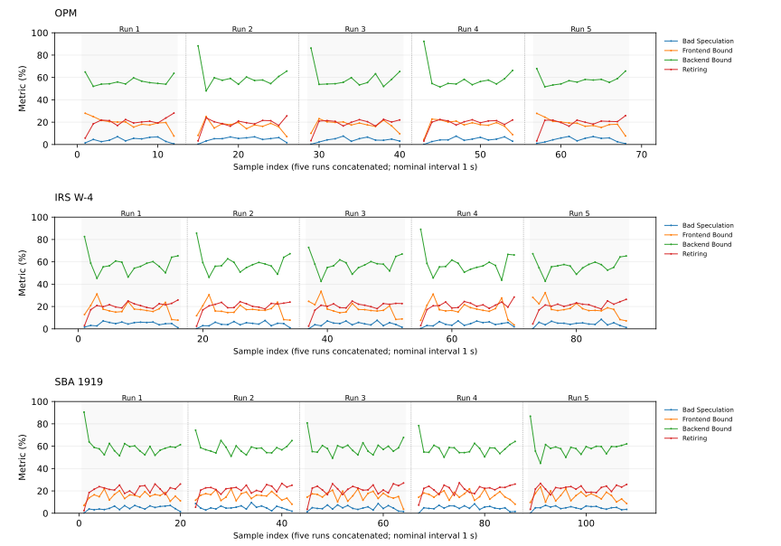

每个点为原始 DevKit 编号报告，每条线为一个指标；横轴为五轮串联的采样点序号，轮间留空且不连线。名义间隔 1 秒，保留启动和停止包络，不平滑、不插值。

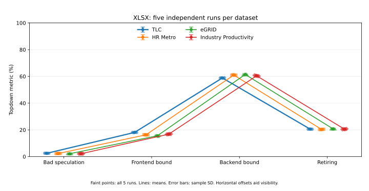

每个点为原始 DevKit 编号报告，每条线为一个指标；横轴为五轮串联的采样点序号，轮间留空且不连线。名义间隔 1 秒，保留启动和停止包络，不平滑、不插值。

| 数据集 | IPC CV | Backend CV | 五轮两两 Top-10 共同数 |
|---|---|---|---|
| OPM | 1.69% | 1.30% | 5–7/10 |
| IRS W-4 | 1.29% | 0.88% | 5–8/10 |
| SBA 1919 | 1.32% | 0.63% | 6–8/10 |
| TLC | 0.44% | 0.23% | 10–10/10 |
| HR Metro | 0.68% | 0.29% | 10–10/10 |
| eGRID | 0.72% | 0.54% | 8–9/10 |
| Industry Productivity | 0.68% | 0.39% | 9–10/10 |

XLSX 的主要特征与热点集合在固定环境重复运行中接近；PDF 单轮热点排名更易波动，五轮合并用于识别持续出现的主要函数。例如 OPM Fetch Bandwidth CV 为 12.36%，因此稳定性按指标分别描述。曲线展示轮内变化，均值和 CV 仍来自每轮 ALL；两者分别回答过程变化与重复波动。

## 六、已有实验的覆盖边界与 Word/PPT 扩展价值

### 6.1 已验证的范围与尚未覆盖的操作

| 场景 | 操作范围 | 已知或待测的机制 |
|---|---|---|
| PDF，已测 | 可填写表单的字段映射、填写、渲染和验证 | 已观察到 Python、压缩编码、图像处理、Poppler／字体路径 |
| XLSX，已测 | 百万级单元格工作簿检查、增强、保存、重算、验证 | 已观察到解释执行、对象管理、GC、XML、Calc 路径 |
| Word，待测 | 长文档结构编辑、样式与复杂表格、分页 | 待检验连续文本布局、字体度量、跨页布局的显著性 |
| PPT，待测 | 幻灯片构建、母版编辑、形状与图片布局 | 待检验演示对象构建、图形布局与渲染的显著性 |

现有结果支持两类已测任务的跨领域代表性，尚未覆盖完整 PDF／XLSX 任务空间。共同解释器和库函数可由业务处理及公共检查共同贡献，不能仅凭函数名称推断相同上层算法。当前统计以相对周期与流水线分配为主，绝对 CPU 工作量需要同一版本的 CPU-seconds 等补充；不混用旧版本账本。

前面的五组对照表明：沿用表单处理与工作簿增强任务时，跨领域输入仍持续进入解释器、对象管理、XML、压缩和渲染等共同路径。因此，继续只更换业务行业，未必能补充新的主要计算类型。下一步应扩展实际操作，重点考察当前较少涉及的连续文档排版和幻灯片图形布局。

### 6.2 为什么选择 Word/PPT

| 证据层次 | 来源与事实 | 对场景选择的意义 |
|---|---|---|
| 生态采用 | 2026-10-28 保存的 Skills.sh 快照：Anthropic DOCX 约 20.85 万、PPTX 约 24.38 万 Installs。[DOCX](https://www.skills.sh/anthropics/skills/docx)、[PPTX](https://www.skills.sh/anthropics/skills/pptx) | 说明相应工具能力有较多采用；Installs 不等于独立用户 |
| 产品落地 | 微软将 Word、PowerPoint 文件创建纳入 Copilot Agent。[产品说明](https://learn.microsoft.com/en-us/microsoft-365/copilot/wordexcelppt-agents) | 说明文字报告和演示材料属于实际产品任务 |
| 公开任务覆盖 | OmegaUse-OfficeVal 的 100 项任务按输出类型包含 Word 37 项、PowerPoint 39 项，另有 1 项 Word＋Excel 跨文件任务。[数据集](https://huggingface.co/datasets/baidu-frontier-research/OmegaUse-OfficeVal) | 提供具体可复现任务；任务集比例不推导市场使用比例 |
| 专项任务 | PPT-Eval 提供 120 个 PowerPoint 创建与编辑任务，覆盖 12 个文件。[项目页](https://microsoft.github.io/ppteval/) | 为幻灯片构建和编辑提供独立评测任务 |
| 跨格式操作 | DocOps 发布 210 项 Excel、Word、PowerPoint、PDF 文档操作任务。[官方仓库](https://github.com/icip-cas/DocOps) | 支持沿原生文档编辑与结果验证选取任务 |

### 6.3 新操作可能补足的 CPU 机制

| 操作 | 工具／软件模块 | 实际计算行为 | 后续关注的热点与指标 |
|---|---|---|---|
| Word 长文档创建、段落和样式修改 | DOCX Skill 的结构处理工具；LibreOffice Writer `sw` | 维护段落／表格结构；内容或样式变化后进行文本布局、字体度量、换行与分页 | 结构构建、布局／字体函数；CPU 核秒、内存、缓存和分支指标 |
| Word 复杂表格、页眉页脚与导出 | Writer 文档模型及布局；PDF 导出 | 计算连续文本流与跨页对象的位置，生成页面描述 | 排版与页面生成的 CPU 工作量、Frontend／Backend 分布 |
| PPT 模板编辑、幻灯片构建 | PPTX Skill；PptxGenJS／Node.js 或 OOXML 编辑；Impress `sd` | 组织幻灯片、母版、文本框、形状、图片及资源关系，计算对象布局 | 对象构建、运行时对象管理、图形／文本布局函数 |
| PPT 渲染与可见性检查 | Impress、Poppler、Pillow | 绘制文本和矢量形状、处理图片、生成缩略图 | 图形、字体、栅格化与图像处理热点，CPU 核秒与内存峰值 |

上述链路依据公开 [DOCX Skill](https://github.com/anthropics/skills/blob/main/skills/docx/SKILL.md)、[PPTX Skill](https://github.com/anthropics/skills/blob/main/skills/pptx/SKILL.md) 及 LibreOffice 的 [Writer](https://github.com/LibreOffice/core/blob/master/sw/README.md)、[Impress](https://github.com/LibreOffice/core/blob/master/sd/README.md)、[Calc](https://github.com/LibreOffice/core/blob/master/sc/README.md) 模块说明整理，是待测机制的选型依据。

同样调用 LibreOffice，Calc、Writer、Impress 进入的文档模型和布局路径不同；同样进入 Poppler，文本、矢量对象与图片的构成也可能改变字体与渲染计算。公共组件能够解释部分共同热点，却不能替代对这些操作的实测。

### 6.4 下一轮实验要回答的问题

选择长文档结构／样式编辑、分页与复杂表格，以及多页幻灯片构建／模板编辑／图形布局任务；由真实 Agent Skill 完成并冻结成功轨迹，在统一环境下回放。继续以 perf 识别主要函数与工具归属，以固定版本 DevKit 比较流水线特征，并增加同一版本的 CPU-seconds、任务时长、活跃核数和内存峰值。

下一轮重点检验：Writer／Impress 的布局、字体和图形路径是否成为显著热点；这些工作占多少绝对 CPU 工作量；共享压缩、XML 和渲染机制之外，是否出现 PDF 表单与 XLSX 增强尚未充分覆盖的主导机制。**已有七例用于验证跨领域输入下的机制延续，Word/PPT 用于扩展操作类型的覆盖。**

完整数据、逐次命令和核验材料：[实验数据汇总记录](experimental-results.md)。
<!-- BEGIN DOCOPS TASK OPERATION EXTENSION -->

## 七、扩展任务操作：旧用例的代表性与补充建议

前六章考察跨行业输入，本章进一步扩展实际任务操作。

**结论：旧 OPM／TLC 保留为核心；具体函数优先补 013＋021，不同操作优先补 021、按需加 009。** 本节先说明样本与软件栈，再用规模复测区分函数实现差异和操作差额，最后结合 Topdown 给出补充建议。

### 7.1 测了什么，如何回放与采集

| 格式 | 任务 | 主要操作 |
|---|---|---|
| PDF | 031／037／pdfwf005 | 材料包修复、发布、预览 |
| Excel | 013／014／016 | 评审发布、补助发布、情景重算 |
| Word | 001／003／009 | 发布修复、元数据清理、手册构建 |
| PPT | 021／026／029 | 无障碍整改、图表重建、样式发布 |

十二项任务来自已保存的 Agent 轨迹，每项冻结最终有效脚本、输入、Skill 和命令。回放直接执行构建、修补、重算、渲染和原有检查，公共入口负责调度与归档，不调用模型。原始 Agent 官方内容判定为四项通过、八项未通过；十二项工具链回放均完成，来源判定另记。

| 项目 | 旧 OPM／TLC | 十二项原始新用例 |
|---|---|---|
| 环境 | Python 3.12.3、LibreOffice 25.8.7.3 | 共用基础版本，补充文档与图像依赖 |
| 采集次数 | 每路五次独立采集 | 每项每路一次，内部十轮 |
| perf | cycles:u、49 Hz、DWARF 16384 | 同参数；工作流 ROI 区间并集 |
| Topdown | DevKit，CPU 0–7，1 秒间隔 | 同参数；控制器 CPU 9 |
| 边界 | 完整循环，含 reset／检查 | perf 排除准备、reset、归档；Topdown 为按核包络 |

perf 与 DevKit 分开运行。热点合并保留样本的周期权重；旧例 Topdown 取五次 ALL 均值，新例取本次 ALL。7.3 比较原始规模与大规模复测；7.4 和 7.6 使用十二项原始任务。

### 7.2 软件与库：哪些旧用例已有，哪些是新增

本节先比较使用的软件和库，7.3 再比较库内实际执行的函数及操作。

任务脚本可以在 Python 中调用文档库，也可以启动 LibreOffice 等外部程序。它们处理的文档不同，但可能调用相同的底层库，因此会出现共同的 CPU 热点。

#### 7.2.1 上层：由什么工具处理文档

**表 7-1：各场景的主要处理工具。**

| 场景 | Python 库（主要工作） | 另外启动的程序 |
|---|---|---|
| PDF：旧 OPM＋新任务 | pypdf（表单、页面、书签）；ReportLab（新 031／037 绘制 PDF）；Pillow（旧 OPM 图片处理） | Poppler 命令；ImageMagick（新 pdfwf005） |
| Excel：旧 TLC＋新任务 | openpyxl（单元格、公式、样式和图表） | LibreOffice；新三项还用 Poppler，013 还用 ImageMagick |
| Word：新任务 | python-docx（段落、表格和样式） | LibreOffice、Poppler 命令 |
| PPT：新任务 | python-pptx（幻灯片、文本框、形状和图表） | LibreOffice、Poppler 命令；021 还用 ImageMagick |

Python 库在 Python 进程内执行，外部程序由脚本另外启动。LibreOffice 负责重算、排版和格式转换；Poppler 提供 `pdftoppm`（页面转图片）、`pdftotext`（提取文字）等命令；ImageMagick 提供 `montage` 等图片缩放与拼图命令。

**上层变化：** 新 Excel 继续使用 openpyxl，新 PDF 继续使用 pypdf 并增加 ReportLab；Word、PPT 分别增加 python-docx、python-pptx。

#### 7.2.2 底层：使用了哪些计算库

底层库提供压缩／解压、XML 解析、字体和绘图等具体功能，由上层工具调用。其中 `.so` 文件是编译好的共享库，供程序加载和调用。例如，Python 文档库和 LibreOffice 都可能把实际压缩工作交给 zlib：

```text
Python 文档库 → Python 的 ZIP 处理代码 → zlib
LibreOffice  → 自己的 ZIP 处理代码    → zlib
```

**表 7-1A：主要底层库的新旧对照。** 根据 perf 记录核对。✓ 表示该库中出现了执行样本，— 表示未观测到；新用例列中仅写格式名表示该类三项均观测到，附编号表示部分任务。

| 底层库 | 主要用途 | 旧 OPM | 旧 TLC | 新用例 |
|---|---|---|---|---|
| Python：`libpython3.12.so` | 执行 Python 脚本和库代码 | ✓ | ✓ | PDF；Excel；Word；PPT |
| C 运行库：`libc.so` | 内存分配、字符串和文件操作 | ✓ | ✓ | PDF；Excel；Word；PPT |
| zlib：`libz.so` | 压缩／解压文档与图片数据 | ✓ | ✓ | PDF；Excel；Word；PPT |
| XML：`libxml2.so` | 解析和修改 XML | — | ✓ | Excel；Word；PPT |
| lxml 扩展：`etree.*.so` | 让 Python 调用 XML 处理代码 | — | — | Excel；Word；PPT |
| UNO：`libuno_cppu.so` | 传递和管理 Office 组件数据 | — | ✓ | Excel；Word；PPT |
| VCL：`libvcllo.so` | 文字、图片和页面绘制 | — | ✓ | Excel；Word；PPT |
| OOXML：`libooxlo.so` | Office 文件导入、属性和图形处理 | — | ✓ | Excel；PPT |
| Calc：`libsclo.so`／`libscfiltlo.so` | 表格模型、公式重算和 Excel 导入 | — | ✓ | Excel |
| Writer：`libswlo.so`／`libsw_writerfilterlo.so` | Word 导入、段落、表格和分页 | — | — | Word |
| Impress／Draw：`libsdlo.so` | 幻灯片／绘图文档的页面和对象 | — | — | PPT |
| Poppler：`libpoppler.so` | 读取 PDF、生成页面预览 | ✓ | — | PDF；Excel；Word；PPT |
| 字体：`libfreetype.so` | 读取字体和生成文字字形 | ✓ | — | PDF；Excel 013／016；Word 001；PPT |
| Pillow：`_imaging.*.so` | 图片读取、缩放和像素处理 | ✓ | — | — |
| PNG：`libpng16.so` | PNG 图片编解码 | — | — | PDF；Excel；Word |
| JPEG：`libjpeg.so` | JPEG 图片编解码 | — | — | PPT |
| ImageMagick：`libMagickCore*.so` | 图片缩放、滤波和拼图 | — | — | PDF pdfwf005；Excel 013；PPT 021 |

**底层变化：** Python、zlib、Poppler 和字体库在旧例中已有；新 Excel／Word／PPT 继续使用 TLC 已有的 XML、UNO 和 VCL 组件。新增路径包括 Writer、Impress／Draw、lxml 扩展，以及 libpng、libjpeg 和 ImageMagick。表中 Calc 库负责 Excel 表格与重算，Writer 库负责 Word 导入与布局，Impress／Draw 共用库负责幻灯片和绘图文档的页面对象；它们属于 LibreOffice。

表中的重合表示使用了相同的库；是否执行相同函数或同类操作，见 7.3。Python 文档库的计算会落在解释器、XML 或压缩等底层库中，因此下表的 Python 权重不是某一个 Python 文档库的单独占比。

#### 7.2.3 主要热点落在哪些库

**表 7-2：旧基准概览。** 组件按软件归属汇总，比例为用户态 perf 周期权重。

| 基准 | 主要脚本／进程 | 主要组件 |
|---|---|---|
| OPM | convert_pdf_to_images.py 38.85%；fill_fillable_fields.py 38.44%；verify_pdf_batch.py 12.26%；pdftoppm 8.03% | Python 50.41%；zlib 25.18%；Pillow 14.61%；Poppler 6.23% |
| TLC | enhance_workbook.py 22.01%；inspect_xlsx_structure.py 12.69%；recalc.py 11.60%；inspect_xlsx_features.py 10.57% | Python 79.26%；LibreOffice 6.43%；Expat 5.65%；ElementTree 3.68% |

**表 7-3：旧两例与十二项原始新任务的前三个原生库。** 每格为“库名、用途、占比”，库名简写。

| 用例 | 页面预览 | 第 1 大原生库 | 第 2 大原生库 | 第 3 大原生库 |
|---|---|---|---|---|
| 旧 PDF／OPM | PNG | `libpython3.12.so` ★（Python 执行）50.41% | `libz.so` ★（PNG 压缩为主）25.18% | `_imaging.*.so` ★（图片读取、缩放和像素处理）14.61% |
| 旧 Excel／TLC | 不生成页面预览 | `libpython3.12.so` ★（Python 执行）79.26% | `pyexpat.*.so` ★（XML 解析）5.65% | `_elementtree.*.so` ★（XML 节点处理）3.68% |
| [新 PDF 031](../docops/payload/tasks/031/recipe.json) | PNG | `libz.so` ★（PNG 压缩为主）66.25% | `libpython3.12.so` ★（Python 执行）20.08% | `libpng16.so`（PNG 编解码）8.68% |
| [新 PDF 037](../docops/payload/tasks/037/recipe.json) | PNG | `libz.so` ★（PNG 压缩为主）52.92% | `libpython3.12.so` ★（Python 执行）29.90% | `libpng16.so`（PNG 编解码）10.27% |
| [新 PDF pdfwf005](../docops/payload/tasks/pdfwf005/recipe.json) | PNG＋拼图 | `libpython3.12.so` ★（Python 执行）31.74% | `libMagickCore-7.Q16HDRI.so`（图片缩放／滤波／拼图）25.96% | `libz.so` ★（PNG 压缩为主）23.67% |
| [新 Excel 013](../docops/payload/tasks/013/recipe.json) | PNG＋拼图 | `libz.so` ★（PNG 压缩为主）31.66% | `libpython3.12.so` ★（Python 执行）19.77% | `libMagickCore-7.Q16HDRI.so`（图片缩放／滤波／拼图）13.43% |
| [新 Excel 014](../docops/payload/tasks/014/recipe.json) | PNG | `libz.so` ★（PNG 压缩为主）30.54% | `libpython3.12.so` ★（Python 执行）25.49% | `libpng16.so`（PNG 编解码）7.57% |
| [新 Excel 016](../docops/payload/tasks/016/recipe.json) | PNG：首页 | `libpython3.12.so` ★（Python 执行）47.65% | `libc.so` ★（内存／字符串等）8.81% | `libsclo.so` ★（表格模型／重算）6.11% |
| [新 Word 001](../docops/payload/tasks/001/recipe.json) | PNG | `libz.so` ★（PNG 压缩为主）44.27% | `libpython3.12.so` ★（Python 执行）18.74% | `libc.so` ★（内存／字符串等）7.16% |
| [新 Word 003](../docops/payload/tasks/003/recipe.json) | PNG | `libz.so` ★（PNG 压缩为主）44.62% | `libpython3.12.so` ★（Python 执行）14.91% | `libpng16.so`（PNG 编解码）9.05% |
| [新 Word 009](../docops/payload/tasks/009/recipe.json) | PNG | `libz.so` ★（PNG 压缩为主）44.39% | `libpng16.so`（PNG 编解码）19.00% | `libpython3.12.so` ★（Python 执行）8.86% |
| [新 PPT 021](../docops/payload/tasks/021/recipe.json) | JPEG＋拼图 | `libpoppler.so` ★（PDF 页面渲染）27.74% | `libpython3.12.so` ★（Python 执行）15.95% | `libvcllo.so` ★（文字／图片绘制）12.32% |
| [新 PPT 026](../docops/payload/tasks/026/recipe.json) | JPEG | `libpoppler.so` ★（PDF 页面渲染）36.90% | `libpython3.12.so` ★（Python 执行）20.97% | `libc.so` ★（内存／字符串等）6.60% |
| [新 PPT 029](../docops/payload/tasks/029/recipe.json) | JPEG：首页 | `libpython3.12.so` ★（Python 执行）36.96% | `libc.so` ★（内存／字符串等）7.61% | `libooxlo.so` ★（Office 结构／图形）5.41% |

★ 表示旧 OPM 或 TLC 中也观测到该库。占比为该库在整轮保留样本中的周期权重，不将前三项重新归一化。任务编号链接到冻结脚本与命令，进程明细见[详细记录](experimental-results.md)；逐库权重、zlib 调用来源与采集记录见[表格依据](evidence/old-new-preview-comparison-20261116.json)。

**预览区别：** 旧 OPM 已生成 PNG，旧 TLC 不生成页面预览；十二项新任务均生成预览图片。

**新 Excel 仍有 XML 等文件的压缩／解压。** XLSX 是 ZIP 包，读取时解压其中的 XML 等内容，保存时重新压缩；XML 解析本身由解析库执行。新任务在工作簿处理之外，又把工作簿转为 PDF 并生成 PNG。

**新 Excel 的高压缩权重主要来自 PNG 预览。** 旧 TLC 的 zlib 权重为 1.55%，主要服务于工作簿读写。新 Excel 014 的 zlib 为 30.54%，其中 29.27% 是 `pdftoppm` 生成 PNG 所占的整轮权重。PPT 的 JPEG 编码主要使用 libjpeg，与 PNG 的 zlib 压缩不同。

**本节小结：上层文档库按格式分工，底层计算库大量复用。** 旧 OPM／TLC 已包含 Python 执行、XML 处理、压缩／解压、表格重算和页面渲染所用的主要组件；新任务增加 Word／PPT 文档模型及部分图片处理实现。下一节进一步检查这些库中实际执行的函数。

### 7.3 旧用例覆盖了哪些函数与操作

先看十二项原始任务的函数覆盖，再比较扩大规模后的变化，最后检查剩余函数是否属于旧例已有的操作。以 OPM＋TLC 为旧参考，百分比均按热点采样权重计算。

#### 7.3.1 从原始规模出发，再比较扩大规模后的变化

新任务调用的函数，在旧 OPM 或 TLC 记录中出现过，就计为“函数已覆盖”；比较时同时核对所属库。“未匹配”是已识别但旧记录中没有的函数，“未解析”是尚不能确定函数名的部分。

**原始规模的发现：** 使用 Agent 任务原有的冻结输入回放，函数覆盖为 45.41%–79.15%。例如 Excel 016 为 56.25%，PPT 029 为 55.51%，仍有较多函数未在旧例中匹配。

**为什么扩大规模：** 小输入中，解释器启动、脚本解析和检查的权重可能更显眼。为观察输入规模变化后的结果，将十二项任务各扩为两档，共 24 个规模变体。下表保留原始规模作为起点，与大档对照；小档结果见本节末的完整记录。

**表 7-4：原始规模与大规模的函数覆盖对比。** 变化为“大规模－原始规模”，单位为百分点，按未舍入原值计算。

| 用例 | 原始规模函数覆盖 | 大规模函数覆盖 | 变化（百分点） |
|---|---|---|---|
| PDF 031 | 79.15% | 86.49% | +7.34 |
| PDF 037 | 72.77% | 86.72% | +13.95 |
| PDF pdfwf005 | 45.41% | 48.94% | +3.53 |
| Excel 013 | 59.16% | 93.25% | +34.09 |
| Excel 014 | 66.17% | 91.82% | +25.65 |
| Excel 016 | 56.25% | 80.03% | +23.78 |
| Word 001 | 71.94% | 75.56% | +3.62 |
| Word 003 | 68.65% | 71.58% | +2.92 |
| Word 009 | 65.01% | 71.59% | +6.59 |
| PPT 021 | 46.59% | 50.44% | +3.85 |
| PPT 026 | 59.39% | 63.00% | +3.61 |
| PPT 029 | 55.51% | 46.29% | -9.22 |

**规模复测的结果：** 11/12 项大档高于原始任务。Excel 016 从 56.25% 提高到 80.03%，PPT 029 则从 55.51% 降至 46.29%。在规模复测中，多数任务的匹配权重提高，变化方向并不完全相同。剩余差额继续按实际操作核对。

#### 7.3.2 把同类操作也算上，覆盖了多少

以下使用上表的大规模结果，具体规模列在表 7-4A 中。

旧例用 Pillow、新例用 ImageMagick 缩放图片，函数不同，操作同类。Python 容器与对象管理、脚本解析／编译、XML 节点处理和 UNO 组件数据管理，也按具体用途逐项对应。

**公共操作按具体用途对应。** 每类都保留旧 OPM／TLC 的实际依据，包括字典／列表操作、对象调用、XML 文本比较与节点查询、组件引用管理、字体和像素格式处理。例如 ElementTree 与 lxml 都会查询 XML 节点，Pillow 与 VCL 都会读写图片像素。旧 OPM 的冻结脚本还实际调用 `PdfWriter.write`，提供 PDF 对象写出的操作依据。

**合计覆盖＝已覆盖函数＋未匹配函数中的同类操作。** 同一部分只计算一次。JPEG 编解码、图像模糊、多图合成和 Word／PPT 文档对象路径分别保留。

**表 7-4A：大规模复测中，计入同类操作后的覆盖。**

| 用例 | 函数已覆盖 | 同类操作补充 | 合计覆盖 |
|---|---|---|---|
| PDF 031（100页） | 86.49% | 13.51%：PNG、Python 对象／调用／内存管理、字体字形加载／栅格化等 | **>99.99%** |
| PDF 037（100页） | 86.72% | 13.28%：PNG、字体字形加载／栅格化、Python 脚本解析／编译等 | **>99.99%** |
| PDF pdfwf005（120页） | 48.94% | 49.09%：图片缩放、PNG、像素读写／格式转换等 | **98.03%** |
| Excel 013（1000供应商） | 93.25% | 6.54%：图片缩放、PNG、Python 容器／迭代等 | **99.79%** |
| Excel 014（10000申请） | 91.82% | 6.64%：PNG、PDF 渲染、模型／重算等 | **98.46%** |
| Excel 016（500单元／2000行） | 80.03% | 18.07%：模型／重算、Python 脚本解析／编译、C++ 容器／查找等 | **98.10%** |
| Word 001（500条记录） | 75.56% | 18.26%：PNG、正则处理、文本比较／编码／拼接等 | **93.82%** |
| Word 003（500单元） | 71.58% | 25.93%：PNG、文本搜索、PDF 渲染等 | **97.51%** |
| Word 009（500事件） | 71.59% | 15.67%：PNG、属性／样式管理、字体与文字排布等 | **87.27%** |
| PPT 021（80页） | 50.44% | 33.88%：图片缩放、PDF 渲染、像素读写／格式转换等 | **84.32%** |
| PPT 026（90页） | 63.00% | 23.32%：PDF 渲染、属性／样式管理、像素读写／格式转换等 | **86.32%** |
| PPT 029（81页） | 46.29% | 34.37%：属性／样式管理、字体与文字排布、Python 脚本解析／编译等 | **80.66%** |

**计入同类操作后：** Word 009 从函数匹配的 71.59% 提高到 87.27%，PPT 021 从 50.44% 提高到 84.32%，PPT 029 从 46.29% 提高到 80.66%。10/12 项大档合计超过 85%。

#### 7.3.3 剩下的是什么，还有必要增加用例吗

公共组件中能确认属于旧例同类操作的部分，已计入表 7-4A。下表合并列出剩余函数的用途和权重。**函数尚未匹配，不等于操作是新增的；只有已明确识别的不同操作，才作为补充用例的依据。**

**表 7-5：大规模复测后，逐例说明剩余部分。** 各百分比均按整轮保留样本的周期权重计算；各行列出的函数权重加上未解析部分，等于表 7-4A 合计覆盖之外的部分。

| 用例 | 尚未匹配的函数主要在做什么 | 未解析 |
|---|---|---|
| PDF 031 | Shell 初始化等 <0.01% | <0.01% |
| PDF 037 | Shell 初始化、字符编码等 <0.01% | <0.01% |
| PDF pdfwf005 | 多图合成 1.17%；其余 ImageMagick 图像参数／链表管理等 0.38% | 0.43% |
| Excel 013 | 多图合成 0.15%；图文对象／样式 <0.01%；其余 图像链表、进程与 Shell 支撑等 0.04% | 0.02% |
| Excel 014 | 图文对象／样式 0.01%；其余 绘图指令、图形边框、加密等 0.47% | 1.05% |
| Excel 016 | 图文对象／样式 0.28%；其余 图形边框／坐标、区域配置、加密等 1.07% | 0.55% |
| Word 001 | Word 导入／对象布局 2.31%；图文对象／样式 0.20%；其余 加密、URI 字符处理、连字符处理等 0.27% | 3.40% |
| Word 003 | Word 导入／对象布局 0.85%；图文对象／样式 0.02%；其余 加密、文档状态、图形属性等 0.14% | 1.48% |
| Word 009 | Word 导入／对象布局 7.77%；图文对象／样式 0.48%；其余 绘图指令、PDF 字形登记、加密／证书等 1.02% | 3.46% |
| PPT 021 | JPEG 编解码 8.15%；图文对象／样式 2.20%；图像模糊 1.71%；多图合成 0.45%；其余 幻灯片对象、图形路径、文字方向与加密等 1.07% | 2.11% |
| PPT 026 | JPEG 编解码 6.12%；图像模糊 2.83%；图文对象／样式 2.26%；其余 幻灯片对象、图形属性、文字方向与加密等 0.60% | 1.87% |
| PPT 029 | 图文对象／样式 4.66%；图像模糊 3.46%；JPEG 编解码 0.44%；其余 幻灯片对象／属性、文字方向与加密等 3.93% | 6.84% |

Office 公共组件承担属性、数据、文字和位图处理；例如 `libsvllo.so` 管理属性／样式，UNO 库管理组件数据，`libvcllo.so` 处理文字与位图。同一个库可以执行不同工作，所以按具体操作判断覆盖。Python 项来自 CPython 解释器库 `libpython3.12.so.1.0`；“其余”列举主要用途，权重包含未逐项展开的全部剩余函数。

**PPT 的公共工作已计入，剩余主要看具体图片与幻灯片操作。** 021 的 JPEG 编解码合计 8.15%，其中 `encode_mcu_gather` 约占 3.16%；另有模糊 1.71%、图文对象／样式 2.20% 和多图合成 0.45%。这些比通用 Python／XML 函数更能说明补充价值。

**Word 009 的公共计算已计入覆盖。** Python 对象管理、XML 比较等已按同类操作对应；其余 1.02% 为绘图指令、PDF 字形登记、加密／证书等函数差异。

**Word 专用工作仍单独保留。** LibreOffice Writer 的 `libswlo.so` 负责段落、表格与布局，`libsw_writerfilterlo.so` 负责 Word／DOCX 导入。扣除两库中的通用容器和运行支撑后，尚未覆盖的 Word 导入／对象布局为 7.77%。001、003 同样有 Word 路径；009 的反复排版与目录页码确认使这部分更突出。

#### 7.3.4 结论：按函数或按操作，分别补哪些用例

**只看具体函数：优先增加 Excel 013＋PPT 021。** 新出现的库主要包括 PNG 编解码的 libpng、图片处理的 ImageMagick、JPEG 编解码的 libjpeg，以及 lxml 扩展和 Word 的 Writer 库；旧例已有的 VCL、OOXML 等库中也出现了不同函数。013 可补 PNG 预览和图片处理函数，021 可补 JPEG、图片处理及幻灯片相关函数。

**把同类操作也算上：先补 PPT 021，需要研究 Word 导入与排版时再加 009。** 旧两例已涵盖 Python、XML、压缩／解压、图片缩放、页面渲染和表格重算等共同操作。021 重点补 JPEG 编解码、模糊和多图合成；009 重点补 Writer 的 Word 导入、段落、表格和分页。

| 判断口径 | 补充的原始用例 | 十二项大档的平均覆盖 |
|---|---|---|
| 具体函数匹配 | 013＋021 | 72.14% → **90.14%** |
| 计入同类操作 | 021 | 93.69% → **96.01%** |
| 计入同类操作 | 021＋009 | 93.69% → **96.93%** |

平均覆盖先分别计算十二项大档的覆盖率，再等权取平均；未解析部分仍计入分母。候选均为十二项原始用例，不增加规模变体。

**少量补例能补多少：** 若以平均覆盖达到 90% 为精简选型目标，具体函数口径至少需两项；最好的单项 013 为 84.51%，013＋021 达到 90.14%。计入同类操作时，旧两例本身已达到 93.69%，补 021、009 是为增加图片处理和 Word 路径。

**仍值得单独看的是 PPT 029。** 加入 013＋021 后，其具体函数覆盖为 67.73%；加入 021＋009 后，计入同类操作的覆盖为 86.29%。若关注幻灯片表格样式，再补原始 029。

[原始、小档、大档完整结果](../analysis/docops/processed/unified-scaling-final-20261108/analysis.md)｜[本次归并与旧例函数依据](../analysis/docops/processed/operation-equivalence-deep-20261115/analysis.md)｜[补充组合核算](../analysis/docops/processed/supplement-selection-20261116/analysis.md)｜[早期 Word 009 交叉核对](../analysis/docops/processed/word009-coverage-review-20261113/review.md)

### 7.4 Topdown 相似性：CPU 瓶颈分布是否接近

本节只比较十二项原始新用例。函数和操作覆盖回答“执行了什么”，Topdown 回答“CPU 的瓶颈份额如何分配”。采用七维、不重复计权的向量，IPC 单独列相对变化，idle 不加入距离。

**表 7-6：七维向量。** 误推测、前端和后端由各自子项替换，七项合计约 100%。

| 向量分量 | 含义 |
|---|---|
| Retiring | 有效完成 |
| Branch Mispredicts | 分支误判 |
| Machine Clears | 流水线清空 |
| Fetch Latency Bound | 前端延迟受限 |
| Fetch Bandwidth Bound | 前端带宽受限 |
| Core Bound | 核心执行受限 |
| Memory Bound | 缓存／内存供数受限 |

向量顺序为 `[Retiring, Branch Mispredicts, Machine Clears, Fetch Latency, Fetch Bandwidth, Core, Memory]`。所有分量均取 0–100 的百分数，不额外标准化。

| 指标 | 公式 | 读法 |
|---|---|---|
| 七维余弦 | `Σ(AᵢBᵢ) / [√ΣAᵢ² × √ΣBᵢ²]` | 越接近 1，形状越接近 |
| 七维欧氏距离 | `√Σ(Aᵢ−Bᵢ)²` | 越小，占比差异越小 |

**算例：** A=`[20,4,1,15,5,45,10]`，B=`[20,4,1,10,5,50,10]`；前端延迟减少 5 pp、Core 增加 5 pp，余弦为 0.9933，欧氏距离为 √(5²＋5²)=7.07。两项结合阅读，避免高余弦掩盖分项变化。

**比较参照：** 旧 OPM／TLC 各取五次采集均值，两者余弦为 0.9962、欧氏距离为 4.77。新例分别对照两例，表中列欧氏距离较近的一路。以 4.77 为本批参照，范围内记为“相对接近”；这不是统计检验阈值。

**表 7-7：十二项原始新用例的 Topdown 比较。**

| 新用例 | 较近旧例 | 七维余弦 ↑ | 七维欧氏距离 ↓ | 判断 | IPC 变化 |
|---|---|---|---|---|---|
| PDF 031 | OPM | 0.9784 | 13.39 | 超出参照 | -13.5% |
| PDF 037 | TLC | 0.9817 | 12.38 | 超出参照 | -19.8% |
| PDF pdfwf005 | OPM | 0.9904 | 8.11 | 超出参照 | -8.6% |
| Excel 013 | TLC | 0.9916 | 7.30 | 超出参照 | -23.0% |
| Excel 014 | TLC | 0.9884 | 8.18 | 超出参照 | -31.9% |
| Excel 016 | TLC | 0.9772 | 11.41 | 超出参照 | -41.7% |
| Word 001 | TLC | 0.9874 | 8.84 | 超出参照 | -27.9% |
| Word 003 | TLC | 0.9911 | 7.77 | 超出参照 | -23.8% |
| Word 009 | TLC | 0.9981 | 3.40 | 相对接近 | -12.5% |
| PPT 021 | TLC | 0.9968 | 4.91 | 超出参照 | -6.8% |
| PPT 026 | TLC | 0.9972 | 4.04 | 相对接近 | -17.3% |
| PPT 029 | TLC | 0.9930 | 6.35 | 超出参照 | -26.3% |

**表 7-8：差异最大的三项。** 单位为百分点，正号表示新例更高。

| 新用例 | 对照 | 主要变化（pp） |
|---|---|---|
| 031 | OPM | 核心执行受限 +8.72；前端延迟 -8.14；内存受限 +5.00 |
| 037 | TLC | 核心执行受限 +9.32；前端延迟 -6.47；有效完成 -4.08 |
| pdfwf005 | OPM | 前端延迟 -5.61；核心执行受限 +4.12；内存受限 +3.75 |
| 013 | TLC | 有效完成 -4.69；核心执行受限 +3.75；内存受限 +3.06 |
| 014 | TLC | 有效完成 -6.53；内存受限 +4.68；分支误判 +1.19 |
| 016 | TLC | 有效完成 -8.50；前端延迟 +5.37；内存受限 +4.25 |
| 001 | TLC | 有效完成 -5.66；内存受限 +4.99；核心执行受限 +3.35 |
| 003 | TLC | 核心执行受限 +4.99；有效完成 -4.84；前端延迟 -2.61 |
| 009 | TLC | 有效完成 -2.58；核心执行受限 +1.84；内存受限 +0.82 |
| 021 | TLC | 核心执行受限 +4.08；前端延迟 -2.14；有效完成 -1.42 |
| 026 | TLC | 有效完成 -3.58；内存受限 +1.30；核心执行受限 +0.89 |
| 029 | TLC | 有效完成 -5.36；内存受限 +2.29；前端延迟 +2.07 |

**结果：** 009、026 相对接近旧例，距离为 3.40／4.04；021 为 4.91，接近参照边界。031、037、016 的距离为 13.39／12.38／11.41，分项差异更明显。共同函数和同类操作可以承担不同权重，因此 7.3 的操作归并与本节的瓶颈比较分别判断。

**统计口径：** 新例每项一次采集、内部十轮；采用 Report-ALL。CPU 0–7 包络包含步间间隙及可能的同核宿主活动。旧 OPM／TLC 到自身均值的最大距离为 1.89／0.55；新例均高于对应重复波动范围。

[完整七维对照](../analysis/docops/processed/topdown-original-cosine-euclidean-20261108/analysis.md)保留 24 组新旧配对、原值及未计数标记。

### 7.5 结论：建议增加哪些用例

**保留旧 OPM／TLC 作为核心，再按研究目标补充。** 它们覆盖了本批任务的大部分共同操作；具体函数实现仍有差异。

| 研究目标 | 建议补充的原始用例 |
|---|---|
| 覆盖更多具体函数 | Excel 013＋PPT 021 |
| 补充不同操作 | 先选 PPT 021；研究 Word 导入与长文档排版时，再加 Word 009 |
| 专门研究幻灯片表格样式 | 再选 PPT 029 |

013 主要补 PNG 预览与图片处理实现，021 补 JPEG、图片处理和幻灯片相关路径，009 补 Word 导入、表格、分页与目录页码确认。组合效果见 7.3.4。

### 7.6 十二项任务的逐点曲线与读图说明

十二图共 533 个实际过程点。四条线表示误推测、前端受限、后端受限和有效完成；横轴为输出点编号，纵轴为百分比，名义间隔 1 秒。每图来自一次采集、内部十轮，展示过程变化；7.4 使用最终累计指标。

#### 图 7-1：PDF／031 听证材料包扁平化发布——四项 Topdown 过程

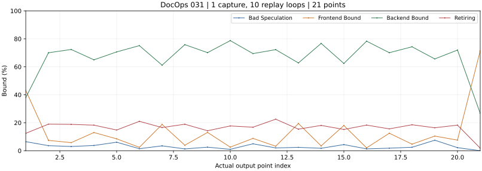

**读图：** 后端受限占比较高；相对 OPM 的汇总变化为前端降低、后端增加。热点同时显示压缩占比突出。 本图共 21 个实际输出点。

#### 图 7-2：PDF／037 公交绕行材料修复——四项 Topdown 过程

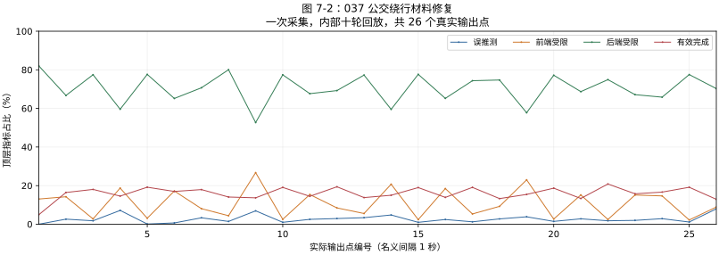

**读图：** 后端受限是主要份额，与 031 的汇总特征接近；压缩与 PNG 编码是主要函数热点。 本图共 26 个实际输出点。

#### 图 7-3：PDF／pdfwf005 结算材料包重建——四项 Topdown 过程

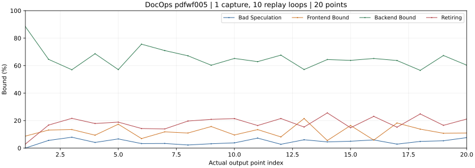

**读图：** 本项加入材料包重建与拼图，热点中出现 ImageMagick 图像滤波；结合曲线观察其流水线分配。 本图共 20 个实际输出点。

#### 图 7-4：Excel／013 采购投标评审发布——四项 Topdown 过程


**读图：** 本项同时执行工作簿处理和 PDF／图片交付；结合压缩、图像与 Calc 热点阅读这些过程点。 本图共 53 个实际输出点。

#### 图 7-5：Excel／014 灾害补助公开发布——四项 Topdown 过程

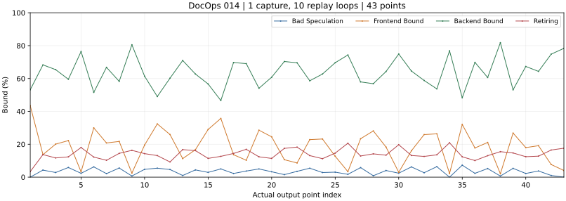

**读图：** 本项包含工作簿重算、OOXML 修补及渲染；最终指标取整段累计，曲线用于显示过程变化。 本图共 43 个实际输出点。

#### 图 7-6：Excel／016 预测模型情景级联——四项 Topdown 过程


**读图：** 汇总前端受限高于 TLC，IPC 低于 TLC；函数中可见 Python 对象处理与 Calc 路径。 本图共 55 个实际输出点。

#### 图 7-7：Word／001 受控文档发布修复——四项 Topdown 过程


**读图：** Word 构建、转换与检查；主要函数热点集中在压缩。 本图共 31 个实际输出点。

#### 图 7-8：Word／003 公开记录元数据清理——四项 Topdown 过程

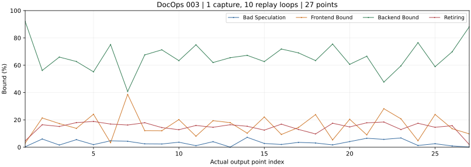

**读图：** 本项包含元数据处理、审计与文档渲染；曲线需与压缩、PNG 和 Writer 工具路径一起解释。 本图共 27 个实际输出点。

#### 图 7-9：Word／009 事件手册发布——四项 Topdown 过程

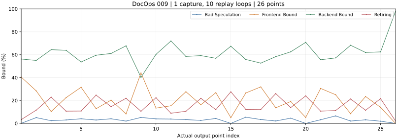

**读图：** 本项事件手册发布的主要函数集中于压缩和 PNG 编码，图中展示这份批次的实际流水线变化。 本图共 26 个实际输出点。

#### 图 7-10：PPT／021 庇护所无障碍整改——四项 Topdown 过程

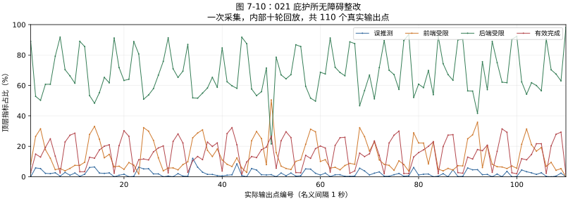

**读图：** 本项 PDF 页面绘制与图像处理较突出；与 029 共享工具，但主要热点函数和指标分配不同。 本图共 110 个实际输出点。

#### 图 7-11：PPT／026 气候披露图表重建——四项 Topdown 过程

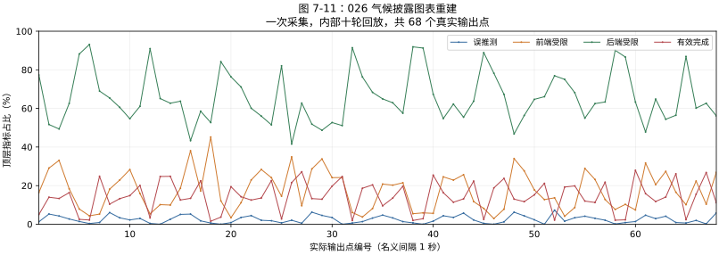

**读图：** 本项 Poppler 页面绘制份额较高；实际过程点展示渲染相关工作流的流水线分配。 本图共 68 个实际输出点。

#### 图 7-12：PPT／029 季度业务回顾发布——四项 Topdown 过程

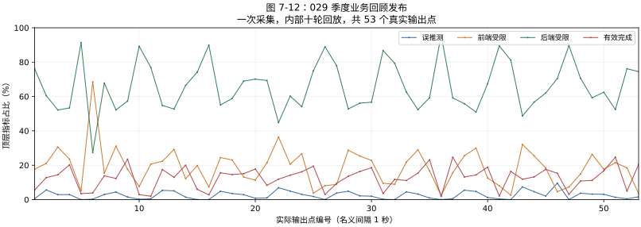

**读图：** 解释器、字典查找与 DrawingML 表格样式共同参与。 本图共 53 个实际输出点。

<!-- END DOCOPS TASK OPERATION EXTENSION -->
