# 文档解析类 Agent 代表性评估报告

## 一、研究目标与关键发现

本评估考察：保留 PDF 批量表单处理和 XLSX 大型工作簿增强任务，更换真实业务输入后，原基准的主要 CPU 计算机制是否延续。进一步据此识别办公 Agent 尚未覆盖的操作类型，为 Word/PPT 场景选型提供依据。

| 关键发现 | 实测证据 | 含义 |
|---|---|---|
| PDF 的主要热点延续 | W-4／SBA 与 OPM 共享 9／7 个 Top-10 函数；三例合并 Top-5 共有 5 个函数 | 解释执行、压缩编码与图像处理路径共同出现 |
| XLSX 的主要热点延续 | HR Metro／eGRID／Industry 与 TLC 共享 8／9／8 个 Top-10 函数 | 对象管理、GC、XML 与工作簿处理机制延续 |
| 顶层流水线分配接近 | 五组 Bound 余弦 0.998858–0.999897 | 支持粗粒度分配形状接近，结合函数证据解释 |
| 固定环境下可重复 | 每例、每路各五次；XLSX IPC CV 0.44%–0.72%，Backend CV 0.23%–0.54% | 主要结果在同环境重复运行中保持接近 |

**主要判断：在本次任务形态和工具链下，跨业务领域输入没有明显改变主要原生热点集合。任务操作与软件执行路径，是解释 CPU 负载特征的重要线索。** 这里验证的是同类任务的跨领域代表性；整个办公 Agent 的场景覆盖还需要检验文档排版与幻灯片构建等不同操作。

本报告完整说明实验设计、测量与结论；逐轮数值、完整热点排名、采样点、命令和证据索引见[实验数据汇总记录](experimental-results.md)。

## 二、数据集选择与任务设计

选择同时考虑官方或公开可信来源、业务领域、工作簿规模和任务可执行性。XLSX 从交通扩展到电力能源、区域就业工资和产业生产率；PDF 从联邦雇佣申报扩展到税务预扣和小企业贷款申请。

| XLSX 数据集 | 领域与来源 | 冻结输入规模 | 任务 |
|---|---|---|---|
| TLC（原基准） | 交通出行；NYC TLC | 7 个工作表；主表 100,000 行 × 25 列，约 250 万单元格 | 真实出租车行程样本及分组汇总；新增运营 Summary、指标、情景和图表 |
| eGRID | 电力能源；美国 EPA | 11 个工作表；约 273 万非空单元格 | 机组、发电机、电厂与区域统计；新增能源业务 Summary |
| HR Metro | 就业与工资；美国 BLS OEWS | 4 个工作表；主表 150,023 条记录、32 列；约 421 万非空单元格 | 都会区／非都会区职业就业与工资统计；新增 Workforce Summary |
| Industry Productivity | 产业生产率；美国 BLS | 3 个工作表；长表约 56.7 万条记录、9 列；约 580 万非空单元格 | 年度宽表与机器可读长表，涵盖生产率、产出、工时、就业和劳动补偿；新增产业 Summary |

| PDF 数据集 | 领域与发布机构 | 冻结版本 | 页数／字段／批处理 |
|---|---|---|---|
| OPM OF-306（原基准） | 联邦雇佣申报；美国 OPM | 08/2023 | 3 页、38 个字段；10 条记录 |
| IRS W-4 | 员工税务预扣；美国 IRS | 2026 | 5 页、48 个字段；10 条记录 |
| SBA Form 1919 | 小企业贷款申请；美国 SBA | 04/2024 可填写版本 | 7 页、127 个字段；10 条记录 |

TLC 沿用基于真实行程记录构建的原业务工作簿；三个新增 XLSX 保留发布方原始工作簿。百万级单元格规模为解析、对象构建和保存提供实际工作量，既有业务指标用于新增 Summary、公式、情景和图表。PDF 使用公开可填写表单与十条虚构记录，覆盖不同页面和字段规模，统一执行字段映射、填写、渲染和验证。

来源依据包括 [TLC 行程数据](https://www.nyc.gov/site/tlc/about/tlc-trip-record-data.page)、[EPA eGRID](https://www.epa.gov/egrid/detailed-data)、[BLS OEWS](https://www.bls.gov/oes/tables.htm)、[BLS 生产率表](https://www.bls.gov/productivity/tables/home.htm)、[OPM OF-306](https://www.opm.gov/forms/pdf_fill/of0306.pdf)、[IRS W-4](https://www.irs.gov/forms-pubs/about-form-w-4) 和 [SBA 1919](https://www.sba.gov/document/sba-form-1919-borrower-information-form)。原始表数量、数据布局及表单页数差异保留；领域多样性用于检验任务机制的延续。

## 三、实验环境、轨迹来源与回放流程

### 3.1 硬件、软件与容器

| 项目 | 实际配置 |
|---|---|
| 处理器平台 | HiSilicon HIP09；MIDR `0x00000000480fd020`，主板 `BC83AMDAL-7270Z`；平台依据为 MIDR、板号及既有硬件核验记录 |
| CPU 拓扑 | aarch64；2 路 × 64 个物理核，每核 2 个硬件线程，共 256 个逻辑 CPU；4 个 NUMA 节点 |
| 频率记录 | lscpu 报告上限 2.9 GHz、下限 0.4 GHz，boost disabled；不将上限写成实测固定运行频率 |
| 宿主内核 | `6.6.0-28.0.0.34.oe2403.aarch64`；容器共享宿主内核 |
| 回放镜像 | `office-trace-replay:agent-traces`；实际 ID `sha256:4baef1363ba99a994e17e93fe6a32c904cdb5cb349487adfa2fb13ba42301499`；arm64 / openEuler 回放环境 |
| Python 与库 | Python 3.12.3；openpyxl 3.1.5、pypdf 6.10.0、pdf2image 1.17.0、pillow 12.2.0 |
| 文档工具 | LibreOffice 25.8.7.3；Poppler 23.12.0 |
| 采集工具 | 容器内 `perf version 6.6.0-145.3.23.154.oe2403sp3.aarch64`；DevKit 26.0.RC1，可执行文件按 SHA256 冻结 |
| CPU 布局 | 容器可用逻辑 CPU 0–9；workload 运行在 0–7，控制程序和身份监测在 9。编号是宿主逻辑 CPU，不是八个独占物理核 |
| 容器隔离与权限 | 每次采集新建容器，`--network none --cpuset-cpus 0-9 --cap-add PERFMON --security-opt seccomp=unconfined`；perf 采集容器另有 `SYS_PTRACE` |
| 挂载与入口 | 测量代码 `/measurement`、证据 `/evidence` 只读，结果 `/results` 可写；Topdown 另只读挂载 `/devkit`。ENTRYPOINT 为固定 venv Python；未挂载覆盖镜像内 workload 源码。运行容器根文件系统可写 |
| 容器启动的测量入口 | perf：`/measurement/collect_native.py --dataset <id> --output /results`；Topdown：`/measurement/capture.py --dataset <id> --output /results`。各入口再按下面的流程启动采集工具与实际回放 |

### 3.2 真实 Agent 轨迹来源

TLC／OPM 沿用原有任务与回放材料。五个新增用例由 OpenClaw Agent 实际执行；每例使用独立提示词，明确业务任务、输入、输出和验收要求。Agent 编写业务 helper 并调用 Skill，保存 trajectory、tool events、脚本修订、输入／提示词及运行环境绑定，选择成功轨迹用于回放。

| 新增用例 | 采用的成功轨迹 | Agent 业务脚本 |
|---|---|---|
| eGRID | `xlsx-egrid-20261027T032347Z-225eb8e9` | `helpers/enhance_energy_report_v2.py` |
| HR Metro | `xlsx-hr_metro-20261027T042913Z-2c0c625f` | `helpers/enhance_workforce_v2.py` |
| Industry Productivity | `xlsx-industry_productivity-20261027T015504Z-769d363e` | `helpers/enhance_workbook_v1.py` |
| IRS W-4 | `pdf-irs_w4-20261027T021455Z-c206db3d` | `build_field_values.py、run_batch.py` |
| SBA 1919 | `pdf-sba1919-20261027T021613Z-ccd6fc4e` | `build_field_values.py、run_batch.py` |

### 3.3 容器内轨迹回放

一个固定镜像支持七例：旧 OPM／TLC 使用 `document-oe/run.py`，新增五例由 `agent/replay.py` 调度私有 runner。每例独立保存输入、业务脚本、Skill、recipe 和 verifier。轨迹中的内联代码整理为独立脚本，回放执行冻结脚本与工具，不再调用模型。

| 阶段 | XLSX | PDF |
|---|---|---|
| P01 输入检查 | 结构、特征检查，读取原工作簿 | 可填写检查、字段抽取、模板渲染 |
| P02 业务内容 | 业务 helper 新增 Summary、公式、情景、图表并保存 | 业务 helper 生成十条记录的字段值 |
| P03 重算／批处理 | `recalc.py` → LibreOffice，公式／缓存检查，导出本轮 CSV | 逐记录填写、逐页渲染 |
| P04 验证与交付 | 指标、缓存、CSV 和交付物验证，生成摘要 | 填写字段、保护字段、PDF／PNG 与批次验证 |

每轮重建工作区。正式循环包含 reset、P01–P04 和循环内验证；归档、哈希及循环外独立审计位于循环外。旧 43 个 workload 文件保持冻结字节与权限。

## 四、采集方法与分析方法

### 4.1 两路独立采集

| 测量 | 实际对象 | 轮次与范围 | 汇总 |
|---|---|---|---|
| perf 热点 | 回放命令及其后代进程／线程 | 七例各五个独立容器；每次一轮，PDF 每轮 N=10；共 35 次 | 正式 ROI 原始 sample period 合并，再计算用户态周期占比 |
| DevKit Topdown | 宿主逻辑 CPU 0–7，按核计数 | 相同七例各五次，另行执行，共 35 次 | 每轮最终 ALL 报告 → 均值、样本标准差和 CV |

perf 采集命令在容器内执行，由它启动回放；没有 `-a`、`-C` 或 `-p`。CPU 0–7 是进程允许运行的位置，控制和身份监测在 CPU 9。DevKit 则明确按 CPU 0–7 统计，可能包含这些 CPU 上的其他宿主活动。

```bash
# 容器内：目标回放命令与后代任务；固定 venv Python 执行实际回放。
perf record -e cycles:u -F 49 -k mono --call-graph dwarf,16384 \
  -o /results/perf.data -- taskset -c 0-7 <回放命令>
perf script --no-inline --ns -F +pid -i /results/perf.data

# 容器内：控制器位于 CPU 9；对 CPU 0–7 计数。
stdbuf -oL -eL /devkit/devkit tuner top-down -c 0-7 -L 0 -i 1 -l 0
```

新用例的 `<回放命令>` 为固定 Python 执行 `agent/replay.py --dataset <id> --loops 1` 并传入结果目录和容器 inspect；旧用例由 `legacy_capture.py` 包装原入口记录相同循环边界。逐次实参见数据记录。

`cycles:u` 只覆盖目标任务用户态执行；以 CLOCK_MONOTONIC 的循环标记筛选 ROI，未知项保留在分母。同镜像导出物理栈，按物理叶函数独占计数并关联脚本和库。它描述采样周期分布，不直接等于总 CPU 时间。

DevKit 在首次完成 PMU 读取后放行循环，循环结束后 SIGINT 停止并取得 ALL。保留启动／停止包络，不将按核 PMU 百分比视为严格 ROI 过滤。`-i 1` 为名义一秒输出，`-l 0` 为 debug 日志；未显式指定 `-r`，采用工具默认权限范围。idle 由循环门控前后 `/proc/stat` 单独计算。

### 4.2 向量、函数集合与相似度

```text
v = [IPC, Bad Speculation, Frontend Bound, Backend Bound, Retiring,
     Core Bound, Memory Bound, Fetch Latency Bound, Fetch Bandwidth Bound, idle_pct]
```

每维取五轮最终结果的算术均值；IPC 无量纲，其余用 0–100 的百分数，不做标准化。均值 `μ=Σx/5`；样本标准差 `s=√(Σ(x−μ)²/4)`；`CV=100s/|μ|`。

| 比较量 | 输入与公式 | 解释 |
|---|---|---|
| Bound 余弦 | 只取四顶层 Bound：`(a·b)/(‖a‖‖b‖)` | 比较粗粒度分配形状，避免重复计入父子项 |
| 热点 Jaccard | 五轮 period 合并排序，取 Top-10「库类别＋物理叶函数」；`&#124;A∩B&#124;/&#124;A∪B&#124;` | 比较主要函数成员，权重不进入集合运算 |
| 原始欧氏距离 | 十维向量：`√Σ(aᵢ−bᵢ)²` | 含混合单位和父子层级，仅作辅助，不拼成总分 |

### 4.3 执行、采样与结果核验

每次要求请求／完成／成功／失败＝1／1／1／0、循环业务验证成功，并核对实际 Docker inspect、输入与 recipe 绑定。perf 栈与无栈导出逐样本交叉核验、ROI 内外 period 守恒；Topdown 校验顶层与子层分区，五轮统计从原始结果复算。丢样、未知符号和未计数事件保留记录，不补算缺失权重。43 个旧 workload、35 次各路采集、来源与报告哈希均有核验记录。SMT／事件复用语义待核验项与按核包络限制随数据记录保留。

## 五、实验结果与代表性分析

### 5.1 主要脚本、库与计算机制

下表按执行职责归并实际脚本。占比为完整 ROI 的已观测用户态 sample period；业务处理与检查／验证分列，避免把公共检查成本直接归为业务计算。

| PDF 职责／脚本 | OPM | IRS W-4 | SBA 1919 |
|---|---|---|---|
| 转换 `convert_pdf_to_images.py` | 38.85% | 44.17% | 44.92% |
| 填写 `fill_fillable_fields.py` | 38.44% | 36.41% | 29.00% |
| 渲染 `pdftoppm` | 8.03% | 6.89% | 14.57% |
| 验证 `verify_pdf_batch.py` | 12.26% | 12.40% | 10.64% |

| XLSX 职责／脚本 | TLC | HR Metro | eGRID | Industry Productivity |
|---|---|---|---|---|
| 输入检查 `inspect_xlsx_structure.py / inspect_xlsx_features.py` | 23.26% | 20.90% | 11.09% | 16.82% |
| 业务增强 `enhance_workbook.py / enhance_*_v*.py` | 22.01% | 25.30% | 25.59% | 20.52% |
| 重算 `recalc.py`，公式／缓存检查 `inspect_xlsx_*.py` | 27.83% | 35.09% | 45.85% | 42.84% |
| 循环验证 `verify_xlsx_enhanced.py` | 10.25% | 11.19% | 11.50% | 10.25% |
| 摘要／CSV `write_xlsx_summary.py / export_xlsx_csv.py` | 9.05% | 0.01% | 0.18% | 0.00% |
| LibreOffice 主进程 `soffice.bin` | 4.66% | 3.44% | 3.13% | 4.51% |

这些行为是完整工具 workload 的组成部分：PDF 验证占约 10%–12%，XLSX 验证占约 10%–12%，共同机制同时出现在业务 helper、检查、重算和验证。表中的 `recalc.py` 包含其 Python 缓存检查，`soffice.bin` 为单列的子进程，不能将两者脚本归属混成同一份周期。未归属线程与剩余小项在数据记录中单列。

| PDF 主要原生库 | OPM | IRS W-4 | SBA 1919 |
|---|---|---|---|
| libpython | 50.41% | 45.21% | 37.28% |
| zlib | 25.18% | 23.75% | 23.89% |
| Pillow | 14.61% | 21.71% | 21.22% |
| Poppler | 6.23% | 3.47% | 6.93% |
| FreeType | 1.02% | 2.25% | 6.27% |

| XLSX 主要原生库 | TLC | HR Metro | eGRID | Industry Productivity |
|---|---|---|---|---|
| libpython | 79.26% | 79.54% | 81.70% | 78.55% |
| LibreOffice | 6.43% | 6.44% | 4.91% | 8.41% |
| expat | 5.65% | 5.15% | 4.97% | 5.28% |
| ElementTree | 3.68% | 3.64% | 3.40% | 3.11% |
| zlib | 1.56% | 2.09% | 1.89% | 1.37% |

PDF 的主要机制为 Python 解释执行、zlib 压缩和 Pillow 图像处理，伴随 Poppler／FreeType 渲染。XLSX 以 libpython 为主，并持续出现 XML 解析和 LibreOffice 路径；这把函数重合与实际工具工作联系起来。

### 5.2 主要热点函数与跨领域重合

★ 为原基准 Top-10，按原排名列出；粗体为该函数在各例中的权重，✓ 表示仍进入该例 Top-10。新例额外进入 Top-10 的函数及完整排名保存在数据记录中。

| PDF 基准热点 | OPM | IRS W-4 | SBA 1919 |
|---|---|---|---|
| ★ 1 · `libpython / _PyEval_EvalFrameDefault` | **16.52% ✓** | **18.57% ✓** | **15.02% ✓** |
| ★ 2 · `zlib / longest_match` | **10.07% ✓** | **11.14% ✓** | **12.96% ✓** |
| ★ 3 · `zlib / deflate_slow` | **7.04% ✓** | **6.22% ✓** | **6.12% ✓** |
| ★ 4 · `Pillow / ImagingResampleHorizontal_8bpc` | **5.41% ✓** | **8.18% ✓** | **8.51% ✓** |
| ★ 5 · `Pillow / ImagingZipEncode` | **4.70% ✓** | **7.54% ✓** | **5.78% ✓** |
| ★ 6 · `libpython / deduce_unreachable` | **3.42% ✓** | **1.56% ✓** | **1.47%** |
| ★ 7 · `libpython / gc_collect_main` | **2.92% ✓** | **1.81% ✓** | **1.52%** |
| ★ 8 · `zlib / slide_hash` | **2.74% ✓** | **3.07% ✓** | **2.82% ✓** |
| ★ 9 · `Pillow / ImagingResampleVertical_8bpc` | **2.52% ✓** | **3.26% ✓** | **4.88% ✓** |
| ★ 10 · `zlib / inflate_fast` | **2.47% ✓** | **1.06%** | **0.46%** |

| XLSX 基准热点 | TLC | HR Metro | eGRID | Industry Productivity |
|---|---|---|---|---|
| ★ 1 · `libpython / _PyEval_EvalFrameDefault` | **23.65% ✓** | **21.97% ✓** | **22.80% ✓** | **21.57% ✓** |
| ★ 2 · `libpython / gc_collect_main` | **5.13% ✓** | **7.31% ✓** | **7.24% ✓** | **7.04% ✓** |
| ★ 3 · `libpython / subtype_traverse` | **3.90% ✓** | **4.84% ✓** | **5.09% ✓** | **4.27% ✓** |
| ★ 4 · `libpython / _Py_dict_lookup` | **3.57% ✓** | **4.77% ✓** | **4.97% ✓** | **4.80% ✓** |
| ★ 5 · `libpython / deduce_unreachable` | **3.23% ✓** | **4.30% ✓** | **4.43% ✓** | **4.10% ✓** |
| ★ 6 · `libpython / visit_reachable` | **2.97% ✓** | **3.33% ✓** | **3.38% ✓** | **3.16% ✓** |
| ★ 7 · `libpython / _PyObject_GenericGetAttrWithDict` | **2.04% ✓** | **1.27% ✓** | **1.35% ✓** | **1.50% ✓** |
| ★ 8 · `libpython / dictiter_iternextkey` | **1.92% ✓** | **0.78%** | **0.81%** | **0.74%** |
| ★ 9 · `libpython / tupledealloc` | **1.61% ✓** | **1.81% ✓** | **1.76% ✓** | **1.69% ✓** |
| ★ 10 · `libpython / PyObject_GC_Del` | **1.49% ✓** | **1.07%** | **1.15% ✓** | **1.02%** |

三种 PDF 五轮合并 Top-5 共有 5 个函数，对应解释器、zlib 匹配／编码和 Pillow 缩放／编码；各自 Top-5 累计 ROI 占比为 OPM 43.74%、IRS W-4 51.65%、SBA 1919 48.40%。XLSX 的共同函数包括解释器、字典查找、对象遍历、GC 和对象释放。这里的共同热点说明主要计算类型延续，允许各输入有不同排名和权重。

### 5.3 Topdown 特征与相似度

| 数据集 | IPC | Bad Spec. | Frontend | Backend | Retiring |
|---|---|---|---|---|---|
| OPM | 1.23 | 4.68% | 18.12% | 56.76% | 20.44% |
| IRS W-4 | 1.27 | 4.67% | 17.62% | 56.54% | 21.17% |
| SBA 1919 | 1.31 | 4.95% | 15.71% | 57.50% | 21.84% |
| TLC | 1.23 | 2.48% | 18.10% | 58.85% | 20.57% |
| HR Metro | 1.22 | 2.33% | 16.31% | 61.01% | 20.35% |
| eGRID | 1.25 | 2.15% | 15.61% | 61.45% | 20.78% |
| Industry Productivity | 1.23 | 2.18% | 16.80% | 60.46% | 20.55% |

| 基准 → 新输入 | Top-10 共同函数 | Jaccard | Bound 余弦 | 十维欧氏距离（辅助） |
|---|---|---|---|---|
| OPM → IRS W-4 | 9/10 | 0.8182 | 0.999897 | 1.457 |
| OPM → SBA 1919 | 7/10 | 0.5385 | 0.998987 | 4.040 |
| TLC → HR Metro | 8/10 | 0.6667 | 0.999314 | 3.852 |
| TLC → eGRID | 9/10 | 0.8182 | 0.998858 | 4.755 |
| TLC → Industry Productivity | 8/10 | 0.6667 | 0.999634 | 2.929 |

七例均以 Backend Bound 为最大的顶层分类；五组余弦接近 1，与主要热点的延续相互补充。Backend 是粗粒度分类，不能单独推出具体瓶颈一致，也不代表执行效率或 CPU 核秒相同。

### 5.4 逐采样点过程与五轮稳定性

下图每条线对应一个顶层指标，横轴为真实采样点；各轮按编号顺序串联展示，轮间留空、分别标注。保留初始与结束包络，不平滑、不补点。不同数据集耗时不同，横轴不用于强行对齐同一执行阶段。

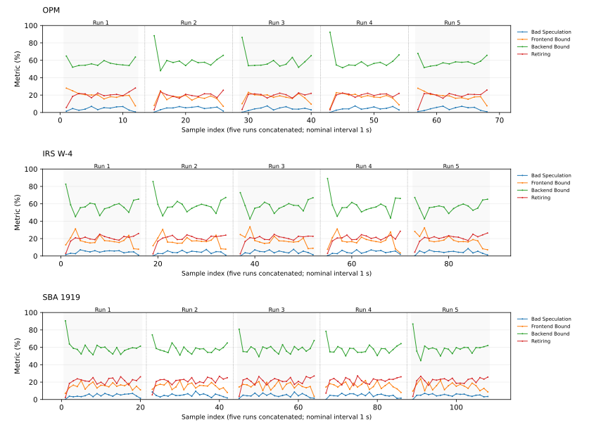

每个点为原始 DevKit 编号报告，每条线为一个指标；横轴为五轮串联的采样点序号，轮间留空且不连线。名义间隔 1 秒，保留启动和停止包络，不平滑、不插值。

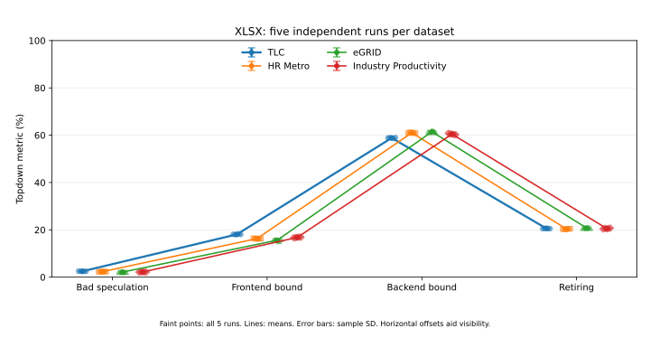

每个点为原始 DevKit 编号报告，每条线为一个指标；横轴为五轮串联的采样点序号，轮间留空且不连线。名义间隔 1 秒，保留启动和停止包络，不平滑、不插值。

| 数据集 | IPC CV | Backend CV | 五轮两两 Top-10 共同数 |
|---|---|---|---|
| OPM | 1.69% | 1.30% | 5–7/10 |
| IRS W-4 | 1.29% | 0.88% | 5–8/10 |
| SBA 1919 | 1.32% | 0.63% | 6–8/10 |
| TLC | 0.44% | 0.23% | 10–10/10 |
| HR Metro | 0.68% | 0.29% | 10–10/10 |
| eGRID | 0.72% | 0.54% | 8–9/10 |
| Industry Productivity | 0.68% | 0.39% | 9–10/10 |

XLSX 的主要特征与热点集合在固定环境重复运行中接近；PDF 单轮热点排名更易波动，五轮合并用于识别持续出现的主要函数。例如 OPM Fetch Bandwidth CV 为 12.36%，因此稳定性按指标分别描述。曲线展示轮内变化，均值和 CV 仍来自每轮 ALL；两者分别回答过程变化与重复波动。

## 六、已有实验的覆盖边界与 Word/PPT 扩展价值

### 6.1 已验证的范围与尚未覆盖的操作

| 场景 | 操作范围 | 已知或待测的机制 |
|---|---|---|
| PDF，已测 | 可填写表单的字段映射、填写、渲染和验证 | 已观察到 Python、压缩编码、图像处理、Poppler／字体路径 |
| XLSX，已测 | 百万级单元格工作簿检查、增强、保存、重算、验证 | 已观察到解释执行、对象管理、GC、XML、Calc 路径 |
| Word，待测 | 长文档结构编辑、样式与复杂表格、分页 | 待检验连续文本布局、字体度量、跨页布局的显著性 |
| PPT，待测 | 幻灯片构建、母版编辑、形状与图片布局 | 待检验演示对象构建、图形布局与渲染的显著性 |

现有结果支持两类已测任务的跨领域代表性，尚未覆盖完整 PDF／XLSX 任务空间。共同解释器和库函数可由业务处理及公共检查共同贡献，不能仅凭函数名称推断相同上层算法。当前统计以相对周期与流水线分配为主，绝对 CPU 工作量需要同一版本的 CPU-seconds 等补充；不混用旧版本账本。

前面的五组对照表明：沿用表单处理与工作簿增强任务时，跨领域输入仍持续进入解释器、对象管理、XML、压缩和渲染等共同路径。因此，继续只更换业务行业，未必能补充新的主要计算类型。下一步应扩展实际操作，重点考察当前较少涉及的连续文档排版和幻灯片图形布局。

### 6.2 为什么选择 Word/PPT

| 证据层次 | 来源与事实 | 对场景选择的意义 |
|---|---|---|
| 生态采用 | 2026-10-28 保存的 Skills.sh 快照：Anthropic DOCX 约 20.85 万、PPTX 约 24.38 万 Installs。[DOCX](https://www.skills.sh/anthropics/skills/docx)、[PPTX](https://www.skills.sh/anthropics/skills/pptx) | 说明相应工具能力有较多采用；Installs 不等于独立用户 |
| 产品落地 | 微软将 Word、PowerPoint 文件创建纳入 Copilot Agent。[产品说明](https://learn.microsoft.com/en-us/microsoft-365/copilot/wordexcelppt-agents) | 说明文字报告和演示材料属于实际产品任务 |
| 公开任务覆盖 | OmegaUse-OfficeVal 的 100 项任务按输出类型包含 Word 37 项、PowerPoint 39 项，另有 1 项 Word＋Excel 跨文件任务。[数据集](https://huggingface.co/datasets/baidu-frontier-research/OmegaUse-OfficeVal) | 提供具体可复现任务；任务集比例不推导市场使用比例 |
| 专项任务 | PPT-Eval 提供 120 个 PowerPoint 创建与编辑任务，覆盖 12 个文件。[项目页](https://microsoft.github.io/ppteval/) | 为幻灯片构建和编辑提供独立评测任务 |
| 跨格式操作 | DocOps 发布 210 项 Excel、Word、PowerPoint、PDF 文档操作任务。[官方仓库](https://github.com/icip-cas/DocOps) | 支持沿原生文档编辑与结果验证选取任务 |

### 6.3 新操作可能补足的 CPU 机制

| 操作 | 工具／软件模块 | 实际计算行为 | 后续关注的热点与指标 |
|---|---|---|---|
| Word 长文档创建、段落和样式修改 | DOCX Skill 的结构处理工具；LibreOffice Writer `sw` | 维护段落／表格结构；内容或样式变化后进行文本布局、字体度量、换行与分页 | 结构构建、布局／字体函数；CPU 核秒、内存、缓存和分支指标 |
| Word 复杂表格、页眉页脚与导出 | Writer 文档模型及布局；PDF 导出 | 计算连续文本流与跨页对象的位置，生成页面描述 | 排版与页面生成的 CPU 工作量、Frontend／Backend 分布 |
| PPT 模板编辑、幻灯片构建 | PPTX Skill；PptxGenJS／Node.js 或 OOXML 编辑；Impress `sd` | 组织幻灯片、母版、文本框、形状、图片及资源关系，计算对象布局 | 对象构建、运行时对象管理、图形／文本布局函数 |
| PPT 渲染与可见性检查 | Impress、Poppler、Pillow | 绘制文本和矢量形状、处理图片、生成缩略图 | 图形、字体、栅格化与图像处理热点，CPU 核秒与内存峰值 |

上述链路依据公开 [DOCX Skill](https://github.com/anthropics/skills/blob/main/skills/docx/SKILL.md)、[PPTX Skill](https://github.com/anthropics/skills/blob/main/skills/pptx/SKILL.md) 及 LibreOffice 的 [Writer](https://github.com/LibreOffice/core/blob/master/sw/README.md)、[Impress](https://github.com/LibreOffice/core/blob/master/sd/README.md)、[Calc](https://github.com/LibreOffice/core/blob/master/sc/README.md) 模块说明整理，是待测机制的选型依据。

同样调用 LibreOffice，Calc、Writer、Impress 进入的文档模型和布局路径不同；同样进入 Poppler，文本、矢量对象与图片的构成也可能改变字体与渲染计算。公共组件能够解释部分共同热点，却不能替代对这些操作的实测。

### 6.4 下一轮实验要回答的问题

选择长文档结构／样式编辑、分页与复杂表格，以及多页幻灯片构建／模板编辑／图形布局任务；由真实 Agent Skill 完成并冻结成功轨迹，在统一环境下回放。继续以 perf 识别主要函数与工具归属，以固定版本 DevKit 比较流水线特征，并增加同一版本的 CPU-seconds、任务时长、活跃核数和内存峰值。

下一轮重点检验：Writer／Impress 的布局、字体和图形路径是否成为显著热点；这些工作占多少绝对 CPU 工作量；共享压缩、XML 和渲染机制之外，是否出现 PDF 表单与 XLSX 增强尚未充分覆盖的主导机制。**已有七例用于验证跨领域输入下的机制延续，Word/PPT 用于扩展操作类型的覆盖。**

完整数据、逐次命令和核验材料：[实验数据汇总记录](experimental-results.md)。
<!-- BEGIN DOCOPS TASK OPERATION EXTENSION -->

## 七、扩展任务操作：与原始 PDF/XLSX 基准比较

前六节保留原七例“跨行业输入”实验及其提出的场景扩展问题。本节报告十二项 DocOps L3 的真实轨迹回放：在 PDF／Excel 中改变任务操作，并加入 Word／PPT，分别与原始 OPM／TLC 比较。
**先看判断：原七例能够代表已测任务形态下的跨行业输入，但没有充分覆盖更广的文档操作。本次扩展已观察到不同的热点函数和流水线分配，因此有必要按操作类型补充负载。** 以下依次说明工具做什么、旧热点保留多少、CPU 指标怎样变化。

### 7.1 样本、轨迹与测量口径

| 任务组 | 本次操作覆盖 | 主要对照 |
|---|---|---|
| PDF：031／037／pdfwf005 | 听证材料包发布、公交绕行材料修复、结算材料包重建 | 原始 PDF：OPM |
| Excel：013／014／016 | 投标评审发布、灾害补助公开发布、预测模型情景级联 | 原始 XLSX：TLC |
| Word：001／003／009 | 受控发布修复、元数据清理、事件手册发布 | OPM、TLC 均比较 |
| PPT：021／026／029 | 无障碍整改、图表重建、季度业务回顾发布 | OPM、TLC 均比较 |

十二项任务采用已保存 Agent 轨迹中的最终有效依赖链。各任务独立冻结脚本、输入、Skill 和命令；内联命令保留为任务私有步骤。回放不调用模型，保留最终构建、必要修补、重算、渲染及原有检查，公共入口负责调度、环境和归档。
来源中的官方内容判定为四项通过、八项未通过；本次十二项工具链回放及采集均完成。两类结果分别记录，逐项来源和判定见实验数据记录。

| 项目 | 原始 OPM／TLC | 新增 DocOps |
|---|---|---|
| 环境 | 原七例测量镜像；Python 3.12.3、LibreOffice 25.8.7.3 | 基于同一测量镜像；共用 Python、LibreOffice、Poppler 和 perf 版本，补充文档、幻灯片及图像处理依赖 |
| 重复与汇总 | 每路五次独立运行；热点合并周期权重，Topdown 取五次 ALL 均值 | 每项每路一次独立采集，内部十轮回放；热点按工作流周期权重，Topdown 取本次 ALL |
| 采集 | perf：cycles:u、49 Hz、DWARF；DevKit：CPU 0–7、1 秒间隔 | 沿用相同参数；两路分开运行，控制器 CPU 9 |
| 窗口 | 既有完整循环，包含 reset 和循环检查 | perf 为 workflow 步骤区间并集，排除准备、reset 和归档；Topdown 为按核采集包络 |

本节比较实际工作流，任务操作、输入组织和规模可能同时变化；结论用于识别负载差异。十轮合并采集只算一次独立运行，不套用原七例的五次稳定性结论。

### 7.2 软件分别做什么，哪些沿用、哪些扩展

**表 7-1：软件用途。** “脚本／工具”是直接调用的程序，“底层组件”是执行过程中真正消耗 CPU 的库。比如 python-docx 操作 Word，但对应 CPU 周期可能记在 Python、XML 或压缩函数中，不能把两层占比直接相加。

| 软件／组件 | 一般用途 | 在本批任务中的位置 |
|---|---|---|
| Python | 执行脚本，创建和管理数据对象 | 原有与新增任务共同的运行环境 |
| openpyxl | 读取、修改、保存 Excel 工作簿 | 已有 Excel 读写工具，扩展任务继续使用 |
| python-docx／python-pptx | 创建和修改段落、表格、形状及幻灯片 | 为 Word／PPT 任务补充的直接操作库 |
| LibreOffice：Calc／Writer／Impress | 分别处理表格、文字文档和幻灯片；支持重算、排版与格式转换 | 沿用同一软件版本，任务进入不同文档模块 |
| Poppler／pdftoppm | 解析 PDF，将页面绘制为图片 | 原 PDF 已有；新任务的预览和渲染继续使用 |
| Pillow／ImageMagick | 图片转换、缩放、滤波和拼图 | Pillow 为原有工具；DocOps 补充 ImageMagick |
| ReportLab／fontTools | 分别用于生成 PDF、读取和处理字体 | DocOps 补充的任务依赖；安装存在不等于占主要热点 |
| zlib／PNG 编码库 | 压缩重复数据，编码并写出图片 | 部分新任务中成为主要 CPU 热点 |
| lxml／Expat／ElementTree | 读取和处理文档内部的 XML 结构 | 原 Excel 已有 XML 路径，DocOps 增加 lxml 依赖 |
| libc／loader | 基础内存、字符串等操作，以及装载程序依赖库 | 公共运行基础，不能仅由该库名判断具体文档业务 |

**表 7-2：原始任务作为对照。** OPM 代表 PDF 表单填写与检查，TLC 代表大型工作簿检查、增强、重算和缓存验证。下面的百分比为用户态 perf 采样周期占比，包含所有保留的工作流样本，不是任务墙钟时间。

| 原始基准 | 主要脚本／进程 | 主要底层组件及周期占比 |
|---|---|---|
| OPM | convert_pdf_to_images.py 38.85%; fill_fillable_fields.py 38.44%; verify_pdf_batch.py 12.26%; pdftoppm 8.03% | Python 50.41%; zlib 25.18%; Pillow 14.61%; Poppler 6.23% |
| TLC | enhance_workbook.py 22.01%; inspect_xlsx_structure.py 12.69%; recalc.py 11.60%; inspect_xlsx_features.py 10.57% | Python 79.26%; LibreOffice 6.43%; Expat 5.65%; ElementTree 3.68% |

**表 7-3：十二项新增任务实际执行什么。** 先看脚本链路，再看采样周期主要落在哪些底层软件；每行只列占比最高的四项组件，不要求四项合计为 100%。

| 格式／任务 | 实际脚本／工具链 | 主要底层组件及周期占比 |
|---|---|---|
| PDF／031 听证材料包扁平化发布 | build_public_packet.py；PDF 渲染；validate_public_packet.py | zlib 66.25%; Python 20.08%; PNG 8.68%; Poppler 2.56% |
| PDF／037 公交绕行材料修复 | build_bus_detour_packet.py；PDF 渲染；validate_bus_detour_packet.py | zlib 52.92%; Python 29.90%; PNG 10.27%; Poppler 4.61% |
| PDF／pdfwf005 结算材料包重建 | rebuild_closeout_binder.py；PDF 检查；图片／拼图／诊断 | Python 31.74%; ImageMagick 25.96%; zlib 23.67%; PNG 11.60% |
| Excel／013 采购投标评审发布 | build_public_bid_workbook.py；recalc.py；verify_public_bid_workbook.py；PDF／拼图 | zlib 31.66%; Python 19.77%; ImageMagick 13.43%; LibreOffice 10.20% |
| Excel／014 灾害补助公开发布 | build_disaster_release_v1.py；recalc.py；finalize_disaster_release_ooxml_v3.py；validate_disaster_release_v1.py／渲染 | zlib 30.54%; Python 25.49%; LibreOffice 17.51%; PNG 7.57% |
| Excel／016 预测模型情景级联 | build_forecast_dashboard_v1.py；recalc.py；测试副本切换情景并重算 | Python 47.65%; LibreOffice 27.74%; libc 8.81%; loader 3.62% |
| Word／001 受控文档发布修复 | create_packet.py；render_docx.py；结构与渲染检查 | zlib 44.27%; Python 18.74%; LibreOffice 11.65%; libc 7.16% |
| Word／003 公开记录元数据清理 | build_public_packet.py；audit_public_packet.py；render_docx.py | zlib 44.62%; Python 14.91%; LibreOffice 14.23%; PNG 9.05% |
| Word／009 事件手册发布 | build_incident_manual_publication.py；render_docx.py；validate_incident_manual_publication.py | zlib 44.39%; PNG 19.00%; LibreOffice 9.11%; Python 8.86% |
| PPT／021 庇护所无障碍整改 | build_public_shelter_briefing.py；validate_public_shelter_briefing.py；soffice.py／图片／拼图 | Poppler 27.74%; LibreOffice 24.32%; Python 15.95%; ImageMagick 10.59% |
| PPT／026 气候披露图表重建 | build_climate_disclosure.py；转 PDF／图片；qa_climate_disclosure.py | Poppler 36.90%; Python 20.97%; LibreOffice 19.20%; libc 6.60% |
| PPT／029 季度业务回顾发布 | build_release_deck.py；validate_release_deck.py；转 PDF／图片 | Python 36.96%; LibreOffice 32.15%; libc 7.61%; Poppler 5.08% |

**本节总结：**

- **共同基础仍然保留。** Python、LibreOffice、Poppler、压缩和图像处理继续构成主要工具链。
- **扩展了文档操作工具和模块。** 新增 python-docx、python-pptx、lxml、ImageMagick 等依赖，并执行 Writer、Impress 和幻灯片对象处理路径。
- **已有软件也会承担不同的工作。** 同样调用 LibreOffice 或 Poppler，实际可能是表格重算、文档转 PDF 或页面绘图，热点权重不会天然相同。

### 7.3 热点函数：旧热点保留多少，新热点在做什么

本节分两步阅读：表 7-4 看原有热点的延续程度，表 7-5 解释新任务最耗周期的函数。函数以“完整物理叶函数名＋所属库文件名”匹配，同名但来自不同库的函数不会混为一项。未知符号仍保留在完整周期分母中。

**两个指标的区别：**“共同函数数”比较两份前十名单，有几个相同；“旧热点函数占比”则把原基准前十个函数在新任务全部采样中的周期相加，即使该函数掉出新任务前十也计入。后者是十个具体函数的权重，不是整个任务或旧切片的覆盖率。

**读表示例：** 031 与 OPM 的前十热点共有 3 个函数，但 OPM 的前十函数在 031 中仍占 67.11%；其中压缩函数 `longest_match` 单独占 56.95%。所以共同函数数量少，不一定表示共同计算的权重小。

**表 7-4：原始热点在新任务中的延续程度。** PDF 以 OPM 为主对照，Excel 以 TLC 为主对照；Word／PPT 同时列两个基准。OPM 自身前十函数合计占 57.81%，TLC 为 49.50%，并非基准全部周期。

| 新任务 | 对照基准 | 两份前十名单中相同的函数数 | 原基准前十函数在新任务中的周期占比 |
|---|---|---|---|
| 031 听证材料包扁平化发布 | OPM | 3/10 | 67.11% |
| 037 公交绕行材料修复 | OPM | 4/10 | 56.07% |
| pdfwf005 结算材料包重建 | OPM | 5/10 | 25.93% |
| 013 采购投标评审发布 | TLC | 1/10 | 6.12% |
| 014 灾害补助公开发布 | TLC | 2/10 | 8.37% |
| 016 预测模型情景级联 | TLC | 2/10 | 12.06% |
| 001 受控文档发布修复 | OPM | 4/10 | 45.33% |
| 001 受控文档发布修复 | TLC | 2/10 | 4.61% |
| 003 公开记录元数据清理 | OPM | 3/10 | 44.19% |
| 003 公开记录元数据清理 | TLC | 0/10 | 2.00% |
| 009 事件手册发布 | OPM | 4/10 | 45.80% |
| 009 事件手册发布 | TLC | 1/10 | 3.89% |
| 021 庇护所无障碍整改 | OPM | 1/10 | 2.59% |
| 021 庇护所无障碍整改 | TLC | 1/10 | 3.90% |
| 026 气候披露图表重建 | OPM | 2/10 | 4.96% |
| 026 气候披露图表重建 | TLC | 2/10 | 6.34% |
| 029 季度业务回顾发布 | OPM | 1/10 | 7.36% |
| 029 季度业务回顾发布 | TLC | 2/10 | 12.53% |

**表 7-5：新任务主要在计算什么。** 列出每项前三个函数及其周期占比，并按软件说明用途。完整前二十函数、所属库及全部 OPM／TLC 对照见实验数据记录。

| 新任务 | 前三热点函数及周期占比 | 这些函数通常做什么 |
|---|---|---|
| 031 听证材料包扁平化发布 | `longest_match` 56.95%; `png_write_find_filter` 8.68%; `deflate_slow` 6.83% | zlib：查找重复数据并压缩；PNG：选择图像编码方式并写出图片 |
| 037 公交绕行材料修复 | `longest_match` 45.90%; `png_write_find_filter` 10.27%; `deflate_slow` 4.64% | zlib：查找重复数据并压缩；PNG：选择图像编码方式并写出图片 |
| pdfwf005 结算材料包重建 | `HorizontalFilter._omp_fn.0` 12.59%; `VerticalFilter._omp_fn.0` 11.46%; `png_write_find_filter` 10.57% | ImageMagick：横向／纵向图像滤波、缩放；PNG：选择图像编码方式并写出图片 |
| 013 采购投标评审发布 | `longest_match` 21.24%; `png_write_find_filter` 8.38%; `HorizontalFilter._omp_fn.0` 8.05% | zlib：查找重复数据并压缩；PNG：选择图像编码方式并写出图片；ImageMagick：横向／纵向图像滤波、缩放 |
| 014 灾害补助公开发布 | `longest_match` 22.52%; `png_write_find_filter` 7.57%; `deflate_slow` 4.90% | zlib：查找重复数据并压缩；PNG：选择图像编码方式并写出图片 |
| 016 预测模型情景级联 | `_PyEval_EvalFrameDefault` 4.57%; `_Py_dict_lookup` 3.70%; `std::_Rb_tree<int, int, std::_Identity<int>, std::less<int>, std::allocator…` 3.11% | Python：执行脚本指令；Python：查找字典中的对象；C++ 有序容器：插入或查找数据 |
| 001 受控文档发布修复 | `longest_match` 36.05%; `deflate_slow` 5.87%; `png_write_find_filter` 5.34% | zlib：查找重复数据并压缩；PNG：选择图像编码方式并写出图片 |
| 003 公开记录元数据清理 | `longest_match` 33.55%; `png_write_find_filter` 9.05%; `deflate_slow` 5.91% | zlib：查找重复数据并压缩；PNG：选择图像编码方式并写出图片 |
| 009 事件手册发布 | `longest_match` 27.62%; `png_write_find_filter` 19.00%; `deflate_slow` 10.59% | zlib：查找重复数据并压缩；PNG：选择图像编码方式并写出图片 |
| 021 庇护所无障碍整改 | `Splash::pipeRun(SplashPipe*)` 9.94%; `VerticalFilter._omp_fn.0` 6.96%; `Splash::pipeRunAARGB8(SplashPipe*)` 6.12% | Poppler：将 PDF 页面内容绘制成像素；ImageMagick：横向／纵向图像滤波、缩放 |
| 026 气候披露图表重建 | `Splash::pipeRunAARGB8(SplashPipe*)` 12.81%; `Splash::pipeRun(SplashPipe*)` 11.74%; `_PyEval_EvalFrameDefault` 2.75% | Poppler：将 PDF 页面内容绘制成像素；Python：执行脚本指令 |
| 029 季度业务回顾发布 | `_PyEval_EvalFrameDefault` 5.31%; `_Py_dict_lookup` 3.45%; `oox::drawingml::table::applyTableStylePart(oox::core::XmlFilterBase const&,…` 2.00% | Python：执行脚本指令；Python：查找字典中的对象；LibreOffice：处理幻灯片表格等对象的样式 |

**从函数可以读出的四点变化：**

- **新增 PDF：原来就有压缩和图片处理，现在这些工作的比重、具体实现发生变化。** 031／037 的 zlib 压缩占比达到约 **66%／53%**，高于 OPM 的约 **25%**；pdfwf005 则增加了明显的 ImageMagick 图片缩放、滤波和拼图热点。因此，是处理重点改变，不是首次出现图片处理。
- **新增 Excel：从工作簿处理，扩展到工作簿处理加预览发布。** 013／014 不仅生成、重算和检查 Excel，还导出 PDF、渲染图片，因此压缩和图片处理的权重增加。016 则主要体现情景切换、重算以及 Python／Calc 内部处理。
- **新增 Word：虽然操作的是 Word，最终较重的环节却是文档转换后的压缩和图片编码。** 所以它与原 PDF 的压缩热点有共性，但执行的完整任务不同。
- **新增 PPT：部分任务的页面绘制更重。** 021／026 的 Poppler 页面渲染突出；029 则更多体现 Python 对象处理和 LibreOffice 幻灯片表格样式处理。

### 7.4 Topdown：四类流水线指标完整比较

热点函数回答“运行了什么代码”，Topdown 回答“CPU 流水线的资源怎样分配”。下面先解释指标，再展示原值与相对基准的变化；四项顶层指标全部保留。

**表 7-6：指标读法。** 四项 Topdown 顶层分类合计约为 100%；IPC 单独阅读，不与百分数相加。

| 指标 | 中文含义 | 如何理解 |
|---|---|---|
| IPC | 每周期完成的指令数 | 反映平均指令吞吐；单独降低不等于整项任务耗时一定更长 |
| Bad Speculation | 误推测 | 分支预测错误等产生的无效执行份额 |
| Frontend Bound | 前端受限 | 指令获取、解码等供应环节受限的份额 |
| Backend Bound | 后端受限 | 执行资源或数据供应环节受限的份额；不能只凭此项判断是内存问题 |
| Retiring | 有效完成 | 用于正常完成指令的流水线份额，不是整项任务的 CPU 利用率 |

**表 7-7：原始基准与十二项任务的实测原值。** OPM／TLC 为五次独立采集的均值，新任务为本次十轮批次的 ALL 累计结果。除 IPC 外，单位均为百分比。

| 配置 | IPC | 误推测 % | 前端受限 % | 后端受限 % | 有效完成 % |
|---|---|---|---|---|---|
| OPM（原始基准） | 1.226 | 4.676 | 18.120 | 56.762 | 20.440 |
| TLC（原始基准） | 1.234 | 2.478 | 18.100 | 58.846 | 20.572 |
| 031 听证材料包扁平化发布 | 1.060 | 2.980 | 8.940 | 70.480 | 17.600 |
| 037 公交绕行材料修复 | 0.990 | 2.580 | 10.280 | 70.650 | 16.490 |
| pdfwf005 结算材料包重建 | 1.120 | 4.660 | 11.970 | 64.630 | 18.740 |
| 013 采购投标评审发布 | 0.950 | 3.400 | 15.050 | 65.660 | 15.880 |
| 014 灾害补助公开发布 | 0.840 | 3.470 | 18.410 | 64.090 | 14.040 |
| 016 预测模型情景级联 | 0.720 | 4.170 | 23.400 | 60.360 | 12.070 |
| 001 受控文档发布修复 | 0.890 | 3.040 | 14.860 | 67.190 | 14.910 |
| 003 公开记录元数据清理 | 0.940 | 3.210 | 15.180 | 65.890 | 15.730 |
| 009 事件手册发布 | 1.080 | 2.870 | 17.620 | 61.510 | 17.990 |
| 021 庇护所无障碍整改 | 1.150 | 2.490 | 16.270 | 62.090 | 19.150 |
| 026 气候披露图表重建 | 1.020 | 2.940 | 19.020 | 61.040 | 16.990 |
| 029 季度业务回顾发布 | 0.910 | 3.260 | 20.980 | 60.550 | 15.210 |

**表 7-8：与原始基准相比改变了多少。** 正号表示新任务更高，负号表示更低。IPC 用相对百分比；四项 Topdown 用百分点（pp），例如 20% 变成 25% 是 +5 pp。Word／PPT 同时对照 OPM、TLC。

| 任务（对照基准） | IPC 变化 % | 误推测 Δpp | 前端 Δpp | 后端 Δpp | 有效完成 Δpp |
|---|---|---|---|---|---|
| 031（OPM） | -13.5% | -1.70 | -9.18 | +13.72 | -2.84 |
| 037（OPM） | -19.2% | -2.10 | -7.84 | +13.89 | -3.95 |
| pdfwf005（OPM） | -8.6% | -0.02 | -6.15 | +7.87 | -1.70 |
| 013（TLC） | -23.0% | +0.92 | -3.05 | +6.81 | -4.69 |
| 014（TLC） | -31.9% | +0.99 | +0.31 | +5.24 | -6.53 |
| 016（TLC） | -41.7% | +1.69 | +5.30 | +1.51 | -8.50 |
| 001（OPM） | -27.4% | -1.64 | -3.26 | +10.43 | -5.53 |
| 001（TLC） | -27.9% | +0.56 | -3.24 | +8.34 | -5.66 |
| 003（OPM） | -23.3% | -1.47 | -2.94 | +9.13 | -4.71 |
| 003（TLC） | -23.8% | +0.73 | -2.92 | +7.04 | -4.84 |
| 009（OPM） | -11.9% | -1.81 | -0.50 | +4.75 | -2.45 |
| 009（TLC） | -12.5% | +0.39 | -0.48 | +2.66 | -2.58 |
| 021（OPM） | -6.2% | -2.19 | -1.85 | +5.33 | -1.29 |
| 021（TLC） | -6.8% | +0.01 | -1.83 | +3.24 | -1.42 |
| 026（OPM） | -16.8% | -1.74 | +0.90 | +4.28 | -3.45 |
| 026（TLC） | -17.3% | +0.46 | +0.92 | +2.19 | -3.58 |
| 029（OPM） | -25.8% | -1.42 | +2.86 | +3.79 | -5.23 |
| 029（TLC） | -26.3% | +0.78 | +2.88 | +1.70 | -5.36 |

**本节结论：**

- **PDF 031／037 的变化主要体现在前后端分配。** 相比 OPM，前端份额分别降低 9.18／7.84 pp，后端增加 13.72／13.89 pp。
- **Excel 016 的前端受限增加、有效完成份额降低。** 相比 TLC，前端增加 5.30 pp，有效完成降低 8.50 pp，IPC 低 41.7%；是否更耗时还需结合具体工作量。
- **相同大类指标接近，不代表热点相同。** PPT 021 与 029 的四维余弦约 0.9955，但前十热点仅共享两个函数，仍需结合软件和函数比较。
- **四项指标必须一起看。** 前端降低的份额可能转到后端、误推测或有效完成；只列前后端会掩盖其他变化。

**辅助相似度如何使用：** 四维 Bound 余弦描述分布方向，总变差为四项绝对百分点差之和的一半，Jaccard 描述前十函数集合重合程度。详细数值、公式和全部 24 组对照保留在实验数据记录；本节不依据“余弦超过 0.99”给出整体负载高度相似的判断。

### 7.5 十二项任务的逐点曲线与读图说明

下列十二张图每项对应一张，按 PDF、Excel、Word、PPT 排列，共 533 个真实过程点。每张有四条线，分别对应误推测、前端受限、后端受限、有效完成。横轴为实际输出点编号，纵轴为百分比；名义间隔 1 秒，不插值、不增加人工采样点。
每张图是一份采集中十轮回放的过程，不是十次独立采集。曲线用于看执行过程的分布变化，最终指标取 ALL 累计报告。未建立可靠的逐点阶段对应，因此不把某个峰值直接标成“重算”或“渲染”。

### 图 7-1：PDF／031 听证材料包扁平化发布——四项 Topdown 过程

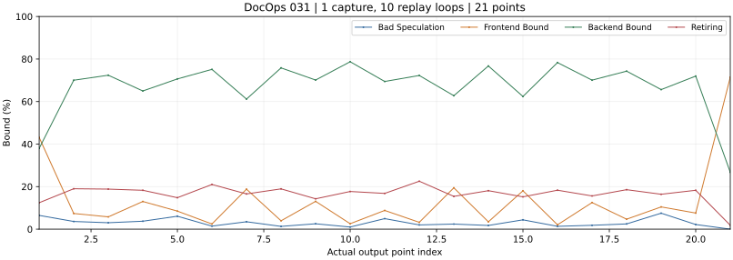

**读图：** 后端受限占比较高；相对 OPM 的汇总变化为前端降低、后端增加。热点同时显示压缩占比突出。 本图共 21 个真实输出点。

### 图 7-2：PDF／037 公交绕行材料修复——四项 Topdown 过程

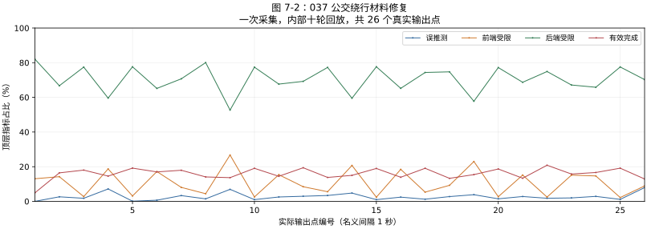

**读图：** 后端受限是主要份额，与 031 的汇总特征接近；压缩与 PNG 编码是主要函数热点。 本图共 26 个真实输出点。

### 图 7-3：PDF／pdfwf005 结算材料包重建——四项 Topdown 过程

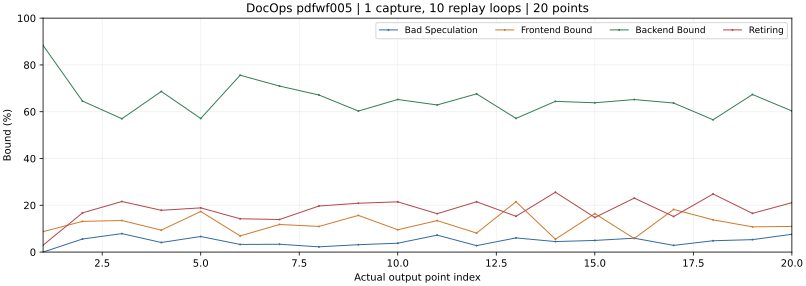

**读图：** 本项加入材料包重建与拼图，热点中出现 ImageMagick 图像滤波；结合曲线观察其流水线分配。 本图共 20 个真实输出点。

### 图 7-4：Excel／013 采购投标评审发布——四项 Topdown 过程

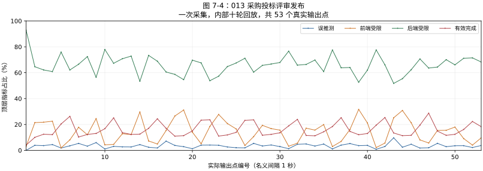

**读图：** 本项同时执行工作簿处理和 PDF／图片交付；结合压缩、图像与 Calc 热点阅读这些过程点。 本图共 53 个真实输出点。

### 图 7-5：Excel／014 灾害补助公开发布——四项 Topdown 过程

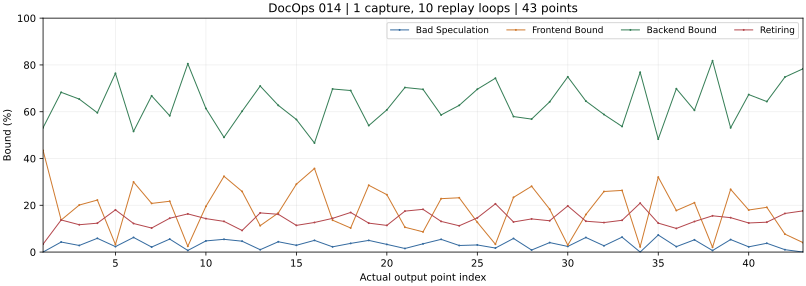

**读图：** 本项包含工作簿重算、OOXML 修补及渲染；最终指标取整段累计，曲线用于显示过程变化。 本图共 43 个真实输出点。

### 图 7-6：Excel／016 预测模型情景级联——四项 Topdown 过程

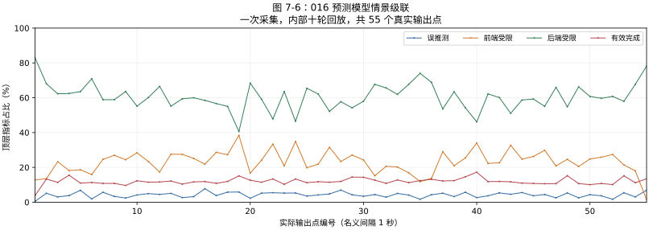

**读图：** 汇总前端受限高于 TLC，IPC 低于 TLC；函数中可见 Python 对象处理与 Calc 路径。 本图共 55 个真实输出点。

### 图 7-7：Word／001 受控文档发布修复——四项 Topdown 过程

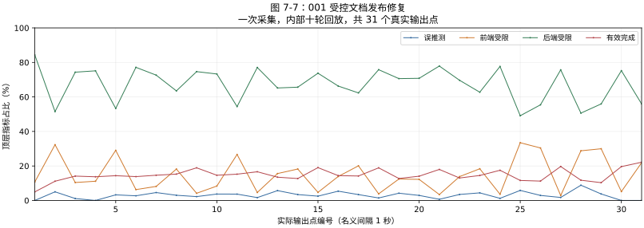

**读图：** 本项执行 Word 构建、转换和检查；压缩函数是主要热点，不能只凭文件格式认为排版必然最重。 本图共 31 个真实输出点。

### 图 7-8：Word／003 公开记录元数据清理——四项 Topdown 过程

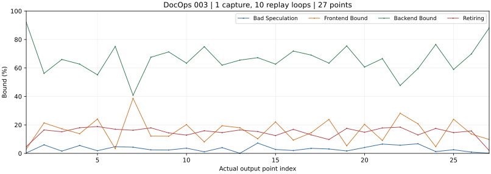

**读图：** 本项包含元数据处理、审计与文档渲染；曲线需与压缩、PNG 和 Writer 工具路径一起解释。 本图共 27 个真实输出点。

### 图 7-9：Word／009 事件手册发布——四项 Topdown 过程

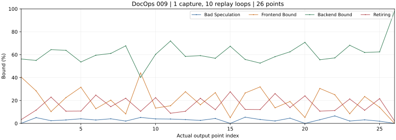

**读图：** 本项事件手册发布的主要函数集中于压缩和 PNG 编码，图中展示这份批次的实际流水线变化。 本图共 26 个真实输出点。

### 图 7-10：PPT／021 庇护所无障碍整改——四项 Topdown 过程

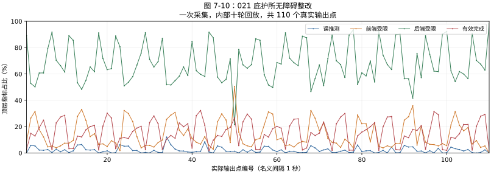

**读图：** 本项 PDF 页面绘制与图像处理较突出；与 029 共享工具，但主要热点函数和指标分配不同。 本图共 110 个真实输出点。

### 图 7-11：PPT／026 气候披露图表重建——四项 Topdown 过程

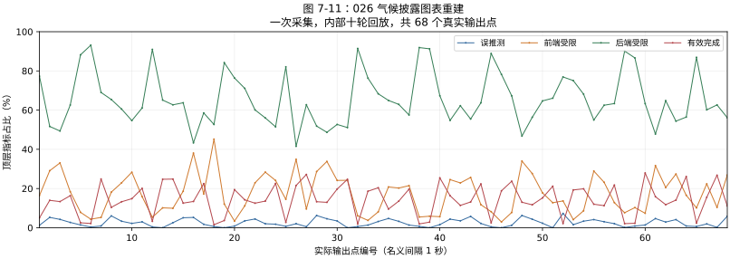

**读图：** 本项 Poppler 页面绘制份额较高；实际过程点展示渲染相关工作流的流水线分配。 本图共 68 个真实输出点。

### 图 7-12：PPT／029 季度业务回顾发布——四项 Topdown 过程

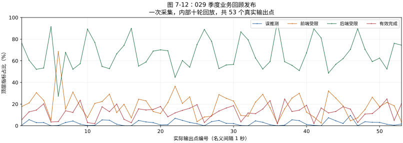

**读图：** 本项出现解释器、字典查找与 DrawingML 表格样式函数，不能用其他 PPT 的渲染热点代替。 本图共 53 个真实输出点。

### 7.6 最终判断：原负载覆盖了什么，还需要扩展什么

**结论是：原有负载在已测任务范围内具有跨行业代表性；扩展操作实验同时发现了原任务未充分覆盖的计算路径，因此仍有必要扩充办公 Agent 的操作类型。** 这两项发现回答不同问题，能够同时成立。

- **原七例的结论继续成立。** 保持表单填写或大型工作簿增强等任务形态时，更换行业输入仍延续主要热点，已有负载有明确用途。
- **覆盖缺口确实存在。** 原来没有充分体现材料包重建、图片滤波与拼图、幻灯片对象样式、不同发布和情景重算组合；本次已在具体函数与模块中观察到相应差异。
- **“未充分覆盖”不等于公共软件全都缺失。** 压缩、XML、LibreOffice 和渲染原本就有；新任务可能增强已有机制，也可能进入不同模块和函数路径。不能拿旧前十名单之外的全部周期都称为全新机制。
- **代表范围需要扩展。** 原负载可以代表已测 PDF 表单与大型工作簿任务，单独用它们代表更广的 Word、PPT 及复杂文档操作仍不充分；本次十二项补充了这部分实测证据。
- **后续优先按操作选型。** 保留原有跨行业输入对照，补充能带来不同热点的文档构建、对象处理、布局与渲染任务；先对候选做独立重复，再决定最终基准集合。连续长文档分页等是否形成主导热点，还需专项实测。

[完整扩展实验记录](experimental-results.md#九扩展任务操作十二项-docops-完整记录)保留九项指标、24 组基准对照、完整函数名单和全部曲线；[机器结果与来源绑定](../analysis/docops/processed/task-operation-expansion-20261104/comparison.json)可逐项追溯。

<!-- END DOCOPS TASK OPERATION EXTENSION -->
